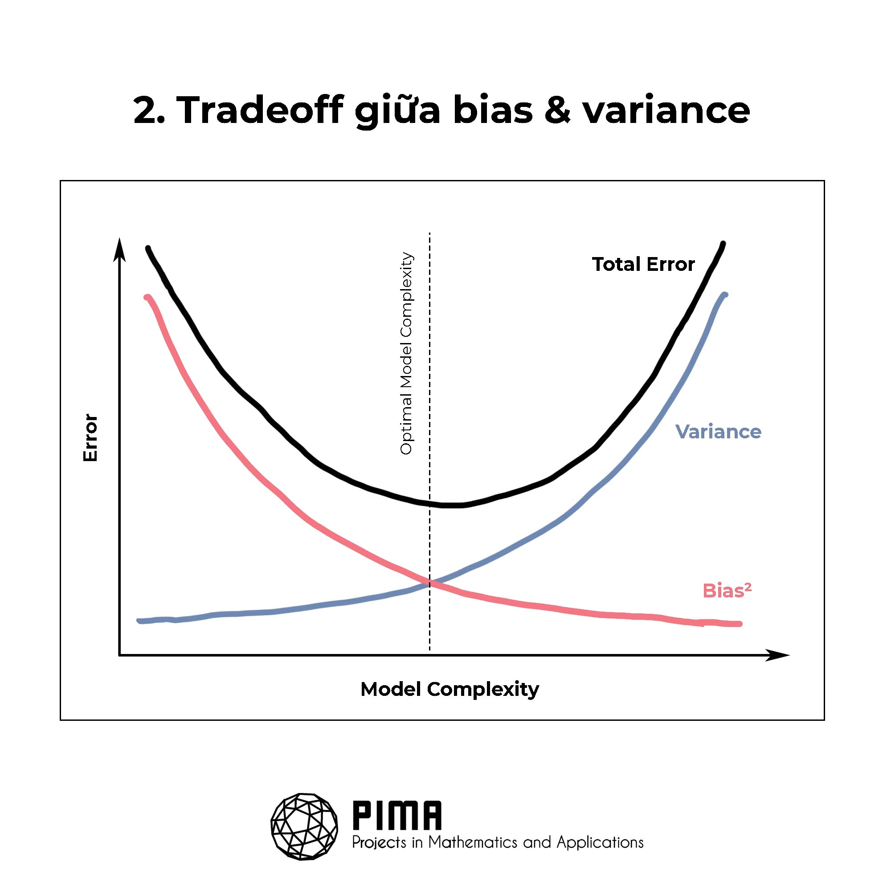
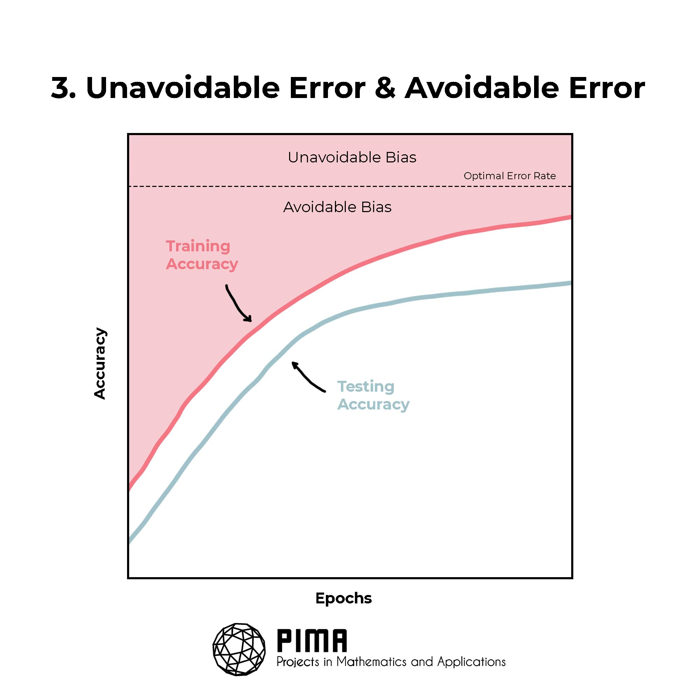
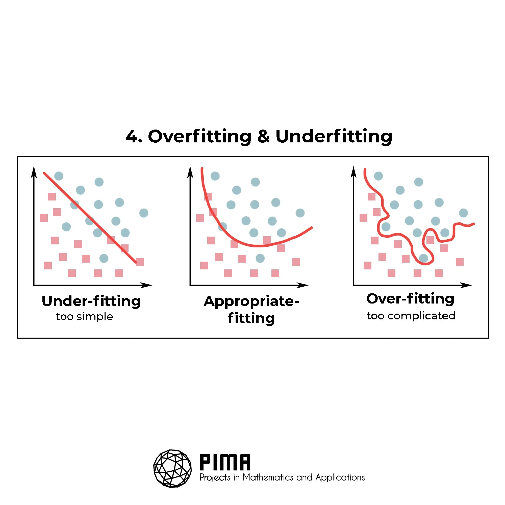

Trong học máy, tồn tại hai khái niệm ảnh hưởng đến độ chính xác của mô hình là Bias và Variance. Với mong muốn dự đoán càng chính xác càng tốt, liệu ta cần phải chú ý điều gì ở hai yếu tố này?

Trong kì này, hãy cùng PiMA khám phá thuật ngữ Bias - Variance và các khái niệm liên quan nhé.

## 1. Khái niệm bias - variance

Bias là sự sai khác giữa trung bình dự đoán của mô hình với giá trị chính xác (groundtruth) của dự đoán đó. Một mô hình có bias cao thể hiện rằng nó chưa đủ phức tạp để mô phỏng training data. Nói một cách khác, bias cao cho ta thấy mô hình còn quá đơn giản.

Variance là khái niệm đặc trưng cho độ phân tán của giá trị dự đoán. Ngoài ra, variance còn đặc trưng cho độ nhạy của mô hình với sự thay đổi của điểm dữ liệu trong tập huấn luyện. Variance cao cho thấy mô hình không những mô phỏng được tập huấn luyện mà thậm chí cả nhiễu trong đó. Một mô hình có variance cao là một mô hình quá phức tạp và chưa đủ tổng quát.

Nhưng chẳng phải cái chúng ta cần là việc dự đoán càng chính xác càng tốt hay sao? Rõ ràng việc có bias thấp đang giúp mô hình dự đoán chính xác trên tập huấn luyện, vậy điều này có phải luôn tốt không? Câu trả lời là có, nhưng chưa đủ.

## 2. Đánh đổi (tradeoff) giữa bias và variance

Khi một mô hình quá khớp (fit) với training data, mô hình đó sẽ dự đoán rất tốt trên tập này nhưng đồng thời dự đoán tệ trên những điểm dữ liệu không có trong tập huấn luyện. Và dĩ nhiên, chúng ta không muốn điều đó. Cái mà chúng ta muốn là mô hình phải dự đoán đủ tốt trên cả dữ liệu huấn luyện (training data) và những điểm chưa được học (unseen data), tức là mô hình phải có độ tổng quát tốt. Nói cách khác, ngoài low bias, ta còn mong muốn mô hình phải có variance thấp. Vì lý do này, sự trade-off (đánh đổi) giữa bias và variance khi huấn luyện các mô hình máy học là một điều cần thiết.

Hình 1 (hình đầu bài) đã trực quan Bias, Variance và sự qua lại giữa chúng ảnh hưởng đến kết quả như thế nào.

Ở đây, tâm của vòng tròn là các giá trị chính xác mà ta muốn mô hình dự đoán được. Các điểm màu đen là dự đoán mô hình đã đưa ra. Như đã nói ở trên, low bias giúp các điểm dự đoán nằm gần tâm nhất (loss/error thấp). Tuy nhiên, chỉ mỗi bias thấp thôi là chưa đủ. Nếu mô hình có variance cao, sự phân bố của các điểm dự đoán tản mát ra xung quanh và làm cho một vài dự đoán xa rời tâm hình tròn (loss/error cao).

Hình 2 (hình bên) sẽ cho chúng ta một cái nhìn rõ hơn để hiểu tại sao phải đánh đổi giữa Bias và Variance.

Trục $Ox$ biểu diễn sự phức tạp của mô hình (cũng có thể xem như là số lượng tham số của mô hình), trong khi đó trục $Oy$ biểu diễn loss tổng của mô hình. Ta thấy khi độ phức tạp của mô hình tăng lên thì bias có xu hướng giảm còn variance tăng. Nếu mô hình quá phức tạp/quá đơn giản thì loss tổng cũng đều ở mức cao. Để giảm loss của mô hình, ta cần phải giữ độ phức tạp ở mức vừa phải để cân bằng giữa bias và variance.

## 3. Unavoidable error và avoidable error

Chúng ta vừa biết bias và variance - những tác nhân làm ảnh hưởng đến độ chính xác của các mô hình máy học - có thể được kiểm soát bằng cách giữ cho độ phức tạp của mô hình ở mức vừa đủ (xem hình 2). Vì vậy, bias và variance được gọi là avoidable error - tức là ta có khả năng cải thiện những sai lệch này. Tuy nhiên, trong học máy, có những khoảng độ lỗi mà chúng ta không thể cải thiện được, phải chấp nhận độ chính xác thấp hơn 100%. Những khoảng lỗi đó được gọi là unavoidable error (hay unavoidable bias, vì ta đang nói về độ chính xác giữa dự đoán của mô hình và thực tế, tức là liên quan tới bias).

Vậy unavoidable error từ đâu mà có?

Thực ra đây là con số do chính chúng ta, những người làm mô hình quyết định. Trong xác suất, có một khái niệm gọi là human error: sai số của một việc khi được làm bởi con người. Và khi con người làm còn sai, thì chúng ta không thể nào mong muốn mô hình sẽ làm đúng hoàn toàn được. Do đó, khi làm mô hình, chúng ta sẽ đặt ra một độ lỗi mà chúng ta thoả hiệp với mô hình rằng đó là sai số chấp nhận được.

Giả sử, bạn là một người chơi chứng khoán. Bạn có 100 cổ phiếu và ngày nào bạn cũng dự đoán mỗi con cổ phiếu sẽ tăng hay giảm trong ngày hôm đó. Tuy nhiên, không may là ngày nào bạn cũng đoán sai ít nhất 5 con. Sau đó, vì bận, bạn quyết định sẽ làm một mô hình để dự đoán giùm mình. Lúc này, bạn không thể mong chờ gì vào mô hình sẽ giúp bạn dự đoán chính xác 100%. Thay vào đó, trong trường hợp này, độ chính xác khoảng 95% sẽ hợp lý hơn. 95% ở đây được gọi là optimal error, ta có thể hiểu là chặn trên của độ chính xác của mô hình, còn 5% được gọi là unavoidable error.

## 4. Overfitting và underfitting

Overfitting là hiện tượng mô hình quá khớp (fit) với các điểm dữ liệu trong tập huấn luyện và không dự đoán đủ tốt trên tập dữ liệu test. Một mô hình đang bị overfitting đồng nghĩa rằng mô hình đó đang có high variance. Ngược lại, với mô hình có high bias có nghĩa là mô hình đó đang bị underfitting.

Overfitting bắt nguồn từ việc mô hình của bạn có quá nhiều tham số (quá phức tạp), trong khi lượng dữ liệu huấn luyện lại quá nghèo nàn. Điều này khiến mô hình của bạn dễ dàng mô phỏng dữ liệu huấn luyện, từ đó đạt được kết quả dự đoán rất tốt trên tập này. Tuy nhiên, khi tham số đã quá khớp vào tập dữ liệu trên, dự đoán của mô hình trên tập test sẽ không còn tốt nữa. Đây là điều mà ta không mong muốn: ta muốn kết quả dự đoán trên các tập dữ liệu đều phải đủ tốt.

Khi mô hình quá đơn giản (quá ít tham số) sẽ dẫn tới hiện tượng underfitting. Độ chính xác của các mô hình bị underfitting đều thấp trên cả tập huấn luyện và tập test, do mô hình không đủ phức tạp để mô phỏng dữ liệu. Vì vậy, underfitting chỉ ra rằng mô hình có high bias.

Ví dụ khi luyện thi đại học, bạn sẽ có quá trình tự luyện (training) và làm bài thi đại học (test). Lúc này coi độ training accuracy là điểm khi làm đề tự luyện, test accuracy là điểm bài thi đại học. Nếu bạn chỉ luyện khoảng 1-2 đề trước khi thi thì bạn sẽ bị underfitting vì khả năng bạn sẽ bị điểm thấp trên cả đề tự luyện và đề thi đại học vì lượng kiến thức chưa đủ nhiều.

Tuy nhiên nếu bạn luyện kĩ 50 đề thầy cô giáo bạn soạn và đưa cho thì khả năng bạn sẽ bị overfitting, vì khi đó điểm làm đề tự luyện sẽ rất cao (vì có thể là format giống nhau, làm đi làm lại nhiều sẽ nhớ), nhưng khi thi đại học vẫn thấp vì khác format hoặc dạng kiến thức đưa ra trong đề đại học khác với đề tự luyện (khác distribution).
