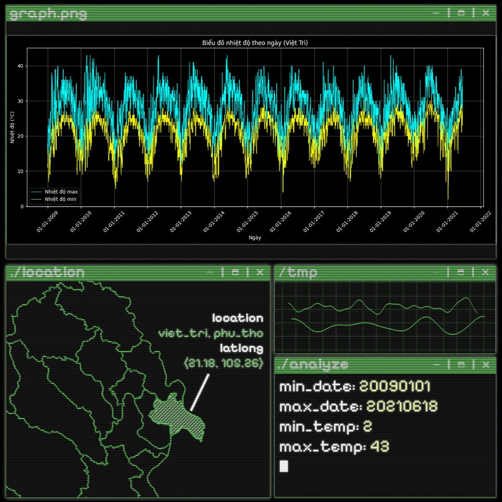
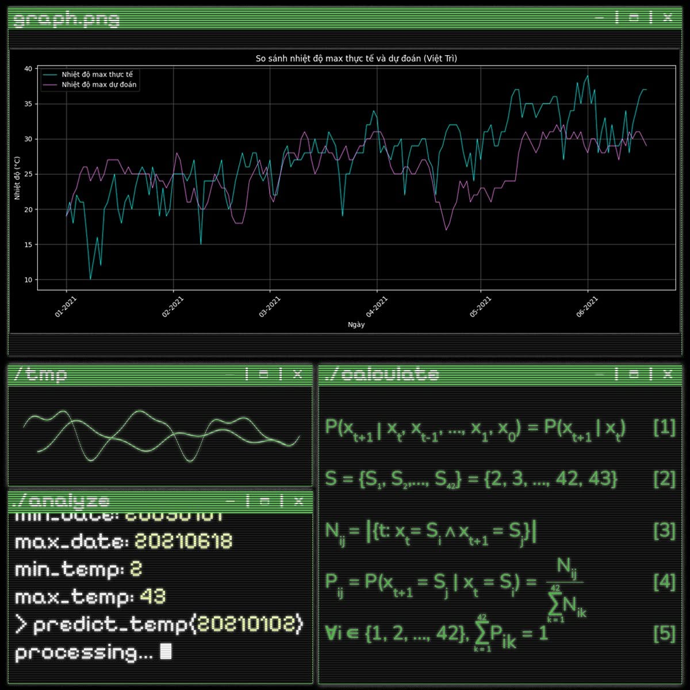

Bạn có bao giờ tự hỏi, liệu thời tiết ngày mai có thể được “tiên đoán” chỉ bằng thông tin hôm nay?

Khi dữ liệu được sắp xếp theo quy luật, và sự ngẫu nhiên lại mang trong mình trật tự ẩn, những mô hình toán học như Chuỗi Markov sẽ cho ta chiếc chìa khóa để khám phá các hiện tượng tưởng chừng đầy bất định như thời tiết mỗi ngày.

Chuỗi Markov (Markov Chains), hay quá trình Markov, là một quá trình ngẫu nhiên mô tả một chuỗi các sự kiện có khả năng xảy ra mà trong đó, xác suất của mỗi biến cố trong tương lai chỉ phụ thuộc vào trạng thái hiện tại, tức là độc lập với quá khứ. Nó được đặt theo tên nhà toán học người Nga Andrey Markov, người đã xây dựng lý thuyết này vào đầu thế kỷ 20 như một cách để mô tả hành vi của những quá trình ngẫu nhiên.

Chuỗi Markov đến nay đã được ứng dụng rộng rãi trong nhiều lĩnh vực như Vật lý, Sinh học, Kinh tế, Khoa học Máy tính. Trong bài viết hôm nay, chúng ta sẽ cùng tìm hiểu một trong số các ứng dụng quan trọng của chuỗi Markov thông qua một bài toán thực tế - dự báo thời tiết.

## 1. Phương pháp Dự báo Tương tự (Analog Forecasting) trong dự báo thời tiết

Nhờ sự phát triển của các máy tính có khả năng tính toán mạnh mẽ, con người đã có thể sử dụng các mô hình số để hiểu rõ hơn về khí hậu và thời tiết.

Trong dự báo thời tiết dài hạn, một phương pháp thống kê cơ bản được áp dụng là Dự báo Tương tự (Analog Forecasting).

Ý tưởng cơ bản của phương pháp này là dựa trên dữ liệu thu thập được về lịch sử thời tiết để đưa ra dự đoán về “quy tắc” ẩn đằng sau các hiện tượng đó.

Với giả định cơ bản rằng nếu điều kiện thời tiết hiện tại giống với một thời điểm nào đó trong quá khứ, thì có khả năng cao là nó sẽ tiếp tục diễn biến như những gì đã xảy ra sau thời điểm đó.

Theo giả định trên, điều kiện thời tiết trong tương lai có thể được dự đoán dựa trên điều kiện hiện tại. Vì thế việc áp dụng chuỗi Markov để dự đoán chúng là một ý tưởng hợp lý.

## 2. Vấn đề

Một trang trại trồng cam tại Việt Trì (Phú Thọ) muốn tận dụng dữ liệu về thời tiết để lên kế hoạch chăm sóc cam phù hợp và tối ưu hóa mùa vụ.

Họ có một bộ dữ liệu được thu thập trong khoảng thời gian 01/01/2009 - 18/06/2021, trong đó bao gồm nhiều thông tin về nhiệt độ, độ ẩm, hướng gió,… Ở đây để cho đơn giản ta sẽ chỉ xem xét yếu tố nhiệt độ. Dữ liệu về nhiệt độ tại đây nằm trong khoảng 2°C - 43°C và được làm tròn đến số nguyên.

Biểu đồ trong hình thể hiện nhiệt độ cao nhất và thấp nhất mỗi ngày trong khoảng thời gian dữ liệu được thu thập, tương ứng với hai đường màu đỏ và màu xanh lam.

Bài toán đặt ra cho trang trại trên là, làm sao để xây dựng một mô hình dự báo thời tiết tại Việt Trì dựa trên bộ dữ liệu đã thu thập được.

## 3. Lời giải

Ở đây trình bày các bước để dự báo nhiệt độ cao nhất trong từng ngày tiếp theo. Để dự báo nhiệt độ thấp nhất ta cũng thực hiện các bước tương tự.

Trước hết, với mọi $t$ nguyên không âm, gọi nhiệt độ cao nhất trong ngày thứ $t$ là $x_t$. Để sử dụng chuỗi Markov thực hiện phương pháp Dự báo Tương tự, ta đưa ra giả định cơ bản rằng xác suất của các điều kiện thời tiết của một ngày chỉ phụ thuộc vào ngày trước đó, và có công thức:

$$
P(x_{t+1} \mid x_t, x_{t-1}, \ldots, x_1, x_0) = P(x_{t+1} \mid x_t) \tag{1}
$$

Ta đưa ra giả định thứ hai, rằng chỉ cần xem xét nhiệt độ trong khoảng 2°C - 43°C. Vì thực tế là nhiệt độ ngoài khoảng đó chưa từng xuất hiện trong hàng chục năm, ta chấp nhận rằng nếu nó xuất hiện thì điều đó là ngoài khả năng dự đoán. Như vậy, $x_i$ có 42 giá trị khả dĩ, hay ta có thể nói, không gian trạng thái của chuỗi Markov đang xét là:

$$
S = \{S_1, S_2, \ldots, S_{42}\} = \{2, 3, \ldots, 42, 43\} \tag{2}
$$

Trước tiên, với mọi $i, j$, ta đếm số lần trong dữ liệu mà ngày có nhiệt độ $S_j$ ở liền sau ngày có nhiệt độ $S_i$. Gọi:

$$
N_{ij} = \left| \{ t : x_t = S_i \land x_{t+1} = S_j \} \right| \tag{3}
$$

Giá trị phù hợp để mô tả xác suất ngày có nhiệt độ $S_j$ ở liền sau ngày có nhiệt độ $S_i$ là

$$
P_{ij} = P(x_{t+1} = S_j \mid x_t = S_i) = \frac{N_{ij}}{\sum_{k=1}^{42} N_{ik}} \tag{4}
$$

Nhận xét:

$$
\forall i \in \{1, 2, \ldots, 42\}, \quad \sum_{k=1}^{42} P_{ik} = 1 \tag{5}
$$

Xây dựng ma trận $T \in [0, 1]^{42 \times 42}$ với $T_{ij} = P_{ij}$, $T$ được gọi là ma trận chuyển trạng thái.

Bạn đọc có thể tự kiểm chứng mệnh đề sau: Nếu $x_i = [x_{i1}, x_{i2}, \ldots, x_{i42}]$ là phân phối xác suất cho các giá trị nhiệt độ có thể có trong ngày thứ $i$, thì $x_{i+1} = x_i T$ chính là phân phối xác suất cho các giá trị nhiệt độ có thể có trong ngày thứ $i + 1$.

Tính toán trên dữ liệu trong khoảng thời gian 01/01/2009 - 31/12/2020, ta xác định được ma trận $T$ như đã mô tả. Sau đó sử dụng ma trận này để xác định nhiệt độ cao nhất từng ngày trong khoảng thời gian 02/01/2021 - 18/06/2021. Để nhận dự báo từ chuỗi Markov đã xây dựng về nhiệt độ cao nhất ngày 02/01/2021, ta làm như sau:

**B1.** Xác định nhiệt độ cao nhất ngày 01/01/2021 là 19°C. Ta tạo véctơ $x_0 = [0 \; \ldots \; 0 \; 1 \; 0 \; \ldots \; 0 \; 0]$ có vị trí thứ 18 (tương ứng với 19°C) bằng 1, các vị trí còn lại bằng 0.

**B2.** Tính $x_0 T$, giá trị nhận được chính là dòng 18 của $T$.

**B3.** Chọn ngẫu nhiên một giá trị nhiệt độ với xác suất tương ứng (trong dòng 18) và dự đoán đó là nhiệt độ cao nhất ngày 02/01/2021, gọi giá trị đó là $x_1$.

Các bước tương tự cũng được áp dụng để dự đoán nhiệt độ cao nhất của các ngày tiếp theo.

Chi tiết các bước thực hiện bằng ngôn ngữ Python được trình bày tại: [Google Colab](https://colab.research.google.com/drive/1oCSLtHu6MlzL6e7nC4ohQQIqEP9PSEz5).

## 4. Mở rộng

Trong các ứng dụng rộng hơn, chuỗi Markov không chỉ được sử dụng để dự đoán diễn biến của các quá trình, mà còn đóng vai trò quan trọng trong việc khám phá phân phối xác suất ẩn sau các hiện tượng mà con người có thể thu thập dữ liệu. Bằng cách lấy mẫu từ các phân phối này, chúng ta có thể tạo ra những điểm dữ liệu mới, điển hình là các hình ảnh do AI tạo ra mà bạn vẫn thường thấy trên mạng xã hội.
