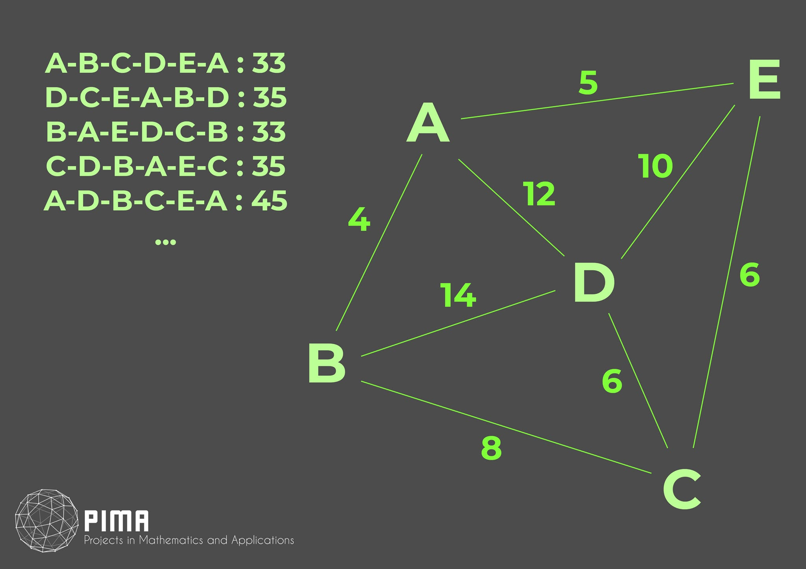

Có lẽ có nhiều người từng mong muốn được đi vòng quanh thế giới. Nếu một ngày bạn được đi vòng quanh thế giới, bạn sẽ làm gì để giảm thiểu chi phí di chuyển qua các quốc gia mà vẫn đảm bảo là đi được các nước mà mình mong muốn? Làm sao để tìm ra con đường ngắn nhất để giảm thiểu chi phí đó?

Vấn đề này tương đương với bài toán tìm đường của người giao hàng (TSP - Travelling Salesman Problem): một người giao hàng cần đi qua $n$ thành phố để giao hàng - bắt đầu từ một thành phố bất kì, đi qua $n - 1$ thành phố còn lại một lần duy nhất và quay trở lại thành phố ban đầu.

Lưu ý một số cách viết tương tự trong bài viết: TSP = Travelling Salesman Problem = Bài toán người giao hàng.

## Sơ lược về lịch sử của bài toán tìm đường của người giao hàng

Mặc dù chưa biết nguồn gốc chính xác của bài toán tìm đường của người giao hàng, nhưng một vấn đề như vậy đã từng xuất hiện trong quyển sổ tay bằng tiếng Đức dành cho những thương nhân đi qua Đức và Thụy Sĩ năm 1832. Quyển sổ tay này chỉ là một quyển sách hướng dẫn, không hề chứa những thuật ngữ toán học. Điều này trở thành một câu đố vào khoảng những năm 1800 được nghiên cứu bởi William Rowan Hamilton (nhà toán học người Ireland) và Thomas Kirkman (nhà toán học người Anh). Và vào khoảng năm 1930, nhà toán học và kinh tế học Karl Menger đã phát biểu về bài toán tìm đường của người giao hàng này với các đồng nghiệp của mình ở Vienna và Harvard.

Bài toán tìm đường của người giao hàng là một bài toán khó, vẫn chưa có cách giải hiệu quả. Bài toán lớn nhất từng được giải là vào năm 2006 với số lượng thành phố là 85 900 thành phố.

## Ứng dụng của bài toán TSP

Bài toán tìm đường của người giao hàng có rất nhiều ứng dụng trong đời sống như khoan bảng mạch in (tìm ra các lỗ cần khoan có cùng đường kính để giảm thiểu thời gian thay mũi khoan), xem xét động cơ tuabin khí (đặt các van sao cho phù hợp), phân tích cấu trúc của các tinh thể (dùng để đo cường độ phản xạ tia X của tinh thể từ các vị trí khác nhau, và TSP được ứng dụng để tìm ra một chuỗi để giảm thiểu thời gian định vị), chọn đơn hàng trong kho, định tuyến xe, thiết kế mạng lưới hệ thống định vị toàn cầu. Những ứng dụng này cũng như bài toán TSP có thể được mô hình hóa bằng đồ thị!

## Mô hình bài toán bằng ngôn ngữ đồ thị

Trở lại với bài toán người giao hàng ở trên. Giả sử ta xác định được khoảng cách hoặc chi phí di chuyển giữa các thành phố. Khi đó, bài toán có thể được biểu diễn bằng một đồ thị $G(V, E)$, với $V$ (tập đỉnh) đại diện cho các thành phố và $E$ (tập cạnh) đại diện cho khoảng cách hoặc chi phí di chuyển giữa các thành phố. Một lộ trình của người giao hàng lúc này sẽ tương ứng với một đường đi giữa các đỉnh của đồ thị. Theo yêu cầu của bài toán, đường đi này có đỉnh đầu và đỉnh cuối trùng nhau và qua mỗi đỉnh khác đúng một lần. Một đường đi như vậy trong đồ thị được gọi là một chu trình Hamilton. Như vậy, bài toán TSP tương đương với việc tìm ra một chu trình Hamilton có tổng quãng đường nhỏ nhất.

Ví dụ: Cho các điểm A, B, C, D, E.

Ta cần phải chọn một đường với tổng độ dài ngắn nhất để đi qua tất cả các điểm và quay trở lại điểm ban đầu. Do đồ thị trên không quá phức tạp, chúng ta có thể thử bằng cách chọn ra một chu trình nào đó như A-B-C-D-E-A hay D-C-E-A-B-D, v.v. Qua việc thử ở nhiều chu trình khác nhau ta có thể tìm ra được chu trình Hamilton có tổng giá trị các cạnh nhỏ nhất (= 33) là A-B-C-D-E-A.

## Độ khó của bài toán tìm đường của người giao hàng

Bài toán tìm đường của người giao hàng là một bài toán NP-khó (tham khảo \[1\]), vẫn chưa có cách giải hiệu quả cho dạng toán này.

Cách giải dễ thấy nhất như ví dụ trên là liệt kê tất cả các trường hợp và chọn ra trường hợp có tổng số giá trị đường đi là nhỏ nhất, đây được gọi là phương pháp vét cạn. Đây là cách giải thông thường đối với số lượng thành phố ít. Tuy nhiên, với số lượng lớn các thành phố, việc liệt kê và tính tổng giá trị tất cả các quãng đường có thể là cực kì phức tạp. Một số thuật giải khác như là dùng kỹ thuật tham ăn, nhánh cận, phương pháp hình học, các bạn có thể tham khảo thêm ở \[2\].

## Tài liệu tham khảo

- \[1\] <https://vi.wikipedia.org/wiki/NP-kh%C3%B3>
- \[2\] <https://hayashikita.wordpress.com/2012/03/27/d%C6%B0%E1%BB%9Dng-di-c%E1%BB%A7a-ng%C6%B0%E1%BB%9Di-giao-hang-tsp/>
