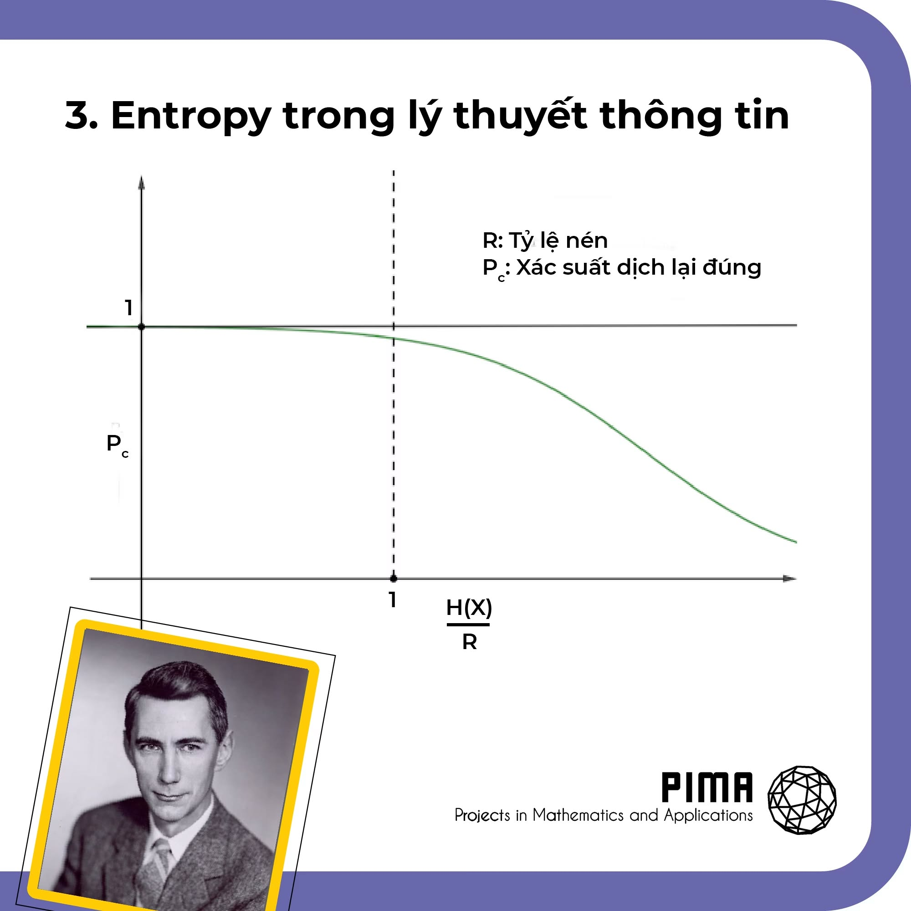

Thông tin là một khái niệm quen thuộc trong đời sống con người. Lời nói, văn bản, hình ảnh... đều là những đối tượng mang thông tin mà ta gặp hằng ngày. Một cách đơn giản, thông tin là những tri thức về đặc điểm, tính chất của sự việc hiện tượng, cung cấp cho con người những sự hiểu biết về một hay nhiều đối tượng cụ thể nào đó. Ví dụ, thông tin về một trận đấu bóng đá bao gồm: “Trận đấu đó diễn ra giữa hai đội nào?”, “Ở đâu?”, “Thời gian nào?”... Những câu trả lời cho các câu hỏi đó cung cấp thông tin đầy đủ về trận đấu.

Mỗi đoạn văn bản hoặc lời nói có thể chứa đựng những lượng thông tin khác nhau. Ví dụ, trong một trận bóng đá giữa hai đội Lào và Đức. Ta có thể chắc chắn gần như tuyệt đối rằng Đức sẽ thắng. Nhưng, điều không chắc chắn, là tỉ số trận đấu và thời gian các bàn thắng được ghi. Vậy, một cách trực giác, lượng thông tin trong câu “Tỉ số trận đấu là 7 – 1 nghiêng về Đức” sẽ lớn hơn trong câu “Đức thắng Lào”. Tiếp theo, ta cần lượng hóa trực giác trên bằng cách tìm ra một thang đo phù hợp lượng thông tin.

Câu hỏi quan trọng ta sẽ đi tìm câu trả lời trong bài viết này là: Làm thế nào để đo lường lượng thông tin? Câu hỏi này sẽ dẫn chúng ta đến với một khái niệm cơ bản và then chốt của lý thuyết thông tin: Entropy.

## 1. Thông tin và sự không chắc chắn

Mời bạn đọc đến với một ví dụ mở đầu đơn giản sau đây:

Alice và Bob chơi trò tung xúc xắc với một con xúc xắc đặc biệt: năm mặt của nó là mặt 1 chấm và chỉ có một mặt là 6 chấm. Đầu tiên Bob sẽ tung xúc xắc, và sau đó Bob sẽ nói cho Alice biết cậu tung xúc xắc ra mặt nào.

Ở đây, xác suất để Bob tung xúc xắc ra mặt 1 chấm là $5/6$ nên Alice hẳn sẽ không ngạc nhiên khi con xúc xắc ra mặt 1 chấm. Thông báo rằng Bob tung xúc xắc ra mặt 1 chấm sẽ có ít giá trị hơn, vì Alice biết rằng điều đó dễ xảy ra hơn nhiều so với tung xúc xắc ra mặt 6 chấm. Điều tương tự cũng đúng đối với ví dụ về trận đấu giữa Đức và Lào ở trên. Xác suất Đức thắng Lào rất gần 1, nhưng xác suất để tỉ số là 7 – 1 thấp hơn thế nhiều, vì còn có nhiều tỷ số khác có thể xảy ra với xác suất xấp xỉ bằng tỉ số 7 – 1.

Như vậy, lượng thông tin được truyền tải về một sự kiện $X$ phụ thuộc vào xác suất của sự kiện đó. Khi một sự kiện $X$ có xác suất lớn, và mọi người đều biết điều đó, thì họ càng ít ngạc nhiên khi biết được rằng nó đã xảy ra.

Cụ thể hóa bài toán trên như sau:

Gọi $X$ là một sự kiện có xác suất $P(X)$, $I(X)$ là một hàm biểu thị giá trị thông tin của tuyên bố “$X$ đã xảy ra”, hay gọi ngắn gọn là lượng thông tin của sự kiện $X$. Khi đó, $I(X)$ tăng khi $P(X)$ giảm và ngược lại. Đặc biệt, khi $P(X) = 1$ thì $I(X) = 0$, do mọi người đều biết chắc chắn việc đó sẽ xảy ra, tuyên bố “$X$ đã xảy ra” lúc này là một sự thật hiển nhiên, và mọi người không có thêm thông tin gì từ tuyên bố này. Giả sử $P(X) = p$. Do $I(X)$ phụ thuộc vào $p$ cho nên ta có thể viết $I(X) = I(p)$.

Theo Shannon, hàm $I(p)$ đặc trưng cho lượng thông tin nên cần có những tính chất đặc trưng của thông tin sau:

1. $I(p)$ phải liên tục, mọi thay đổi nhỏ của $p$ phải dẫn đến một sự thay đổi của lượng thông tin của $X$.
2. $I(p) \ge 0$: Lượng thông tin là một đại lượng không âm. Ta không thể lấy bớt đi thông tin đã biết của bất kỳ ai.
3. $I(1) = 0$ do một sự kiện chắc chắn xảy ra (xác suất bằng 1) thì không đem lại thông tin gì.
4. $I(p_1 p_2) = I(p_1) + I(p_2)$: Khi cả hai sự kiện cùng xảy ra thì thông tin nhận được bằng tổng thông tin của hai sự kiện đó khi xảy ra riêng lẻ.

Người ta đã chứng minh được rằng, với những điều kiện trên, hàm $I(X)$ có dạng như trên hình đầu bài. Trong ví dụ ở trên, nếu $X$ là sự kiện “tung xúc xắc ra mặt 1 chấm”, khi đó $I(X) = -\log_2 (5/6) \approx 0.26$, còn nếu $X$ là sự kiện “tung xúc xắc ra mặt 6 chấm”, $I(X) = -\log_2 (1/6) \approx 2.58$.

## 2. Khái niệm về Entropy thông tin

![Định nghĩa entropy H(X) = E[I(X)] = −Σ P(Xᵢ) log₂ P(Xᵢ) với quy ước 0 log₂ 0 = 0; entropy của phép tung đồng xu f(p) = −p log₂ p − (1 − p) log₂(1 − p) và đồ thị của f(p), đạt cực đại bằng 1 tại p = 0.5](./hinh-1.jpg)

Khái niệm Entropy thông tin được Claude Shannon giới thiệu trong bài báo năm 1948 “A Mathematical Theory of Communication” (Một lý thuyết Toán học về thông tin) của ông. Entropy được Shannon dùng để đo mức độ “thông tin”, “sự không chắc chắn” của một biến ngẫu nhiên.

Định nghĩa: Cho biến ngẫu nhiên $X$ nhận các giá trị $X_1, X_2, \ldots, X_n$ với các xác suất lần lượt là $P(X_1), P(X_2), \ldots, P(X_n)$. Entropy của biến ngẫu nhiên $X$ được định nghĩa là trung bình có trọng số, hay kì vọng của lượng thông tin của các giá trị (sự kiện) $X_i$: $H(X) = E[I(X)]$.

Chúng ta lấy ví dụ đơn giản với việc tung đồng xu. Khi đó biến ngẫu nhiên $X$ sẽ nhận hai giá trị là S (sấp) với xác suất $P(S) = p$ và N (ngửa) với xác suất là $1 - p$, tương ứng với việc xác suất để đồng xu ra mặt sấp và mặt ngửa lần lượt là $p$ và $1 - p$. Khi đó ta tính Entropy của $X$ như hình bên.

Ta thấy $f(p)$ đạt cực đại khi $p = \frac{1}{2}$. Khi đó $P(S) = P(N) = \frac{1}{2}$. Do đó phép thử ngẫu nhiên tung đồng xu với xác suất ngửa và sấp đều bằng $\frac{1}{2}$ có độ không chắc chắn cao, nghĩa là người ta không thể chắc chắn liệu kết quả nào có xu hướng xảy ra nhiều hơn. Mặt khác, nếu $p = 1$, $H(X) = 0$, nghĩa là đồng xu chắc chắn sẽ sấp, do đó thông tin về sự kiện “đồng xu tung ra mặt sấp” bằng 0.

Tổng quát hơn, ta có một kết luận sau: $H(X)$ đạt giá trị lớn nhất khi $P(X_1) = P(X_2) = \cdots = P(X_n) = 1/n$. Điều này có nghĩa là xác suất của $X_1, X_2, \ldots, X_n$ là như nhau, và ta không thể chắc chắn về sự kiện này hơn các sự kiện khác.

## 3. Entropy trong lý thuyết thông tin

Lý thuyết thông tin là một nhánh của toán học ứng dụng nghiên cứu về việc định lượng, lưu trữ và truyền thông tin, ra đời từ những năm 20 – 40 của thế kỉ XX, với những nghiên cứu đầu tiên của các nhà toán học Harry Nyquist, Ralph Hartley và Claude Shannon. Đối tượng trung tâm của lý thuyết này là Entropy.

Entropy là đối tượng quan trọng và then chốt để giải quyết một trong những vấn đề quan trọng của lý thuyết thông tin, đó là bài toán nén dữ liệu. Bài toán này đã được giải quyết với định lý Shannon thứ nhất. Định lý Shannon thứ nhất khẳng định rằng, chặn dưới của tỉ lệ nén thông tin (tức là tỉ lệ giữa độ dài đoạn thông tin được mã hóa và độ dài đoạn thông tin ban đầu) sao cho sai sót là không đáng kể chính là entropy của đoạn thông tin ban đầu.

Định lý Shannon thứ nhất có vai trò như một “tiêu chuẩn” đánh giá độ hiệu quả của các thuật toán nén thông tin. Một thuật toán nén thông tin tốt phải thu gọn được kích thước thông tin đến mức tối đa mà vẫn đảm bảo sai sót là không đáng kể, do vậy thuật toán đó phải đảm bảo được các điều kiện của định lý Shannon thứ nhất.

## Tài liệu tham khảo

- \[1\] C. E. Shannon, “A Mathematical Theory of Communication,” 1948.
- \[2\] “Entropy (information theory),” Wikimedia Foundation, Inc., \[Trực tuyến\]. Available: <https://en.wikipedia.org/wiki/Entropy_(information_theory)>.
