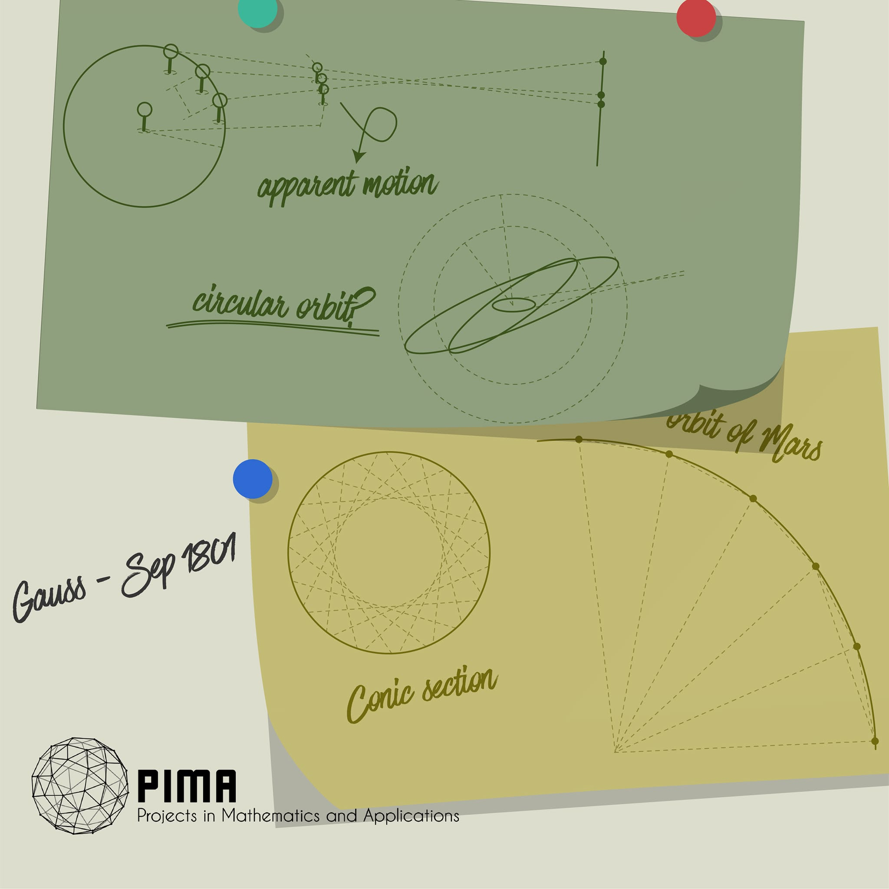

Tìm ra mô hình tổng quát là một trong những giải pháp nền tảng cho nhiều bài toán. Tuy nhiên, vấn đề đôi lúc lại quá phức tạp để có thể xây dựng một mô hình tổng quát hoàn toàn. Trong tình huống đó, Gauss đã làm thế nào để tìm ra quỹ đạo của Ceres bằng… dữ liệu?

Ngày 01 tháng 01 năm 1801, trong những thời khắc đầu tiên của thế kỉ mới, nhà toán học và thiên văn học Giuseppe Piazzi nhìn qua ống kính viễn vọng và phát hiện một đốm sáng nhỏ trên nền trời đen sâu thẳm. Ông ghi nhận vị trí của đốm sáng này so với các thiên thể khác dưới dạng các tọa độ trên thiên cầu (1). Những buổi tối tiếp theo, ông tiếp tục ghi chép cẩn thận vị trí của đốm sáng này, ngày hôm nay lệch một chút so với ngày hôm trước cho đến ngày 12 tháng 02 cùng năm, vật thể này mất hút trong ánh sáng mặt trời. Piazzi ghi chép được tổng cộng trên dưới 20 quan sát, toàn bộ quỹ đạo của nó chỉ vẽ ra một cung vỏn vẹn 9 độ trên thiên cầu.

Một loạt các câu hỏi được dấy lên từ các quan sát này. Piazzi đã phát hiện ra cái gì? Một hành tinh, một ngôi sao, một sao chổi, hay một lớp thiên thể chưa định danh? Nhưng câu hỏi quan trọng hơn hết: nó đang ở đâu trong vùng trời rộng lớn này? Liệu ta có còn lại quan sát được nó mà không bị cản trở bởi ánh sáng chói lóa từ mặt trời? Nếu có, ta nên nhìn vào đâu, khi mà vùng quan sát của ta vẫn còn bị giới hạn bởi công nghệ thời bấy giờ?

Chúng ta đã trả lời được câu hỏi đầu tiên: Thiên thể mà Piazzi nhìn thấy hiện nay được biết đến với cái tên là Ceres, một hành tinh lùn nằm giữa quỹ đạo của Sao Hỏa và Sao Mộc.

Nhưng câu hỏi thứ hai thì không đơn giản để trả lời như vậy. Khoảng tháng 09 năm 1801, Carl Friedrich Gauss, lúc bấy giờ 24 tuổi, mới tiếp cận được với dữ liệu của Piazzi và bắt đầu quá trình đi tìm quỹ đạo của Ceres. Mặc dù đã biết đến và làm nhiều nghiên cứu về quỹ đạo thiên thể nhưng Gauss vẫn mất đến gần 3 tháng tính toán mới có thể đưa ra câu trả lời cho câu hỏi này. Dựa vào đó, ông có thể đưa ra dự đoán chỉ sai lệch nửa độ so với kết quả quan sát thực tế khi Ceres ở ngoài khỏi vùng sáng mặt trời ngày cuối cùng năm 1801.

Gauss đã làm thế nào để đạt được độ chính xác như vậy? Đó là một quá trình dài hơi và đầy những tính toán kỹ thuật hoàn toàn không phù hợp cho một bài viết thế này. Nếu hứng thú và có thời gian (và tôi cho rằng đó là một khoản đầu tư xứng đáng), bạn đọc có thể đọc chi tiết quá trình này ở \[1\]. Ở đây, tôi chỉ xin phép được nói ý tưởng chính của phương pháp.

Cách tiếp cận của Gauss chứa đựng một ý tưởng rất đơn giản nhưng lại đặc biệt quan trọng, mang tính nền tảng. Gauss đã xây dựng một mô hình chuyển động dựa trên các định luật vật lý thiên văn buổi bấy giờ (ví dụ như các định luật của Kepler), mô hình này cho thấy để xác định quỹ đạo của một thiên thể thì cần tìm ra giá trị cụ thể của các tham số trong mô hình. Đến đây, ta hiểu được rằng các tham số này sẽ quy định chuyển động của thiên thể và do đó quyết định được kết quả quan sát của chúng ta. Nói cách khác, chính các kết quả mà chúng ta quan sát được sẽ giúp chúng ta xác định các tham số. Và đó chính là điều mà Gauss đã làm: dựa trên các quan sát của Piazzi, ông xác định các tham số cho mô hình chuyển động của Ceres. Đây cũng là tiền đề cho phương pháp “bình phương tối thiểu” mà ông phát triển (2), một phương pháp giúp tìm tham số của mô hình sao cho phù hợp nhất với các quan sát có được.

Thông qua một ví dụ đã 200 năm tuổi đời này, có thể thấy trong một số tình huống, lượng dữ liệu quan sát đóng vai trò vô cùng lớn trong việc giải quyết bài toán. Để giải một trường hợp cụ thể, đôi khi lại không cần một mô hình quá phức tạp, mà thay vào đó lại cần một lượng dữ liệu quan sát được vừa đủ. Trong trường hợp trên, việc tìm ra quỹ đạo của Ceres không nhất thiết phải tìm mô hình bao quát cho mọi hành tinh mà có thể được giải quyết nhờ vào các dữ liệu có thể thu được của Ceres. Thời đại hiện nay, khi dữ liệu ngày càng nhiều, ngày càng đa dạng, thì cách tiếp cận này lại càng trở nên phù hợp. Khoa học Dữ liệu (Data Science) bao hàm những công việc như vậy: phân tích dữ liệu, nghiên cứu những mô hình định hướng bởi dữ liệu, và áp dụng nó vào giải quyết các vấn đề trong cuộc sống hàng ngày.

## Ghi chú

(1) Thiên cầu: một quả cầu tưởng tượng với tâm là Trái Đất (hoặc người quan sát) và bán kính lớn tùy ý. Các thiên thể được xem như là chiếu lên mặt trong của quả cầu này. Do đó, các tọa độ trên thiên cầu sẽ chỉ vẽ ra một “tia” với hướng xác định, nhưng thiếu đi thông tin về khoảng cách giữa thiên thể và Trái Đất.

(2) Hiện có tranh chấp giữa Adrien-Marie Legendre và Gauss về việc ai là người đề xuất phương pháp này. Legendre công bố năm 1805, còn Gauss tuyên bố trong bài báo xuất bản năm 1809 rằng đã sử dụng nó từ 1795 cũng như đã áp dụng trong việc tìm Ceres năm 1801.

## Tài liệu tham khảo

- \[1\] [“How Gauss Determined The Orbit of Ceres”](https://archive.schillerinstitute.com/fid_97-01/982_orbit_ceres.pdf) bởi Jonathan Tennenbaum và Bruce Director
