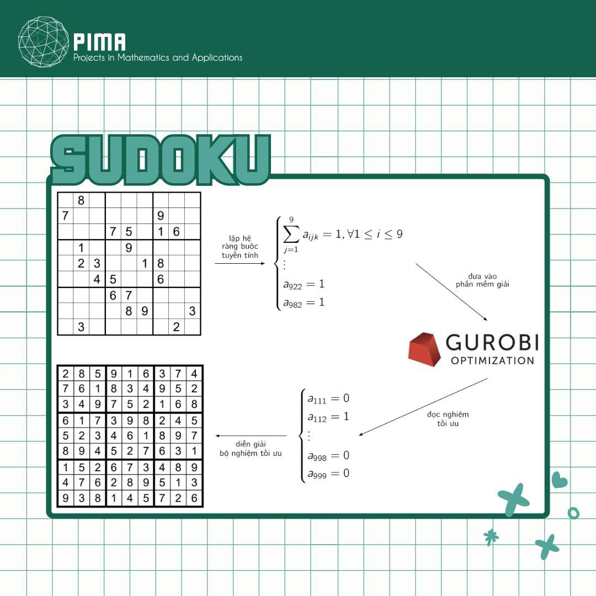

Sudoku là một trò chơi giải đố kinh điển và được nhiều người biết đến, các câu đố này có thể được giải trên các tạp chí hoặc các thiết bị điện tử. Với lịch sử xuất phát từ ông Howard Garns vào năm 1979 và được phổ biến bởi công ty trò chơi Nikoli tại Nhật Bản, đã có nhiều chiến thuật được thiết kế để giải các câu đố Sudoku này. Một số chiến thuật để giải Sudoku cơ bản bao gồm xác định các số có thể được điền vào các ô trống dễ nhận thấy trước bằng cách loại trừ. Trên máy tính, các bảng Sudoku có thể được giải rất nhanh bằng cách quay lui.

Nhân dịp chủ đề của trại hè PiMA 2024 về Quy hoạch tuyến tính, xin được giới thiệu đến các bạn đọc cách sử dụng máy tính để giải một câu đố Sudoku tiêu chuẩn bằng cách giải một bài toán quy hoạch tuyến tính (trên số nguyên) tương ứng.

## Luật chơi Sudoku và thiết lập bài toán quy hoạch tuyến tính tương ứng

Với một bảng Sudoku 9×9 tiêu chuẩn đã được điền trước một vài số, yêu cầu của trò chơi là điền các số từ 1 đến 9 vào các ô còn trống sao cho mỗi hàng, mỗi cột và mỗi ô 3×3 chứa các số từ 1 đến 9 không trùng nhau. Ta sẽ sử dụng bảng Sudoku trong hình minh họa đầu bài.

Gọi $a_{ijk}$ là một biến nhị phân, chỉ có giá trị bằng 1 khi số ở hàng thứ $i$ và cột thứ $j$ của bảng Sudoku bằng $k$. Lấy thí dụ với ô ở hàng 9 và cột 2, do số 3 đã được điền vào nên $a_{923} = 1$ và với mọi số $k$ khác 3 thì $a_{92k} = 0$.

Như vậy ta sẽ sử dụng tới $9 \times 9 \times 9 = 729$ biến nhị phân! Mặc dù số lượng biến có thể là rất lớn, tuy nhiên việc mô hình các ràng buộc của trò chơi Sudoku sẽ trở nên dễ dàng hơn.

Từ luật chơi của Sudoku, ta có các ràng buộc sau:

- Mỗi hàng chứa các số từ 1 đến 9 không trùng nhau (hay mỗi số từ 1 đến 9 chỉ được điền một lần trên mỗi hàng): được minh họa bằng hàng màu xanh dương, với mỗi số $k$ và mỗi hàng $i$ thì tổng của các $a_{ijk}$ với $j$ chạy từ 1 tới 9 phải bằng 1.
- Mỗi cột chứa các số từ 1 đến 9 không trùng nhau (hay mỗi số từ 1 đến 9 chỉ được điền một lần trên mỗi cột): được minh họa bằng cột màu xanh lá, với mỗi số $k$ và mỗi cột $j$ thì tổng của các $a_{ijk}$ với $i$ chạy từ 1 tới 9 phải bằng 1.
- Mỗi ô 3×3 chứa các số từ 1 đến 9 không trùng nhau (hay mỗi số từ 1 đến 9 chỉ được điền một lần trên mỗi ô 3×3): được minh họa bằng vùng màu đỏ, với mỗi số $k$ và với mỗi vùng 3×3 thì tổng của các $a_{ijk}$ với $i$, $j$ chạy trong vùng phải bằng 1.
- Mỗi ô chỉ điền một số: được minh họa bằng màu tím, với mỗi ô ở hàng $i$ và cột $j$ thì tổng của các $a_{ijk}$ qua các số $k$ từ 1 đến 9 phải bằng 1.
- Với một bảng Sudoku đã điền sẵn một vài số, ta có thêm các ràng buộc về số $a_{ijk}$ bằng 1 (như ô màu cam ở hàng 9 và cột 2 trong hình chứa số 3 thì $a_{923} = 1$).

Các ràng buộc đã có đủ, thế còn hàm mục tiêu thì sao (để nhắc lại, một bài toán quy hoạch tuyến tính cần có miền nghiệm và một hàm mục tiêu để tối đa/tối thiểu giá trị)? Thực ra, điều ta quan tâm ở câu đố Sudoku là giá trị của các số ở trong bảng, chứ không phải việc tối ưu hàm mục tiêu. Do đó bất kỳ hàm nào cũng có thể trở thành hàm mục tiêu, chẳng hạn như $T = a_{111}$.

## Quá trình giải bài toán quy hoạch tuyến tính trên số nguyên

Có hai điểm khác biệt lớn giữa bài toán quy hoạch từ bảng Sudoku này so với các bài toán quy hoạch tuyến tính “bình thường” (như [bài toán của bác nông dân trên đảo Chín Rồng](/blog/thuat-toan-don-hinh/) đã được đề cập trước đó của PiMA):

- Ta không biết trước miền nghiệm: Ở bài toán Sudoku này thì ta lại chưa biết trước các bộ giá trị nào thỏa mãn tất cả các ràng buộc.
- Ta quan tâm đến sự tồn tại nghiệm vì mục tiêu cuối cùng của việc giải Sudoku là tìm các số chính xác để điền vào bảng, thay vì thực sự tối ưu một hàm mục tiêu $T$ được đặt một cách hình thức.

Ràng buộc của các biến $a_{ijk}$: thay vì là các biến số thực, ta định nghĩa $a_{ijk}$ là biến nhị phân chỉ có thể nhận giá trị 0 hoặc 1. Gọi một cách đúng đắn, ta thực ra đang giải bài toán quy hoạch (số) nguyên. Một số thuật toán để đảm bảo nghiệm tối ưu thỏa mãn các ràng buộc nguyên bao gồm thuật toán nhánh cận hay lát cắt Gomory.

Sử dụng một phần mềm giải các bài toán quy hoạch tổng quát (chẳng hạn như Gurobi, có mặt trong các ngôn ngữ lập trình tính toán như Python 3 hay Julia) ta sẽ tìm được một bộ giá trị $a_{ijk}$ thỏa mãn các ràng buộc. Từ bộ giá trị này, ta sẽ điền lần lượt các số trở lại bảng Sudoku: điền số $k$ vào ô ở hàng $i$ và cột $j$ nếu $a_{ijk} = 1$.

Các bạn hứng thú với việc lập trình có thể tìm hiểu cách sử dụng Gurobi ([hướng dẫn của Gurobi](https://support.gurobi.com/hc/en-us/articles/17278438215313-Tutorial-Getting-Started-with-the-Gurobi-Python-API)) cho dự án cuối trại và chia sẻ với các bạn khác vào ngày thuyết trình đề tài của nhóm.
