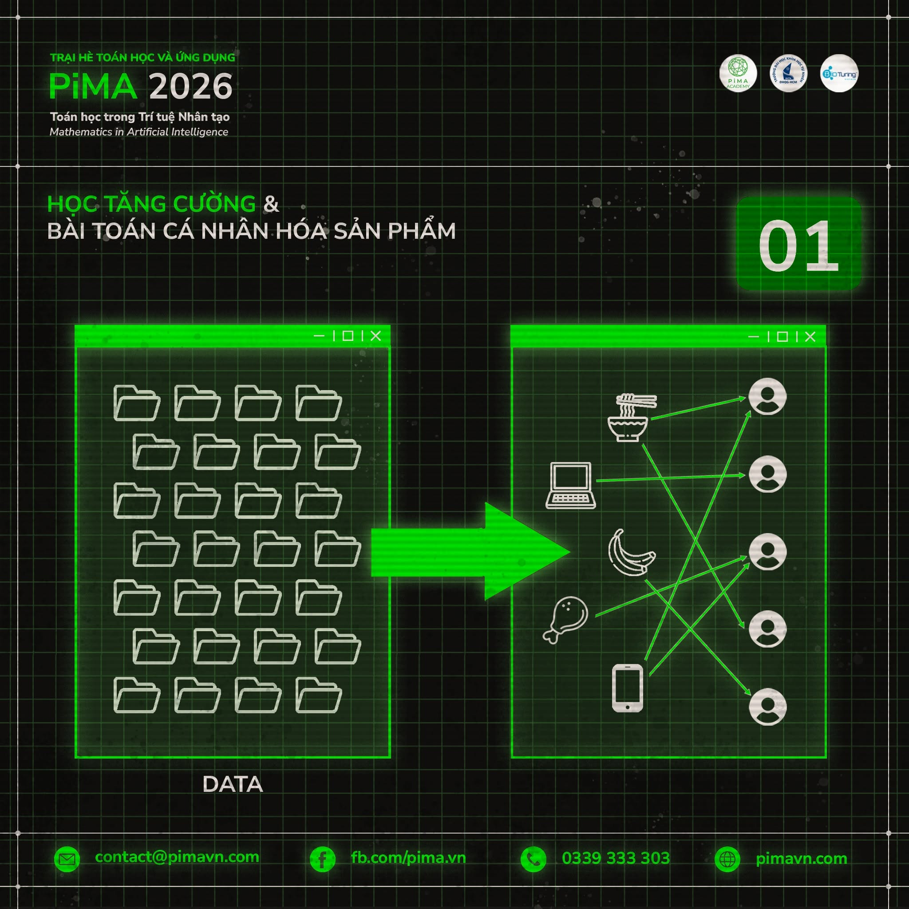
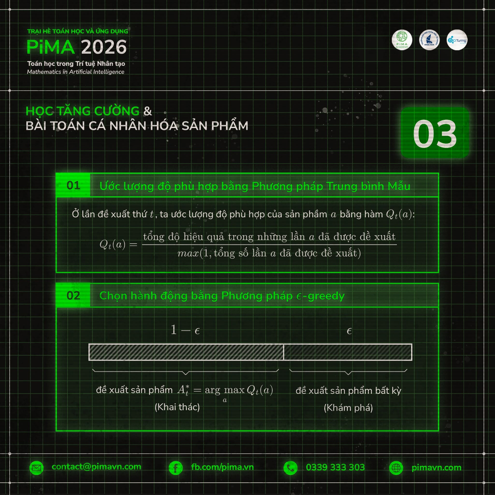
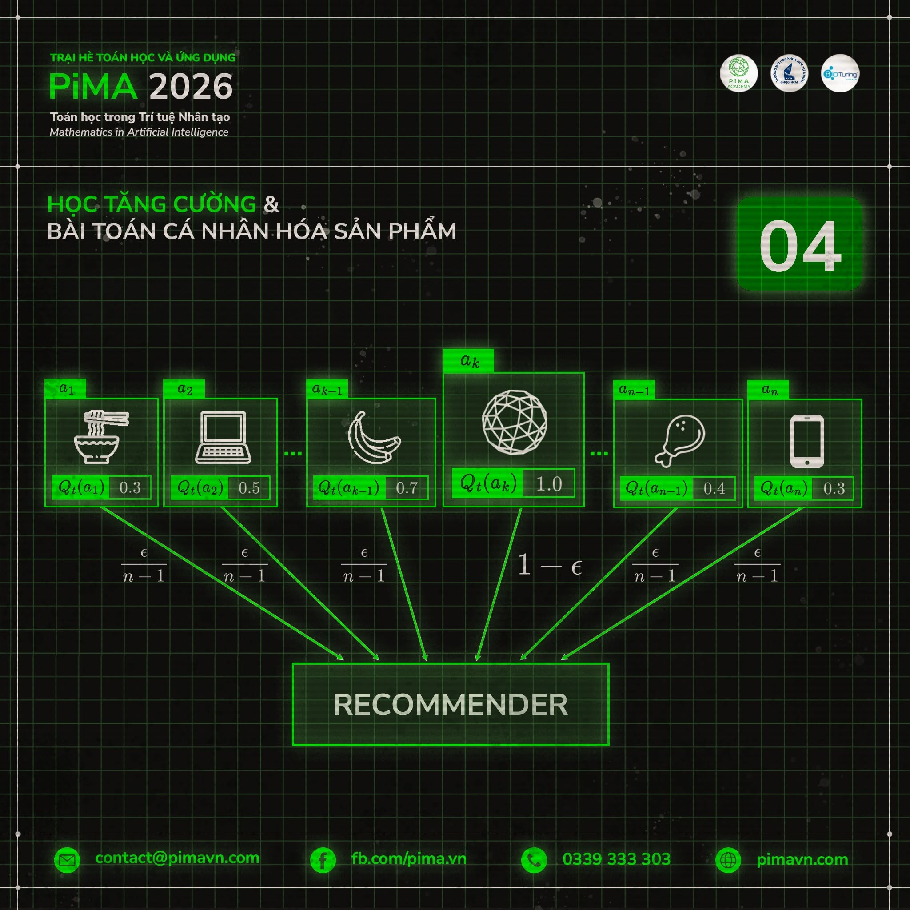

Có lẽ bạn đã ít nhất một lần nghe qua về cách mà các ứng dụng mạng xã hội hay thương mại điện tử đưa ra đề xuất phù hợp cho từng người dùng. Việc bạn nhìn thấy bài viết của ai trên Facebook, xem được nội dung gì ở các video TikTok, hay tìm thấy món ăn nào khi mở GrabFood, đều đã được các doanh nghiệp tính toán tối ưu đến mức mọi nhu cầu của bạn đều gần như được dự đoán trước. Công việc đó được gọi là tự động cá nhân hóa sản phẩm, và nó đã luôn là một phần không thể thiếu ở các nền tảng số ngày nay.

Trong bài viết này, chúng ta sẽ cùng tìm hiểu sơ lược về bài toán cá nhân hóa sản phẩm, cũng như xem xét một giải pháp giải quyết bài toán này trong bối cảnh lượng dữ liệu hạn chế.

Để đề xuất được các sản phẩm phù hợp cho từng cá nhân, những phương pháp phổ biến như Lọc dựa trên nội dung (Content-based Filtering), Lọc cộng tác (Collaborative Filtering) hay nhiều phương pháp học máy khác đã được áp dụng. Ở đó, các chuyên gia thu thập rất nhiều dữ liệu về hoạt động của người dùng cùng với những thông tin tương quan giữa các sản phẩm, sau đó cố gắng kết nối người dùng tới sản phẩm mà có khả năng là họ yêu thích nhất. Nhìn chung, các phương pháp này rất hiệu quả và giải quyết được đa số vấn đề nhờ tận dụng lượng dữ liệu lớn.

Tuy nhiên, một vấn đề mà có lẽ ít người nghĩ đến hơn: chúng ta nên làm gì khi chưa có nhiều dữ liệu? Bạn vẫn cần phải đề xuất các sản phẩm mình có cho từng khách hàng, dù chưa hề biết họ thích gì. Có hai giải pháp cơ bản mà bạn có thể xem xét:

- Một là, đề xuất một vài sản phẩm ngẫu nhiên cho khách hàng, sau đó chọn sản phẩm mà họ có phản ứng tích cực nhất rồi liên tục đề xuất sản phẩm đó về sau. Giải pháp này có ưu điểm là tận dụng được sở thích của khách hàng ngay từ sớm. Tuy nhiên nhược điểm là có thể khiến họ nhàm chán về lâu dài, cũng như bỏ qua cơ hội giới thiệu các sản phẩm mà có thể họ sẽ thích hơn.
- Hai là, đề xuất nhiều nhất có thể các sản phẩm khác nhau cho một khách hàng, cho đến khi nhận thấy họ có sự yêu thích đặc biệt với một (số) sản phẩm cụ thể. Ưu điểm của giải pháp này là nó có khả năng xác định sản phẩm mà khách hàng thực sự thích nhất. Đổi lại, rủi ro là khách hàng có thể được giới thiệu rất nhiều sản phẩm không phù hợp, và họ sẽ không mua hàng, hoặc thậm chí rời bỏ ứng dụng trước khi bạn biết họ thích gì.

Có thể nhận thấy, một giải pháp hiệu quả nên là sự kết hợp linh hoạt giữa hai giải pháp nêu trên. Việc kết hợp chúng thế nào cho hiệu quả thực chất là một vấn đề kinh điển trong Học tăng cường, được gọi là vấn đề Đánh đổi giữa Khám phá và Khai thác (Exploration-Exploitation Trade-off). Có nhiều phương pháp khác nhau đã được đưa ra để giải quyết vấn đề này. Nhưng nhìn chung, các phương pháp đều có thể được quy về hai công việc chính:

- xác định độ phù hợp của các sản phẩm với một người dùng cụ thể, và dựa vào thông tin đó,
- đưa ra quyết định về việc đề xuất sản phẩm nào cho họ.

Chúng ta có thể xem xét một giải pháp cơ bản như sau, ở mỗi lần đề xuất, ta thực hiện 4 bước:

- **Bước 1:** Tính độ phù hợp của sản phẩm với (một) người dùng bằng cách tính trung bình độ hiệu quả trong những lần mà sản phẩm đó được đề xuất trước đây (“độ hiệu quả” có thể đo lường khác nhau tùy vào sản phẩm của bạn, chẳng hạn một bài viết là hiệu quả nếu người dùng dừng lại ở đó lâu hoặc tương tác với nó, một đề xuất món ăn là hiệu quả nếu người dùng đặt mua, …). Đối với những sản phẩm chưa từng đề xuất, chúng ta có thể gán cho nó một giá trị mặc định.
- **Bước 2:** Xác định sản phẩm phù hợp với người dùng đó nhất dựa trên tính toán ở Bước 1. Nếu chúng ta đề xuất sản phẩm phù hợp nhất này - tức là lựa chọn hành động tốt nhất dựa trên thông tin chúng ta có - thì trong Học tăng cường, hành động đó được gọi là “hành động tham lam” (greedy action).
- **Bước 3:** Chọn một giá trị $\epsilon$ nhỏ (chẳng hạn $0.1$). Và với xác suất $1 - \epsilon$, ta sẽ thực hiện hành động tham lam; với xác suất $\epsilon$, ta chọn hành động ngẫu nhiên (tức là đề xuất một sản phẩm bất kỳ).
- **Bước 4:** Dựa vào thông tin về phản ứng của người dùng với đề xuất đó, ta quay lại tiếp tục thực hiện Bước 1.

Cách tính toán ở Bước 1 được gọi là Phương pháp Trung bình mẫu, và cách lựa chọn hành động ở Bước 3 được gọi là Phương pháp $\epsilon$-greedy. Kết hợp chúng thành các bước như trên, chúng ta được một phương pháp hoàn chỉnh cho chiến lược đề xuất sản phẩm. Về mặt toán học, phương pháp này được chứng minh là sẽ tìm ra được hành động tối ưu (các sản phẩm phù hợp nhất với người dùng cụ thể) sau một số lần thực hiện nhất định, từ đó tận dụng hành động tối ưu đó với xác suất tương đối lớn là $1 - \epsilon$.

“Lần này, bài toán đã được giải quyết trọn vẹn”, có thể bạn sẽ nghĩ như vậy. Tuy nhiên, có một vấn đề quan trọng khác mà chúng ta vẫn chưa xét đến: sở thích của một người luôn có thể thay đổi theo thời gian. Như vậy chúng ta vẫn cần thêm những giải pháp mới.

## Tài liệu tham khảo

- Sutton, R. S., & Barto, A. G. (2020). Reinforcement Learning: An Introduction (2nd ed.). MIT Press.

## Người thực hiện

**Người biên soạn**

- Nguyễn Ngọc Cảnh: Mentor Ban Học thuật, Trại hè Toán học và Ứng dụng PiMA 2026

**Minh họa & Thiết kế**

- Hà Phương Uyên: Lead Media, Trại hè Toán học và Ứng dụng PiMA 2026

**Reviewers**

- Trần Phan Anh Danh: Co-head Ban Học thuật, Trại hè Toán học và Ứng dụng PiMA 2026
- Vòng Vĩnh Toàn: Co-head Ban Học thuật, Trại hè Toán học và Ứng dụng PiMA 2026
