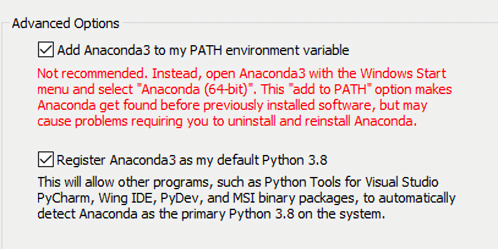
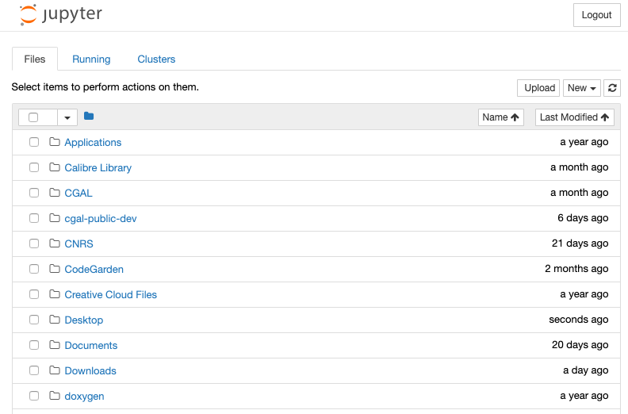

Jupyter Notebook là một trong những môi trường làm việc phổ biến cho các tác vụ xử lý dữ liệu. Jupyter hỗ trợ nhiều ngôn ngữ, trong đó có Python 3. Chúng tôi khuyến khích các bạn cài đặt Jupyter và Python 3 thông qua [Anaconda](https://www.anaconda.com/distribution/). Phần mềm này giúp cài đặt hầu hết các thư viện Python cần thiết để các bạn có thể sẵn sàng lập trình cho project của mình.

Lưu ý: Trong quá trình cài đặt Anaconda trên Windows, các bạn có thể tick vào ô trống đầu tiên đi kèm dòng chữ đỏ (xem hình).



<!--more-->

Sau khi cài đặt xong Anaconda, các bạn vào Command Prompt (Windows) hoặc Terminal (Mac/Linux) rồi gõ lệnh:

```bash
$ jupyter notebook
```

và đợi trong vài giây. Sau đó trên màn hình sẽ hiện ra một dãy thông báo giống như sau:

```bash
[I 23:20:17.054 NotebookApp] 0 active kernels
[I 23:20:17.054 NotebookApp] The Jupyter Notebook is running at: http://localhost:8888/?token=9ce44595fekjneio43ccbf41i8k32jk385d5c6bcf29e06c4
[I 23:20:17.055 NotebookApp] Use Control-C to stop this server and shut down all kernels (twice to skip confirmation).
[C 23:20:17.056 NotebookApp]

    Copy/paste this URL into your browser when you connect for the first time,
    to login with a token:
        http://localhost:8888/?token=9ce44595fekjneio43ccbf41i8k32jk385d5c6bcf29e06c4
```



Bạn copy đường dẫn trên và dán vào một cửa sổ trình duyệt rồi enter, giao diện làm việc sẽ hiện lên.

Sau đó bạn bấm vào nút New ở góc phải trên và chọn Python 3, trình duyệt sẽ mở một tab làm việc mới cho bạn.

Python là ngôn ngữ lập trình _thông dịch_, tức là gõ câu lệnh nào xong thì chương trình sẽ thực thi câu lệnh đó ngay (trái với các ngôn ngữ _biên dịch_ như C, C++, Java, vốn cần phải có cấu trúc tệp tin cụ thể mới chạy được). Sau khi chạy xong một lệnh, nó cho phép các bạn gõ một lệnh mới để tiếp tục công việc của mình.

Jupyter cho phép các bạn chạy một lúc nhiều câu lệnh, còn được gọi là một khối (cell), rồi nó in kết quả ngay bên dưới cell đó. Có hai loại cell thường được sử dụng là:

- Code Cell: chứa các câu lệnh Python để thực thi
- Markdown Cell: chứa các thông tin bổ trợ, giải thích cho các đoạn code

## Markdown

Markdown là một trong những cách đơn giản để trình bày văn bản với các format đơn giản như: in đậm, in nghiêng, tạo danh sách, tạo heading, v.v.

````md
### Ví dụ sử dụng Markdown

Xuống dòng cách đoạn bằng một dòng trống (tức là phải xuống dòng hai lần trong code Markdown thì văn bản mới xuống dòng một lần).

Nếu chỉ xuống dòng một lần trong Markdown thì vẫn được tính là một dòng trong văn bản hiển thị.
Các bạn cũng có thể xuống dòng nhưng không tách đoạn bằng tag br<br> trong HTML.

Tạo danh sách không thứ tự (unordered list) bằng cách thêm dấu trừ hoặc dấu cộng ở đầu mỗi dòng. Các cách format văn bản thường thấy bao gồm:
- Chữ _in nghiêng_ được bỏ trong hai dấu gạch dưới (underscore).
+ Chữ **in đậm** được bỏ trong bốn dấu sao (asterisk).
+ Chữ ~~bị gạch bỏ~~ được kẹp giữa bốn dấu ngã (tilde).
- Chữ **_vừa in nghiêng vừa in đậm_**  được kẹp giữa các dấu sao và dấu gạch dưới.

Đối với danh sách có thứ tự (ordered list), các bạn để ở đầu dòng một con số và một dấu chấm (ví dụ: 1., 2.). Không quan trọng số đó là bao nhiêu, Markdown sẽ tự đánh số lại hết. Các bạn cũng có thể làm cho các danh sách lồng ghép vào nhau như sau:

1. Item
  1. Subitem
  2. Subitem
7. Item
  - Subitem
  - Subitem
    - Subsubitem
    - Subsubitem
    
Các công thức toán học có thể trình bày ở chế độ inline (không xuống dòng), ví dụ $E=mc^2$, hoặc ở chế độ display (tách dòng), ví dụ $$i\hbar {\frac {\partial }{\partial t}}|\psi (t)\rangle ={\hat {H}}|\psi (t)\rangle$$.
Tương tự, trong Markdown nếu bạn có nhu cầu trích dẫn một đoạn code ngắn, cũng có chế độ inline, ví dụ `inline_code`, và chế độ block code, ví dụ:

``` 
This is
a block of code
```

````

Kết quả hiển thị của đoạn code Markdown trên như sau:

### Ví dụ sử dụng Markdown

Xuống dòng cách đoạn bằng một dòng trống (tức là phải xuống dòng hai lần trong code Markdown thì văn bản mới xuống dòng một lần).

Nếu chỉ xuống dòng một lần trong Markdown thì vẫn được tính là một dòng trong văn bản hiển thị.
Các bạn cũng có thể xuống dòng nhưng không tách đoạn bằng tag br<br> trong HTML.

Tạo danh sách không thứ tự (unordered list) bằng cách thêm dấu trừ hoặc dấu cộng ở đầu mỗi dòng. Các cách format văn bản thường thấy bao gồm:
- Chữ _in nghiêng_ được bỏ trong hai dấu gạch dưới (underscore).
+ Chữ **in đậm** được bỏ trong bốn dấu sao (asterisk).
+ Chữ ~~bị gạch bỏ~~ được kẹp giữa bốn dấu ngã (tilde).
- Chữ **_vừa in nghiêng vừa in đậm_**  được kẹp giữa các dấu sao và dấu gạch dưới.

Đối với danh sách có thứ tự (ordered list), các bạn để ở đầu dòng một con số và một dấu chấm (ví dụ: 1., 2.). Không quan trọng số đó là bao nhiêu, Markdown sẽ tự đánh số lại hết. Các bạn cũng có thể làm cho các danh sách lồng ghép vào nhau như sau:

1. Item
    1. Subitem
    2. Subitem
7. Item
    - Subitem
    - Subitem
        - Subsubitem
        - Subsubitem
    
Các công thức toán học có thể trình bày ở chế độ inline (không xuống dòng), ví dụ $E=mc^2$, hoặc ở chế độ display (tách dòng), ví dụ

$$i\hbar {\frac {\partial }{\partial t}}|\psi (t)\rangle ={\hat {H}}|\psi (t)\rangle.$$

Tương tự, trong Markdown nếu bạn có nhu cầu trích dẫn một đoạn code ngắn, cũng có chế độ inline, ví dụ `inline_code`, và chế độ block code, ví dụ:

```
This is
a block of code
```

## Các thao tác trong Jupyter

Mỗi cell trong Jupyter có hai trạng thái: Command Mode và Edit Mode. Edit mode được bật lên khi chúng ta chỉnh sửa nội dung của cell. Command mode được bật lên khi chúng ta nhấn "Esc". Từ Command mode muốn sang Edit mode có thể nhấn "Enter".

Một số thao tác cơ bản trong Command mode:

- Thêm một cell phía trên: `A` (above)
- Thêm một cell phía dưới: `B` (below)
- Chuyển cell sang Markdown: `M` (Markdown)
- Chuyển cell sang Python: `Y`
- Chọn cell: `Shift` + phím mũi tên
- Copy các cell đã chọn: `C` (copy)
- Dán các cell đã chọn phía dưới cell hiện tại: `V`
- Chạy cell: `Ctrl` + `Enter`

Trong Edit mode, các phím tắt cũng có sẵn như khi soạn thảo văn bản.

## Python

Bạn có thể tải xuống file Jupyter (.ipynb) dưới đây:

<a href="/blog/introduction-to-jupyter-and-python/introduction.ipynb" download>Download</a>

## Giới thiệu ngôn ngữ Python
- Python là ngôn ngữ lập trình bậc cao, ra mắt lần đầu vào năm 1991
- Python là ngôn ngữ lập trình đơn giản, cú pháp (syntax) đơn giản,
dễ đọc, rất gần với ngôn ngữ tự nhiên
- Hỗ trợ lập trình hướng cấu trúc, lập trình hướng cấu trúc và lập
trình hàm (yếu)

Đầu tiên, hãy đảm bảo rằng chúng ta sử dụng phiên bản Python 3. Không nên sử dụng Python 2 vì nó đã bị khai tử.

### Các kiểu dữ liệu cơ bản

Python có nhiều kiểu dữ liệu khác nhau. Dưới đây là một số kiểu có sẵn trong Python. Khi các bạn làm việc với các thư viện khác, ta sẽ còn gặp thêm nhiều kiểu dữ liệu nữa.

#### Số nguyên

```python
x = 20
print(type(x))
```

```text
<class 'int'>
```

##### Thao tác với số nguyên
Các thao tác toán học như cộng, trừ, nhân, chia, chia lấy phần nguyên, chia lấy phần dư, tính lũy thừa đều được hỗ trợ trong python.

```python
x = 3
y = 5

print(x + y)
print(x - y)
print(x * y)
print(x / y)
print(x // y)
print(x % y) 
print(x ** y)
```

```text
8
-2
15
0.6
0
3
243
```

#### Số thực

```python
x = 17.0
print(type(x))
```

```text
<class 'float'>
```

##### Thao tác với số thực
Cũng giống như số nguyên. Các thao tác toán học như cộng, trừ, nhân, chia, chia lấy phần nguyên, chia lấy phần dư, tính lũy thừa đều được hỗ trợ trong python.

```python
# Floats
x = 4.0
y = 2.5

print(x + y)
print(x - y)
print(x * y)
print(x / y)
print(x // y)
print(x % y) 
print(x ** y)
```

```text
6.5
1.5
10.0
1.6
1.0
1.5
32.0
```

#### Logic
Python có hỗ trợ kiểu dữ liệu logic (True, False) và các phép tính logic:

```python
x = True
y = False
print(type(x))
print(x and y) # x and y
print(x or y) # x or y
print(not x)
```

```text
<class 'bool'>
False
True
False
```

#### Chuỗi
Chuỗi là cấu trúc lưu dữ liệu dạng văn bản (như tin nhắn chẳng hạn). Một chuỗi có thể được gói giữa hai ký tự nháy kép (`"string"`) hoặc nháy đơn (`'string'`). 

```python
x = "PiMA 2021"
print(type(x))
print(x)
y = 'PiMA 2021'
print(type(y))
print(y)
```

```text
<class 'str'>
PiMA 2021
<class 'str'>
PiMA 2021
```

##### Thao tác với chuỗi
Ta có thể nối chuỗi bằng phép cộng, hoặc nhân bản chuỗi bằng phép nhân.

```python
x = "PiMA"
y = "2021"
print(x + y)
print(x + " " + y)
print(x * 3)
```

```text
PiMA2021
PiMA 2021
PiMAPiMAPiMA
```

Lấy độ dài chuỗi: `len()`

```python
x = "PiMA"
print(len(x))
```

```text
4
```

#### Ép kiểu

Để "ép" một biến `var` từ kiểu `type1` sang một kiểu dữ liệu khác `type2` có thể làm cú pháp như sau: `type2(var)`

```python
y = int(17.3)
print(y, type(y))

y = int(-17.3)
print(y, type(y))

y = float(3)
print(y, type(y))
```

```text
17 <class 'int'>
-17 <class 'int'>
3.0 <class 'float'>
```

### Câu lệnh rẻ nhánh (if)
Câu lệnh `if` dùng để kiểu khiển chương trình dựa trên một điều kiện cho trước. Ví dụ:

```python
x = 2
y = 3
if x < y:
    print("x nho hon y")
```

```text
x nho hon y
```

Ngoài phép so sánh `<`, ta còn có một số phép thông dụng sau:
- `x > y`: x lớn hơn y
- `x == y`: x bằng y (lưu ý là `==` thay vì `=`) 
- `x >= y`: x lớn hơn hoặc bằng y
- `x <= y`: x nhỏ hơn hoặc bằng y
- `x != y`: x khác y

Do python sử dụng thụt lề để phân tách các khối lệnh, nên sau if ta phải thụt lề vào trong:

```python
x = 2
y = 3
# lỗi 
if x < y:
print("x nho hon y")
```

```text
  File "<ipython-input-12-1de1f4307c19>", line 5
    print("x nho hon y")
        ^
IndentationError: expected an indented block
```

Đôi khi ta muốn xử lý trường hợp ngoại lệ (khi mà điều kiện if không đúng), ta có thể dùng thêm `else`:

```python
x = 5
y = 3
if x < y:
    print("x nho hon y")
else:
    print("x khong nho hon y")
```

```text
x khong nho hon y
```

Ta có thể tiếp tục if sau else:

```python
x = 5
y = 3
if x < y:
    print("x nho hon y")
else:
    if x > y:
        print("x lon hon y")
    else:
        print("x bang y")
```

```text
x lon hon y
```

```python
# rút ngắn bằng elif
x = 3
y = 3
if x < y:
    print("x nho hon y")
elif x > y:
    print("x lon hon y")
else:
    print("x bang y")
```

```text
x bang y
```

Ta cũng có thể kết hợp nhiều điều kiện bằng các phép logic như `and`, `or`, `not`.

```python
x = 3
y = 4
z = 5
if x < y and x < z:
    print("x nho hon y va z")

if not x > y:
    print("x khong lon hon y")
```

```text
x nho hon y va z
x khong lon hon y
```

### Vòng lặp

#### `for`
Câu lệnh lặp `for` cơ bản có cú pháp:

`for <tên biến> in range(begin, end, step)`.

Với `range(begin, end, step)` sẽ bắt đầu tại vị trí `begin`, kết thúc **trước** vị trí `end`, với bước nhảy là `step`.

```python
# In các số từ 5 tới 9
for i in range(5, 10, 1):
    print(i)
print()
# step mặc định là 1
for i in range(5, 10):
    print(i)
```

```text
5
6
7
8
9

5
6
7
8
9
```

```python
# In các số chẵn nhỏ hơn 10
for i in range(0, 10, 2):
    print(i)
```

```text
0
2
4
6
8
```

Ta cũng có thể kết hợp với lệnh `if`:

```python
# In các số chẵn nhỏ hơn 10
for i in range(0, 10):
    if i % 2 == 0:
        print(i)
print()
# begin mặc định là 0
for i in range(10):
    if i % 2 == 0:
        print(i)
```

```text
0
2
4
6
8

0
2
4
6
8
```

#### `while`
Câu lệnh `while` có cú pháp `while <conditions>: <statements>`. Trong đó `conditions` có thể là một hoặc nhiều điều kiện ghép nhau bằng `and`, `or`, `not`. Ví dụ sau liệt kê các số chính phương nhỏ hơn 10.

```python
i = 1
while (i**2 < 10):
    print(i**2)
    i += 1
```

```text
1
4
9
```

### Các kiểu dữ liệu container (có thể chứa các dữ liệu khác)

#### Tuple
Trong Python, khi nhóm các giá trị lại với nhau thành cụm sẽ gọi là `tuple`. Ví dụ như mỗi điểm trong không gian Oxyz được biểu diễn bằng ba giá trị $(x; y; z)$ có thể được biểu diễn dạng tuple.

```python
point = (1, 2, 3)
print(type(point))
print(point)
```

```text
<class 'tuple'>
(1, 2, 3)
```

###### Thao tác trên tuple
- Lấy độ dài tuple `len()`

```python
point = (1, 2, 3)
print(len(point))
```

```text
3
```

- Lấy giá trị của tuple

```python
point = (1, 2, 3)
x, y, z = point # Lấy ra giá trị từ tuple
print(x, y, z)
```

```text
1 2 3
```

- Truy cập phần tử

Các phần tử trong tuple có thể được gọi dựa vào chỉ số (index) hay còn gọi là thứ tự của nó trong tuple. Trong một tuple, phần tử đầu tiên có chỉ số là 0.

```python
point = (1, 2, 3)
print(point[0])
print(point[2])
```

```text
1
3
```

Một tuple còn có thể được truy cập thông qua một chỉ số âm. Đối với chỉ số âm, phần tử cuối cùng trong tuple được đánh số -1, phần tử liền trước có chỉ số nhỏ hơn 1 đơn vị so với phần tử liền sau. Xem ví dụ:

```python
x = (1, 2, 3)
print(x)
print(x[-1])
print(x[-2])
```

```text
(1, 2, 3)
3
2
```

Lưu ý: khi truy cập phần tử nằm ngoài tuple sẽ gây ra lỗi

```python
x = (1, 2, 3)
print(x[5])
print(x[-5])
```

```text
---------------------------------------------------------------------------
IndexError                                Traceback (most recent call last)
<ipython-input-28-1ff000fe8882> in <module>()
      1 x = (1, 2, 3)
----> 2 print(x[5])
      3 print(x[-5])

IndexError: tuple index out of range
```

#### Danh sách

Trong python, ta có thể dùng danh sách để chứa nhiều phần tử trong 1 biến.

```python
x = [1, 2, 3, 4]
print(type(x))
```

```text
<class 'list'>
```

Một danh sách có thể bao gồm danh sách khác (nested list), các phần tử của một danh sách có thể thuộc nhiều lớp dữ liệu khác nhau.

```python
x = [[1, 2], [3, 4]] # Ma trận 2x2
x = [[1.0, 2], "xyz", [5, 6]]
print(type(x))
```

```text
<class 'list'>
```

##### Thao tác trên danh sách

Các thao tác cơ bản cho danh sách bao gồm:

- Lấy độ dài danh sách (`len`)

```python
x = ['P', 'i', 'M', 'A']
print(len(x))
```

```text
4
```

- Thêm phần tử vào cuối list (`append`)

```python
x = ['P', 'i', 'M', 'A']
print(x)
x.append(2021)
print(x)
```

```text
['P', 'i', 'M', 'A']
['P', 'i', 'M', 'A', 2021]
```

- Truy cập phần tử

Tương tự như tuple, ta có thể truy cập phần tử dựa vào chỉ số

```python
x = ['P', 'i', 'M', 'A']
print(x[0])
print(x[-1])
print(x[-2])
```

```text
P
A
M
```

- Chèn phần tử vào một vị trí bất kỳ trong list (`insert`)

```python
x = ['P', 'i', 'M', 'A']
x.insert(1, 123)
print(x)
```

```text
['P', 123, 'i', 'M', 'A']
```

- Xóa phần tử ở một vị trí bất kỳ (`pop`)

```python
x = ['P', 'i', 'M', 'A']
x.pop(1)
print(x)
```

```text
['P', 'M', 'A']
```

- Xóa phần tử đầu tiên mang giá trị cho trước (`remove`).

```python
x = ['P', 'i', 'M', 'A', 'i']
x.remove('i')
print(x)
```

```text
['P', 'M', 'A', 'i']
```

Lưu ý: xóa phần tử không nằm trong danh sách sẽ gây ra lỗi

```python
x = ['P', 'i', 'M', 'A']
x.remove(123) # lỗi
```

```text
---------------------------------------------------------------------------
ValueError                                Traceback (most recent call last)
<ipython-input-38-60f835cebd7b> in <module>()
      1 x = ['P', 'i', 'M', 'A']
----> 2 x.remove(123) # lỗi

ValueError: list.remove(x): x not in list
```

- Sắp xếp theo thứ tự tăng dần (`sort`)

```python
x = [5, 1, 3, 2, 8]
x.sort()
print(x)
```

```text
[1, 2, 3, 5, 8]
```

- Duyệt danh sách

Đôi khi ta muốn duyệt qua hết các phần tử của danh sách. Ta có thể dùng câu lệnh `for` với cấu trúc: `for <biến> in <danh_sách>: <khối lệnh>`

```python
x = ['P', 'i', 'M', 'A']
for ele in x:
    print(ele)
```

```text
P
i
M
A
```

Tuy nhiên, đôi khi ta cần chỉ số của phần tử thay vì chính nó. Dưới đây là một số cách để lấy chỉ số của phần tử:
- Dùng hàm len kết hợp với range

```python
x = ['P', 'i', 'M', 'A']
for i in range(len(x)):
    print(i, "->", x[i])
```

```text
0 -> P
1 -> i
2 -> M
3 -> A
```

- Dùng hàm `enumerate`. Hàm `enumerate(x)` sẽ trả về một danh sách các tuple, mỗi tuple gồm 2 thành phần là `(i, x[i])`

```python
x = ['P', 'i', 'M', 'A']
for ele in enumerate(x):
    print(ele)
print()

for ele in enumerate(x):
    print(ele[0], "->", ele[1])
print()

# Do phần tử trong enumerate là tuple
# nên ta có thể lấy giá trị của tuple theo cách này
for idx, ele in enumerate(x):
    print(idx, "->", ele)
```

```text
(0, 'P')
(1, 'i')
(2, 'M')
(3, 'A')

0 -> P
1 -> i
2 -> M
3 -> A

0 -> P
1 -> i
2 -> M
3 -> A
```

- Cắt danh sách (slice) theo cú pháp `[begin : end : step]`.
    - `begin` mặc định là 0, `end` mặc định là độ dài của list, `step` mặc định là 1.
    - Nếu cho `begin` là số âm thì `end` mặc định là 0.
    - Nếu cho `end` là số âm thì `begin` mặc định là `-len(list)`.
    - Nếu cho `step` là số âm thì mặc định `begin = len(list)-1` và `end = 0`.
    - ...

Các bạn có thể thoải mái khám phá thử nghiệm về trò chơi cắt mảng này.

```python
x = [1, 2, 3, 4, 5, 6, 7, 8, 9, 10]
print(x[2:5])
print(x[:5])
print(x[5:])
print(x[::-1]) # đảo chiều danh sách
print(x[-3:])
print(x[:-4])
```

```text
[3, 4, 5]
[1, 2, 3, 4, 5]
[6, 7, 8, 9, 10]
[10, 9, 8, 7, 6, 5, 4, 3, 2, 1]
[8, 9, 10]
[1, 2, 3, 4, 5, 6]
```

##### Cách tạo nhanh `list`

Một `list` có thể được tạo nhanh thông qua dòng `for` (còn gọi là list comprehension). Chẳng hạn tạo một danh sách các số tự nhiên nhỏ hơn 10.

```python
a = [x for x in range(10)]
print(a)
```

```text
[0, 1, 2, 3, 4, 5, 6, 7, 8, 9]
```

Tạo danh sách gồm bình phương của các số tự nhiên trong khoảng `[4; 8]`:

```python
# list comprehension
a = [x * x for x in range(4, 9)]
print(a)
```

```text
[16, 25, 36, 49, 64]
```

Ta cũng có thể tạo một danh sách mà chỉ gồm các phần tử thỏa mãn một tính chất nào đó. Ví dụ ta có thể lọc ra các số chẵn nằm trong 1 danh sách:

```python
a = [2, 1, 3, 5, 6, 8, 10, 9]

b = [x for x in a if x % 2 == 0]

print(b)
```

```text
[2, 6, 8, 10]
```

#### Từ điển
Từ điển (dictionary) dùng để lưu dữ liệu dưới dạng "key-value" (khóa và giá trị). Quan hệ key-value giống với ánh xạ trong toán học.

```python
x = {"P": "Project",
     "i": "in",
     "M": "Mathematics",
     "A": "Applications"}
print(type(x))
print(x)
```

```text
<class 'dict'>
{'P': 'Project', 'i': 'in', 'M': 'Mathematics', 'A': 'Applications'}
```

##### Thao tác trên từ điển

- Truy cập phần tử

Khi gọi một phần tử trong danh sách ta dùng chỉ số của phần tử (e.g. `x[5]`). Tương tự trong từ điển, để tìm một giá trị (value) ta dùng khóa (key).

```python
x = {"P": "Project",
     "i": "in",
     "M": "Mathematics",
     "A": "Applications"}
print("M stands for", x["M"])
```

```text
M stands for Mathematics
```

Để thêm một "định nghĩa" mới (một bộ key-value mới) ta có thể thoải mái "gán" (assign) mà không cần qua thao tác nào.

```python
x = {"P": "Project",
     "i": "in",
     "M": "Mathematics",
     "A": "Applications"}

# Nếu chưa có thì nó sẽ tạo
x["2016"] = "First PiMA camp"
print(x)
```

```text
{'P': 'Project', 'i': 'in', 'M': 'Mathematics', 'A': 'Applications', '2016': 'First PiMA camp'}
```

Ta có thể gán thoải mái những phần tử chưa tồn tại, tuy nhiên nếu truy cập phần tử chưa tồn tại thì sẽ gây lỗi:

```python
x = {"P": "Project",
     "i": "in",
     "M": "Mathematics",
     "A": "Applications"}
# Ta có thể gán phần tử chưa tồn tại, nhưng nếu truy cập nó thì sẽ gây ra lỗi
print(x[123])
```

```text
---------------------------------------------------------------------------
KeyError                                  Traceback (most recent call last)
<ipython-input-51-c02173fd31c4> in <module>()
      4      "A": "Applications"}
      5 # Ta có thể gán phần tử chưa tồn tại, nhưng nếu truy cập nó thì sẽ gây ra lỗi
----> 6 print(x[123])

KeyError: 123
```

- Duyệt từ điển:
Để duyệt các phần tử trong từ điển `x`, ta có thể dùng hàm `x.items()`. Hàm này sẽ trả về danh sách các phần tử trong từ điển dưới dạng tuple 2 phần tử.

```python
x = {"P": "Project",
     "i": "in",
     "M": "Mathematics",
     "A": "Applications"}
print(x.items())

for key, value in x.items():
    print(key, "stands for", value)
```

```text
dict_items([('P', 'Project'), ('i', 'in'), ('M', 'Mathematics'), ('A', 'Applications')])
P stands for Project
i stands for in
M stands for Mathematics
A stands for Applications
```

- Xóa key: `pop(key)`

```python
x = {"P": "Project",
     "i": "in",
     "M": "Mathematics",
     "A": "Applications"}

x.pop("P")
print(x)
```

```text
{'i': 'in', 'M': 'Mathematics', 'A': 'Applications'}
```

#### Tập hợp

Tập hợp (set) dùng để lưu trữ các phần tử khác nhau và không có tính thứ tự.

```python
x = {"P", "i", "M", "A"}
print(type(x))
print(x)
```

```text
<class 'set'>
{'M', 'A', 'i', 'P'}
```

##### Thao tác trên tập hợp
- Duyệt phần tử

```python
x = {"P", "i", "M", "A", "A"}
for ele in x:
    print(ele)
```

```text
M
A
i
P
```

- Thêm phần tử `add()`:

```python
x = {"P", "i", "M", "A"}
x.add("B")
print(x)
```

```text
{'B', 'i', 'M', 'A', 'P'}
```

- Xóa phần tử `remove()`

```python
x = {"P", "i", "M", "A"}
x.remove("A")
print(x)
```

```text
{'M', 'i', 'P'}
```

```python
x = {"P", "i", "M", "A"}
x.remove("B")
print(x)
```

```text
---------------------------------------------------------------------------
KeyError                                  Traceback (most recent call last)
<ipython-input-60-552cfcac22a8> in <module>()
      1 x = {"P", "i", "M", "A"}
----> 2 x.remove("B")
      3 print(x)

KeyError: 'B'
```

So sánh danh sách, tuple, tập hợp, từ điển.

| Danh sách                                      | Tuple                                               | Tập hợp                           | Từ điển                                                        |
|------------------------------------------------|-----------------------------------------------------|-----------------------------------|----------------------------------------------------------------|
| Cho phép phần tử trùng nhau                    | Cho phép phần tử trùng nhau                         | Không cho phép phần tử trùng nhau | Các key không được trùng nhau                                  |
| [1, 2, 3, 4, 5]                                | (1, 2, 3, 4, 5)                                     | {1, 2, 3, 4, 5}                   | {1: "a", 2: "b", 3: "c"}                                       |
| Mutable: Có thể thay đổi (thêm, xóa, sửa, ...) | Immutable: không thể thay đổi tuple khi đã khai báo | Mutable                           | Mutable                                                        |
| Có tính thứ tự                                 | Có tính thứ tự                                      | Không có tính thứ tự              | Có tính thứ tự* (Python 3.6 trở về trước không có tính thứ tự) |

### Hàm (function)
Để khai báo một hàm, dùng cú pháp:

```python
def f(param1, param2=2):
    return param1 + param2 * 0.5
```

Hàm `f` trên lấy hai tham số, trong đó tham số thứ hai (`param2`) có giá trị mặc định là 0. Lưu ý rằng các tham số có giá trị mặc định phải chuyển ra sau cùng trong danh sách tham số.

Các cách sử dụng hàm sau đây là hợp lệ:

```python
print(f(1,2))
print(f(1))
print(f(param2 = 3, param1 = 2))
```

```text
2.0
2.0
3.5
```

Như vậy khi gọi hàm, nếu không ghi rõ tên tham số truyền vào (cách 1, 2) thì các giá trị gán lần lượt cho các tham số theo thứ tự khi khai báo hàm. Nếu có ghi rõ (cách 3) thì không bắt buộc vị trí khai báo.

### Các thao tác nâng cao với chuỗi

- Chuỗi cũng có thao tác slice giống như danh sách:

```python
x = "PiMA 2021"
print(x[::-1])
print(x[:4])
print(x[5:])
```

```text
1202 AMiP
PiMA
2021
```

- Thay thế một chuỗi con

```python
x = "PiMA 2xxx"
x.replace("xxx", "021")
print(x)
print(x.replace("x", "021"))
x = x.replace("xxx", "021")
print(x)
```

```text
PiMA 2xxx
PiMA 2021021021
PiMA 2021
```

- Chuyển chuỗi qua chữ hoa, chữ thường

```python
x = "pImA"
print(x.upper())
print(x.lower())
```

```text
PIMA
pima
```

- Loại bỏ các dấu cách, xuống dòng ở đầu và cuối chuổi:

```python
x = "                abc               "
print(x.strip().replace(' ', '_'))
# Tương tự ta cũng có lstrip và rstrip
print(x.lstrip().replace(' ', '_'))
print(x.rstrip().replace(' ', '_'))
```

```text
abc
abc_______________
________________abc
```

- Format chuỗi

```python
year = 2021
x = f"PiMA {year}"
print(x)
```

```text
PiMA 2021
```

```python
x = {"P": "Project",
     "i": "in",
     "M": "Mathematics",
     "A": "Applications"}
for key, value in x.items():
    print(f"{key} stands for {value}")
```

```text
P stands for Project
i stands for in
M stands for Mathematics
A stands for Applications
```

- Nối chuỗi: Nối chuỗi dùng để nối một danh sách các chuỗi

```python
x = ["P", "i", "M", "A"]
y = ' '.join(x) # tạo chuỗi từ danh sách x và chèn khoảng trắng ở giữa
print(y)

x = ["P", "i", "M", "A"]
y = ''.join(x)
print(y)

x = ["P", "i", "M", "A"]
y = '---'.join(x)
print(y)

x = ["P", "i", "M", "A"]
y = '\n'.join(x) # tạo chuỗi từ danh sách x và chèn xuống dòng ở giữa
print(y)
```

```text
P i M A
PiMA
P---i---M---A
P
i
M
A
```

- Tách chuỗi: Tách chuỗi thành danh sách các chuỗi dựa vào ký tự cho trước

```python
x = "PIMA 2021"
print(x.split(' '))
```

```text
['PIMA', '2021']
```

```python
x = "PIMA 2021"
print('_'.join(x.split(' ')))
```

```text
PIMA_2021
```

### Đọc và viết dữ liệu

#### Standard I/O

```python
var = input("Give me a value: ")
print(type(var))
print(var)
```

```text
Give me a value: 10
<class 'str'>
10
```

```python
var = int(input("Give me an integer: "))
print(type(var))
print(var)
```

```text
Give me an integer: 10
<class 'int'>
10
```

Hàm `input` chỉ có thể đọc trong một dòng mà thôi. Tức là nếu gặp ký tự `'\n'` thì hàm sẽ dừng và trả kết quả cho biến dạng chuỗi.

#### File I/O

```python
with open("file_io.dat", "w") as f:
    f.write("Hello")
    f.write("!\n")
    f.write(f"This is PiMA {2021}")
```

Hàm `write` chỉ nhận tham số dạng chuỗi. Để viết các kiểu dữ liệu khác, xem lại phần format chuỗi.

```python
with open("file_io.dat", "r") as f:
    print(f.read())
```

```text
Hello!
This is PiMA 2021
```

```python
x = "Name,NickName\nThuc,Ca Noc\nThe Anh,Nah"
print(x)
open("file_csv.csv", "w").write(x)
```

```text
Name,NickName
Thuc,Ca Noc
The Anh,Nah
```

```text
37
```

Dưới đây là mẫu đọc một file csv với các hàm xử lý xâu

```python
with open("file_csv.csv", "r") as f:
    lines = f.read().split('\n') # Đọc toàn bộ file f và tách thành từng dòng
    headers = lines[0].split(',') # Dòng đầu tiên là header của cột
    print(headers)

    for line in lines[1:]: # Dùng slide để duyệt qua các dòng còn lại
        name, nickname = line.split(',') # Cắt chuỗi dựa vào dấu ,
        print(f"Name: {name}\nNickname: {nickname}")
```

```text
['Name', 'NickName']
Name: Thuc
Nickname: Ca Noc
Name: The Anh
Nickname: Nah
```

### Bài tập 1
Bài tập này nhằm làm quen với viết hàm và thao tác với chuỗi

 #### 1.1: Viết hàm trả về danh sách các phần tử ở vị trí lẻ của một dach sách

```python
def extract_odd_positions(x):
    # Sửa code này
    result = x
    return result

print(extract_odd_positions([1, 2, 3, 4])) # [2, 4]
print(extract_odd_positions(["a", "b", "c", "d", "e"])) # ["b", "d"]
```

```text
[1, 2, 3, 4]
['a', 'b', 'c', 'd', 'e']
```

#### 1.2 Viết hàm viết hoa tên
Cho một chuỗi có tên của một người (không có dấu cách). Hãy viết hoa ký tự đầu và viết thường các ký tự còn lại.

```python
def uppercase_name(x):
    # Sửa code này
    result = x
    return result

print(uppercase_name("pima")) # Pima
print(uppercase_name("pIMA")) # Pima
```

```text
pima
pIMA
```

#### 1.3 Viết hàm viết hoa tên đầy đủ
Cho một chuỗi có tên của một người. Hãy viết hoa tên người đó theo đúng định dạng

```python
# Gợi ý: kết hợp hàm uppercase_name ở trên, hàm split và join
def uppercase_fullname(x):
    # Sửa code này
    result = x
    return result

print(uppercase_fullname("nguyeN van a")) # Nguyen Van A
print(uppercase_fullname("projects in mathematics and aplications"))
```

```text
nguyeN van a
projects in mathematics and aplications
```

#### 1.4:

Cho hai vector $x = (x_1, x_2)$ và $y = (y_1, y_2)$

1. Tìm tích vô hướng của x và y: $x \cdot y = x_1 y_1 + x_2 y_2$
2. Tìm độ dài của vector x
3. Tìm cos giữa x và y: $x \cdot y = ||x||\ ||y||\cos \theta$

Hình chiếu của x lên y, ký hiệu $\vec{x}^{*} = \text{proj}_{\vec{y}}(\vec{x})$. Biết:

$$\vec{x}^{*} = \frac{\vec{x} \cdot \vec{y}}{||y||^2}\vec{y}$$

4. Tìm hình chiếu của x lên y

```python
import math
# Hàm lấy căn bậc hai của x trong Python là: math.sqrt(x)
# dot product
def dot_product(x, y):
    dot = None
    return dot

# length of a vector x
def length(x):
    l = None
    return l

# cos between two vectors
def cos2v(x, y):
    c = None
    return c

def proj(x, y):
    proj = None
    return proj
    
print(dot_product((1, 2), (3, 4))) # 11
print(length((1, 2)))              # 2.2360679775
print(cos2v((1, 2), (3, 4)))       # 0.9838699101
print(proj((1, 2), (3, 4)))        # (1.32, 1.76)
```

```text
None
None
None
None
```

### Bài tập 2:

2.1. Cho D là bảng phân phối xác suất. D là một dictionary như sau:

`D = {giá trị: xác suất ứng với giá trị đó}`

Tính xác suất kỳ vọng ứng với bảng phân phối xác suất.

**Nhắc lại:**
Cách để truy cập mọi từ khóa, giá trị ứng với từ khóa trong từ điển là:
```python
for key, value in x.items():
    print(key, value)
```

**OPTIONAL**
2.2. Cho hai ma trận A và B. 

    a) Kiểm tra nếu hai ma trận A và B cùng chiều
    
    b) Tính $A + B$, $A - B$

    c) Kiểm tra nếu có thể nhân ma trận A và B với nhau
    
    d) Tính $A \times B$

```python
def expected_value(D):        
    exp_value = 0
    return exp_value

D = {20: 0.2, 28: 0.2, 32: 0.4, 35: 0.2} # (ví dụ 3.10, tài liệu xác suất thống kê)
print(expected_value(D)) # 29.4
```

```text
0
```

```python
# kiểm tra A có thể nhân được với B hay không
def check_dim(A, B):
    if_dim = False
    return if_dim

def add(A, B):
    s = None
    return s

def sub(A, B):
    s = None
    return s

print(check_dim([[1, 2, 3], [4, 5, 6]], [[2, 3, 7], [4, 5, -3]])) # True
print(check_dim([[1, 2, 3], [4, 5, 6]], [[2], [4], [1]])) # True
print(add([[1, 2, 3], [4, 5, 6]], [[2, 3, 7], [4, 5, -3]])) 
print(add([[1, 2, 3], [4, 5, 6]], [[2], [4], [1]])) 
print(sub([[1, 2, 3], [4, 5, 6]], [[2, 3, 7], [4, 5, -3]])) 
print(sub([[1, 2, 3], [4, 5, 6]], [[2], [4], [1]]))

# kiểm tra A có thể nhân được với B hay không
def check_prod(A, B):
    if_prod = False
    return if_prod

def matrix_prod(A, B):
    prod = None
    return prod

print(check_prod([[1, 2, 3], [4, 5, 6]], [[2, 3], [4, 5]])) # False
print(check_prod([[1, 2, 3], [4, 5, 6]], [[2], [4], [1]])) # True
print(matrix_prod([[1, 2, 3], [4, 5, 6]], [[2, 3], [4, 5]])) 
print(matrix_prod([[1, 2, 3], [4, 5, 6]], [[2], [4], [1]])) 
```

```text
False
False
None
None
None
None
False
False
None
None
```

### `*` Lớp (`class`)

Class là chức năng quan trọng khiến Python trở thành ngôn ngữ lập trình hướng đối tượng. Mỗi biến trong Python dù lớn hay nhỏ (`int`) đều là một đối tượng (object). Trong một đối tượng chứa các thuộc tính (attribute) đóng vai trò như biến để cung cấp thêm thông tin về đối tượng đó, và các phương pháp (method) đóng vai trò như hàm để thực thi một loạt các lệnh xử lý.

Ví dụ khi mô hình hóa xe cứu thương vào lập trình, có thể biến nó thành một object với kiểu dữ liệu tên `Ambulance` được định nghĩa qua lớp cùng tên. Xe cứu thương có thể bao gồm các thông số như biển số xe (`string`) và vị trí hiện tại của xe (dựa theo mã tỉnh, `int`). Thao tác có thể đặt bên trong đối tượng này là "di chuyển đến" để hỗ trợ một xe cứu thương khác.

```python
class Ambulance:
    def __init__(self, plate, city):
        self.plate = plate
        self.city = city
    def assist(self, another_ambulance):
        self.city = another_ambulance.city
    def __str__(self):
        return "Ambulance {0} is in city {1}"\
                .format(self.plate, self.city)
```

Lưu ý rằng trong mỗi `class` thường có hàm `__init__` để khởi tạo một đối tượng. Trong ví dụ trên, hàm này có nhận tham số `plate` và gán vào `self.plate`. Có thể hình dung rằng `self.plate` là một biến `plate` là một thuộc tính (hay biến) thuộc lớp Ambulance, còn tham số `plate` được truyền vào hàm `__init__` là một biến độc lập chỉ có giá trị trong hàm này chứ không thuộc lớp `Ambulance`. Hàm `__str__` dùng để hướng dẫn cho câu lệnh `print` nên in ra thông tin gì khi người ta cố gắng in đối tượng này ra màn hình.

Mọi hàm trong class đều phải có tham số `self`. Khi gọi hàm thuộc class không truyền giá trị vào tham số này.

```python
amb1 = Ambulance("65-B1-2019", 32)
amb2 = Ambulance("50-B2-11124", 14)
print(amb1)
print(amb2)
amb2.assist(amb1)
print(amb2)
```

```text
Ambulance 65-B1-2019 is in city 32
Ambulance 50-B2-11124 is in city 14
Ambulance 50-B2-11124 is in city 32
```

## Tài liệu tham khảo:
https://www.w3schools.com/python/default.asp

