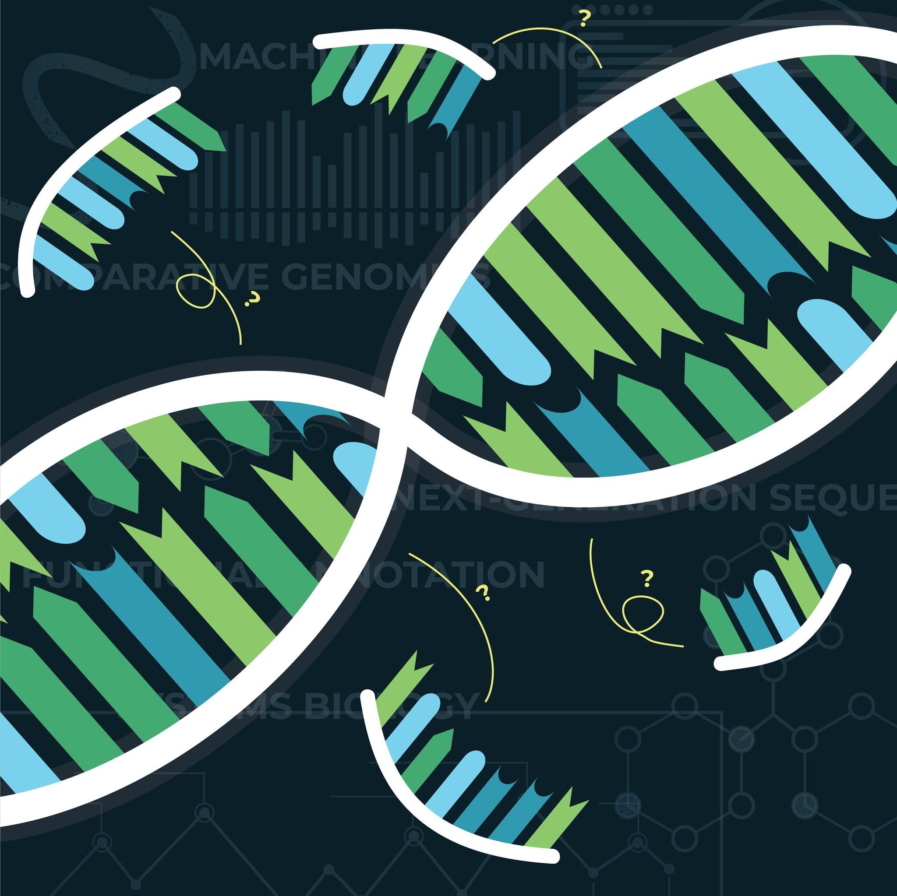
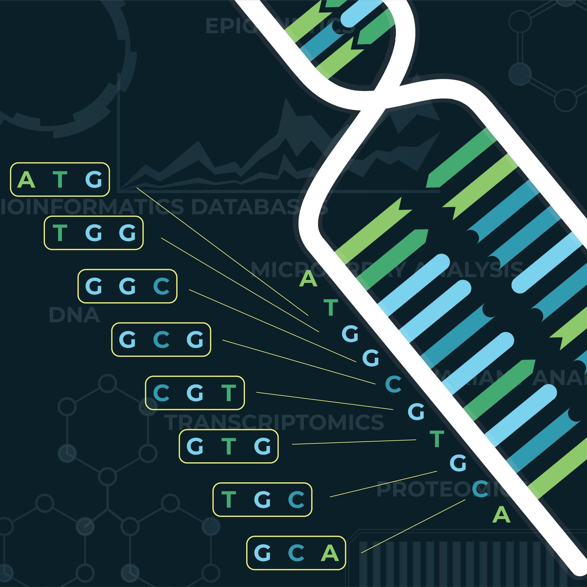
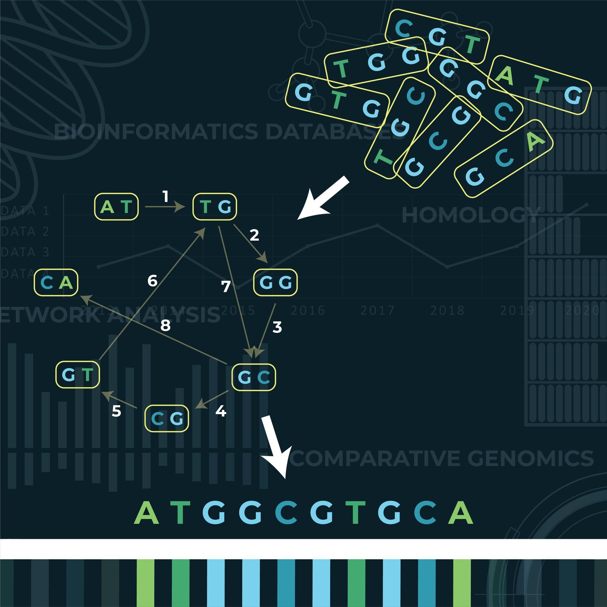

Gen hay DNA (axit deoxyribonucleic) là một hợp chất hữu cơ chứa thông tin di truyền và hướng dẫn tổng hợp protein của các sinh vật sống (trừ một số loại virus). DNA của các loài có tổ tiên chung sẽ có nhiều điểm giống nhau, đồng thời nó góp phần quy định các tính trạng của sinh vật. Do đó, đối với loài người có thể nói: “Your DNA makes you human”.

Kiến thức về trình tự DNA đã trở nên không thể thiếu đối với nghiên cứu sinh học cơ bản và trong nhiều lĩnh vực ứng dụng như chẩn đoán y tế, công nghệ sinh học, sinh học pháp y, virus học và hệ thống sinh học. Ví dụ: So sánh các trình tự DNA khỏe mạnh và đột biến có thể chẩn đoán các bệnh khác nhau bao gồm các bệnh ung thư, đặc trưng của các kháng thể và có thể được sử dụng để hướng dẫn điều trị cho bệnh nhân.

Dự án Bản đồ gen người (Human Genome Project) là một trong những kỳ tích khoa học vĩ đại nhất trong lịch sử, ra mắt vào tháng 10/1990 và hoàn thành vào tháng 4/2003. Thành tựu nổi bật của dự án là tạo ra trình tự đầu tiên của bộ gen người, cung cấp thông tin cơ bản về bản thiết kế con người, từ đó đã thúc đẩy nghiên cứu về sinh học con người và cải thiện việc thực hành y học.

Một trong những bước quan trọng cần thực hiện trong dự án chính là lắp ráp trình tự DNA (DNA sequencing assembly) - sắp xếp và hợp nhất các đoạn DNA ngắn thành đoạn DNA dài hơn để tái tạo lại trình tự nucleotit (A, T, C và G) của DNA ban đầu.

Do giới hạn công nghệ - thiết bị không thể đọc hết toàn bộ chuỗi DNA một lần, nên trong quá trình nghiên cứu phải phân chia chuỗi DNA dài thành các đoạn ngắn hơn và sau đó cần tái cấu trúc lại trình tự chuỗi ban đầu. Để đạt được sự lắp ráp trình tự DNA chính xác, cần phải đọc nhiều đoạn trình tự và sau đó liên kết chúng lại với nhau theo đúng thứ tự. Muốn tìm lại thứ tự của các đoạn, các đầu của mỗi đoạn sẽ có phần trùng (overlapping) với đoạn kế trước và sau nó.

Sau đây là một ví dụ của quá trình chia nhỏ DNA. Từ đoạn DNA ban đầu có trình tự một sợi là: ATGGCGTGCA, nhân bản thành nhiều sợi và chia thành các đoạn nhỏ có chiều dài là $k = 3$, ta thu được các đoạn: ATG, TGG, GGC, GCG, CGT, GTG, TGC, GCA. Mỗi đoạn nhỏ được gọi là một $k$-mer. Ở ví dụ đang xét, ta sẽ không biết thứ tự xuất hiện của 8 đoạn 3-mer này trong sợi ban đầu.

Vấn đề cần giải quyết là: Làm sao từ một tập hợp gồm các đoạn DNA ngắn như trên, tái cấu trúc lại được sợi gen ban đầu?

Một cách tiếp cận để giải quyết vấn đề này là xây dựng một đồ thị (gọi là đồ thị De Bruijn) bằng cách biểu diễn tiền tố và hậu tố có độ dài $k-1$ của mỗi đoạn DNA dưới dạng các đỉnh và sau đó vẽ các cạnh biểu thị $k$-mers có tiền tố và hậu tố cụ thể. Ví dụ, cạnh $k$-mer ATG có tiền tố AT và hậu tố TG. Việc tìm ra một đường đi Euler (Eulerian path) của đồ thị trên cho phép ta tái cấu trúc trình tự của sợi gen ban đầu. Nếu xuất hiện sự trùng lặp $k$-mers trên đoạn gen ban đầu (chẳng hạn: đoạn gen ATGCGTATG trùng lặp 3-mer “ATG”), bội số của cạnh biểu thị $k$-mer hướng từ đỉnh tiền tố đến hậu tố bằng số lần trùng lặp của $k$-mer đó, khi này đồ thị đang xét trở thành đa đồ thị (multigraphs).

Ta xây dựng đồ thị từ các đoạn nhỏ đã phân rã ở minh họa trước đó.

Đây là một đồ thị có hướng (directed graph), mỗi cạnh có hướng từ tiền tố đến hậu tố của một đoạn gen. Việc đi qua mỗi cạnh chính là đang lựa chọn đoạn gen tương ứng với cạnh đó để đưa vào trình tự sắp xếp của sợi gen dài đang tái cấu trúc. Chẳng hạn, nếu ta đi theo lộ trình: AT → TG → GC → CA thì trình tự gen đang có là ATGCA.

Trong toán học, đường đi Euler là đường đi qua mỗi cạnh của đồ thị đúng một lần. Sau khi tìm được đường đi Euler, ta có thể tái cấu trúc trình tự của sợi gen ban đầu bằng cách đi dọc theo đường đi đó trên đồ thị.

Một Euler Path của đồ thị xây dựng từ ví dụ minh họa được thể hiện ở hình trên, lộ trình lần lượt đi qua các đỉnh: AT, TG, GG, GC, CG, GT, TG, GC, CA, đảm bảo đi qua tất cả các cạnh của đồ thị đúng một lần. Từ đó, ta thu được trình tự sợi gen sau khi tái tạo là: ATGGCGTGCA, khớp với trình tự ban đầu của sợi gen trước khi phân thành các đoạn nhỏ.

Bài viết chỉ mới trình bày được một phần nhỏ của bức tranh và vẫn còn nhiều vấn đề cần giải quyết và cải tiến.
