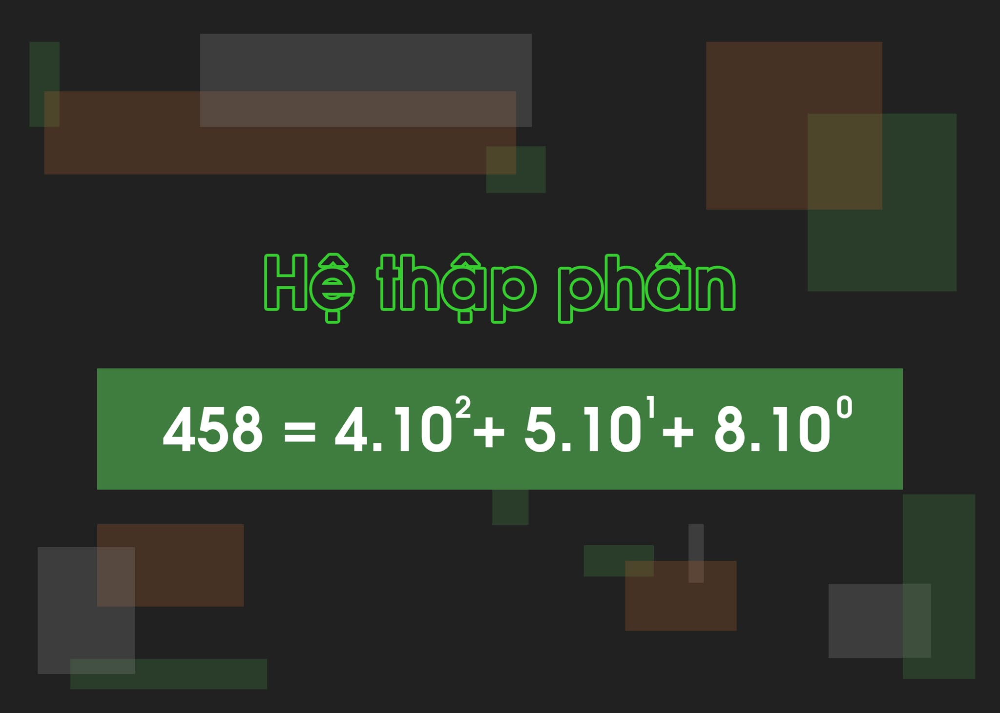
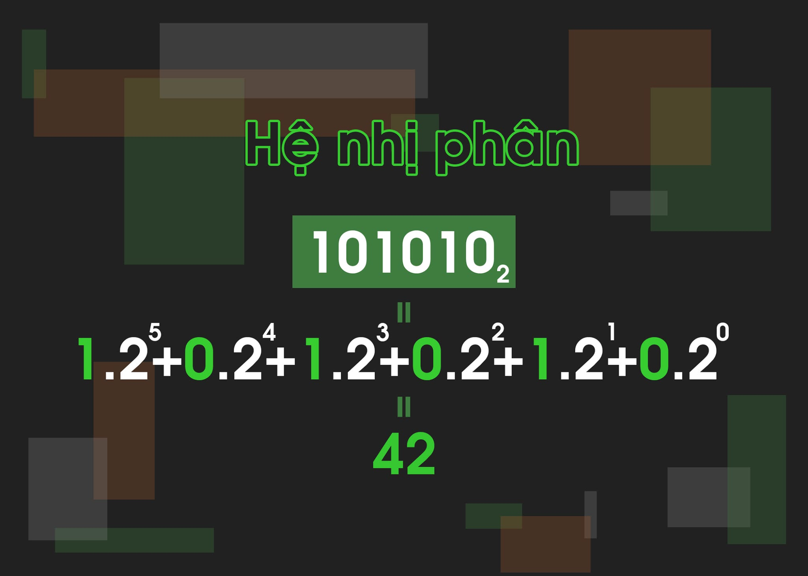

## Tại sao lại có những con số?

Những con số là những ký tự vô cùng quen thuộc với chúng ta trong đời sống hằng ngày. Nhưng có bao giờ chúng ta đặt câu hỏi rằng “Những con số ấy từ đâu mà có?”, “Liệu ngoài những số 1, 2, 3, 4,… hay I, II, III, IV,… còn có những chữ số nào đặc biệt hơn không nhỉ?” hay là “Để có thể có được hệ đếm ngày nay thì con người đã phải mất bao lâu để cải tiến những hệ đếm khác?”

Vì lẽ đó chúng ta hãy cùng nhau tìm hiểu kỹ hơn về lịch sử của những hệ đếm này nhé!

## Sơ lược về hệ đếm

Đầu tiên, lý do chúng ta tạo ra những con số là bởi vì nhu cầu lưu trữ số lượng. Trước đây chúng ta dùng mắt cho hầu hết những hoạt động nhưng khi dùng mắt để ghi nhớ số lượng thì quả thật là quá khó. Thế nên người ta đã tạo ra những ký hiệu và tên gọi cho những ký hiệu đó chính là những con số mà chúng ta biết đến ngày nay.

Người ta dùng nhiều vật dụng để lưu lại những con số. Theo sử gia về khoa học Georges Ifrah đã viết trong bộ sách Lịch sử tổng quát về chữ số ông cho rằng ngày xưa người ta đếm bằng thân thể có nghĩa là mỗi bộ phận của cơ thể được gán cho một con số.

Sau đó trải qua nhiều năm, nhiều thế kỷ, hệ đếm dần được con người tạo ra. Hệ đếm được định nghĩa là một hệ thống thể hiện các con số. Nhìn một con số, đọc một con số, viết một con số là nhiệm vụ của hệ đếm.

Hệ đếm có 2 chức năng chính:

- Chức năng đầu tiên của hệ đếm là dùng để thể hiện những chữ số.
- Chức năng thứ hai đó là dùng để tính toán.

Hệ đếm được phân ra các loại:

- Hệ đếm biểu hình chính là hệ đếm có một loại vật chất nhất định như sỏi, dây, đất sét… thể hiện cho những con số.
- Hệ đếm miệng là hệ đếm là các con số được gọi bằng một tên gọi.
- Hệ đếm viết được đặc trưng bởi những con số. Người ta cho rằng hệ đếm xuất hiện cùng thời với chữ viết.

Chúng ta có các hệ số đếm như hệ thập phân, hệ nhị phân, hệ thập lục phân, hệ lục phân, hệ đếm cơ số sáu mươi (60) của người Sumer, cơ số hai mươi (20) của người Maya, cơ số mười hai (12), năm (5), hai (2).

Trong đó hai hệ đếm phổ biến nhất đó là hệ thập phân và hệ nhị phân. Hãy cùng nhau khám phá sơ lược về hai hệ đếm này nhé!

## Hệ thập phân (Decimal system)

Vào năm 1400 trước Công nguyên, người Trung Quốc đã đưa ra một hệ thống đánh số thập phân bằng thanh tre và đã phát triển bàn tính dựa trên hệ thống này. Và sau đó thì hệ thống số đếm của Hindu-Arab lên ngôi có số thứ tự từ 1 đến 9, những con số này vô cùng quen thuộc với chúng ta. Con số 0 được biểu diễn theo người Trung Quốc đó là một khoảng trống nhưng theo hệ đếm của Hindu-Arab thì đã là con số 0. Theo hệ thập phân ta có thể phân tích: $458 = 4 \cdot 10^2 + 5 \cdot 10^1 + 8 \cdot 10^0$.

Ở đất nước Ai Cập cách đây 3000 năm trước Công Nguyên, người Ai Cập đã sử dụng những chữ số tượng hình, tuy nhiên nó có nhược điểm là không thể hiện được những phân số và số lẻ như 23.6489. Nhưng sau đó khoảng 4000 năm nhà toán học Hà Lan Simon Stevin đã tìm ra cách viết phân số và số lẻ bằng chữ số Ai Cập.

Hệ thập phân hiện nay của chúng ta gồm 10 ký tự: trong đó gồm 9 ký tự là các con số 1, 2, 3, 4, 5, 6, 7, 8, 9 và một ký tự là chữ số 0 dùng làm ký tự để giữ vị trí trống của 9 con số kia.

Nếu như so với hệ số La Mã thì hệ thập phân sẽ ngắn gọn và thuận tiện hơn trong việc thể hiện những con số rất lớn. Ngoài ra khi dùng hệ thập phân dựa vào chiều dài của nó ta có thể biết được số nào lớn hơn. Ví dụ như trong hệ La Mã số 888 được viết là DCCCLXXXVIII còn số 1001 được viết là MI.

Ngoài ra, các bạn có thể xem tại <https://www.youtube.com/watch?v=cZH0YnFpjwU> để có thể biết thêm nhiều thông tin thú vị về hệ thập phân này nhé!

## Hệ nhị phân (Binary system)

Hệ nhị phân hay còn được gọi là hệ đếm cơ số 2 là một hệ đếm dùng hai ký tự đó là 0 và 1 để biểu đạt một giá trị số, bằng tổng số các lũy thừa của 2.

Đã từ thời rất lâu trước đây hệ nhị phân đã được ứng dụng. Người Ấn Độ và Polynesia cổ đại đã dùng hệ nhị phân từ hàng nghìn năm trước nhờ các dấu tích được để lại. Vào thế kỷ 17, Gottfried Leibniz đã đề xuất và phát triển nó trong bài nghiên cứu Explication de l'Arithmétique Binaire (Giải thích về toán thuật trong hệ nhị phân). Ông ấy tạo ra nó vào năm 1679 nhưng đến năm 1703 ông ấy mới công bố nó. Ông là người đặt nền tảng cho máy tính sau này.

Hệ nhị phân mang tính ứng dụng cao trong các lĩnh vực khoa học máy tính. Máy tính chỉ có thể là đúng hoặc sai nên chúng không thể sử dụng hệ thập phân mà phải dùng hệ nhị phân. Nếu bạn để ý thì có thể thấy ngay cả nút nguồn cũng được thiết kế theo 2 chữ số 1 và 0.

Dựa vào hình bên ta có thể thấy được quy tắc của hệ nhị phân. Từ phải sang trái, với mỗi khoảng cách từ phải sang giá trị sẽ được nhân đôi, giá trị đầu tiên ở bên phải là 1. Tiếp theo là 2, 4,… Sau đó cộng tất cả các giá trị của số 1 lại với nhau ta được giá trị là 42 trong hệ thập phân, ngoài ra ta còn có thể chuyển từ hệ thập phân sang hệ nhị phân.

Để hiểu nhiều hơn về các hệ số dùng lập trình trong máy tính, chúng ta hãy cùng xem qua [đoạn clip này](https://www.youtube.com/watch?v=Xpk67YzOn5w) nhé!
