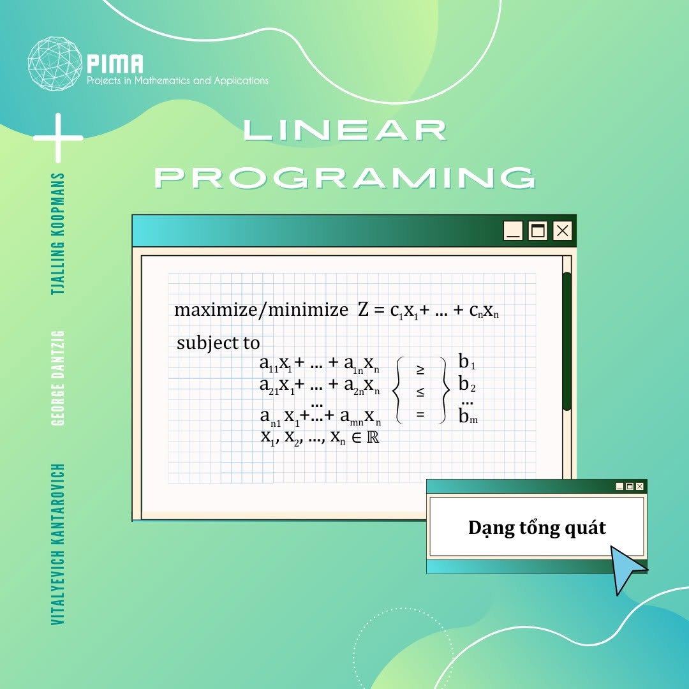

Tại trại hè PiMA 2024: Linear Programming, các bạn học sinh sẽ được làm quen với quy hoạch tuyến tính và khám phá các đề tài về lí thuyết, thuật toán, cũng như ứng dụng của nó. Nếu đây là lần đầu tiên các bạn nghe về quy hoạch tuyến tính thì hãy cùng PiMA đi tìm hiểu một chút về lịch sử của chủ đề toán học này nhé.

Trong nhiều ứng dụng thực tế, ta quan tâm tới bài toán xác định một lựa chọn tốt nhất trong số nhiều những lựa chọn có thể có. Ví dụ, người điều hành một nhà máy quan tâm tới bài toán chọn kế hoạch sản xuất phù hợp với cơ sở vật chất có sẵn sao cho tối đa được lợi nhuận. Một ví dụ khác, chuyên viên dinh dưỡng của một đội tuyển thể thao quan tâm tới bài toán lên kế hoạch khẩu phần ăn sao cho vừa đủ chất dinh dưỡng cho các vận động viên, vừa tối thiểu được chi phí nguyên liệu.

Trước thế kỉ 20, do thiếu một lí thuyết để khảo sát những bài toán như vậy, người ta chỉ có thể lên kế hoạch dựa vào cảm tính và kinh nghiệm. Khám phá quan trọng giúp chúng ta có một cái nhìn sâu sắc và hữu dụng hơn về những bài toán này được tìm thấy vào những năm 30-40 của thế kỉ trước. Các nhà toán học Leonid Kantorovich, George Dantzig, và nhà kinh tế học Tjalling Koopmans đã có một khám phá quan trọng: nhiều bài toán như vậy có thể được mô hình hóa bởi những phương trình và bất phương trình tuyến tính! Điều này đánh dấu sự ra đời của quy hoạch tuyến tính - ngành học nghiên cứu cách tối ưu hóa những bài toán mô hình được bởi quan hệ tuyến tính.

Mùa hè năm 1947, George Dantzig phát minh ra thuật toán đơn hình (simplex algorithm). Đây chính là quy trình hiệu quả đầu tiên được tìm ra để giải nghiệm tối ưu của bài toán quy hoạch tuyến tính. Thuật toán có ứng dụng quan trọng ngay vào mùa thu năm đó khi Cục Tiêu Chuẩn Quốc Gia Hoa Kì dùng nó để giải quyết bài toán tối thiểu hóa chi phí bữa ăn. Sử dụng những máy tính tay, các nhân viên ở đây đã giải một bài toán với 9 phương trình và 77 ẩn trong thời gian tương ứng với 120 ngày làm việc để tìm ra chi phí tối thiểu chính xác bằng \$39.69.

Từ đó đến nay, nhiều nhà nghiên cứu toán học và khoa học máy tính nổi tiếng như John von Neumann, Leonid Khachiyan, Warren Hirsch, Albert Tucker, … đã góp phần xây dựng những lí thuyết và thuật toán quan trọng cho quy hoạch tuyến tính. Người ta đã ứng dụng quy hoạch tuyến tính trong nhiều ngành công nghiệp như dầu khí, thực phẩm, luyện kim, … để tối ưu hóa sản xuất và phân công công việc. Bên cạnh đó, nhiều bài toán trong các lĩnh vực kinh tế, khoa học máy tính, toán học tổ hợp cũng đã được nghiên cứu và giải quyết nhờ ứng dụng quy hoạch tuyến tính.

Những đóng góp của các nhà nghiên cứu quy hoạch tuyến tính trong gần 1 thế kỉ vừa qua đã giúp xây dựng nên cho chúng ta một chủ đề toán học vừa đẹp về mặt lí thuyết, vừa có nhiều ứng dụng thực tiễn trong đời sống.
