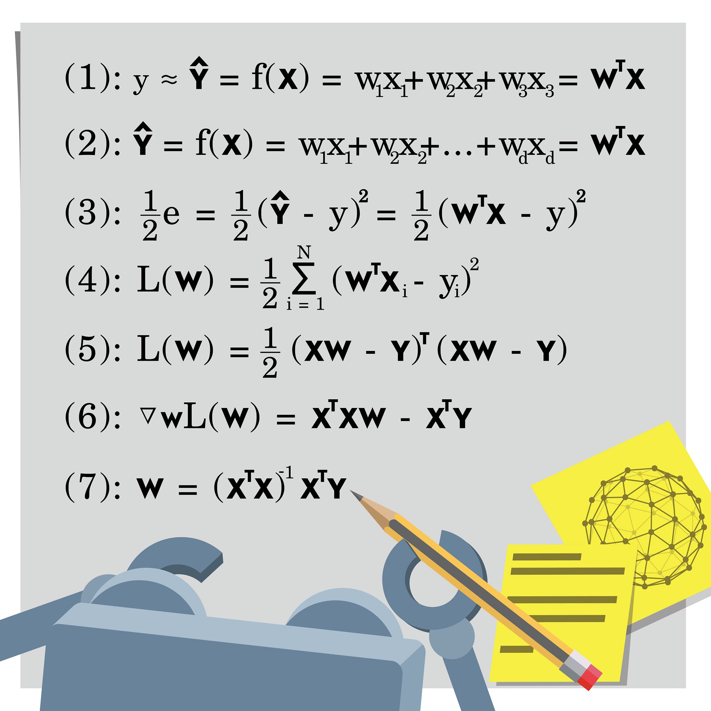

Linear regression là một thuật toán lâu đời và được ứng dụng rộng rãi trong cuộc sống: dự đoán giá nhà, dự đoán giá cổ phiếu,... không chỉ bởi tính hiệu quả mà còn đơn giản của nó.

Hãy cùng PiMA tìm hiểu về thuật toán này qua ví dụ sau đây nhé.

Giả sử ta có một tập dữ liệu gồm độ rộng, số phòng ngủ, khoảng cách đến khu trung tâm và giá của 20.000 căn nhà trong thành phố. Câu hỏi đặt ra là khi có một căn nhà mới với các thông số: độ rộng $x_1$ (m²), có $x_2$ phòng ngủ và cách trung tâm thành phố $x_3$ km, liệu ta có thể dự đoán được giá của căn nhà đó không?

Tổng quát hơn, ta xét bài toán dự đoán đầu ra từ tập dữ liệu đầu vào gồm 3 thông số $x_1, x_2, x_3$; kí hiệu $\mathbf{x} = [x_1, x_2, x_3]^T$ là vector-cột chứa dữ liệu đầu vào, $y$ là đầu ra. Ta có thể mô hình đầu ra là một hàm của đầu vào ở (1) hình bên:

$$
y \approx \hat{y} = f(\mathbf{x}) = w_1 x_1 + w_2 x_2 + w_3 x_3 = \mathbf{w}^T \mathbf{x} \tag{1}
$$

Trong đó $\mathbf{w} = [w_1, w_2, w_3]^T$ là vector trọng số cần tìm, $\hat{y}$ là đầu ra dự đoán.

Mối quan hệ (1) là một mối quan hệ tuyến tính, tên gọi “hồi quy tuyến tính” xuất phát từ đây.

Về mặt hình học, ta có thể hiểu rằng bài toán đặt ra là xấp xỉ các dữ liệu bởi đường thẳng có phương trình $y = \mathbf{w}^T \mathbf{x}$.

Bây giờ, ta đi tìm nghiệm $\mathbf{w}$ của bài toán trên. Xét tổng quát hơn, nếu mỗi điểm dữ liệu được mô tả bởi $d$ đặc trưng (vector đặc trưng $d$ chiều) thì hàm dự đoán đầu ra có dạng

$$
\hat{y} = f(\mathbf{x}) = w_1 x_1 + w_2 x_2 + \dots + w_d x_d = \mathbf{w}^T \mathbf{x} \tag{2}
$$

Ta luôn mong muốn sai khác $e = \hat{y} - y$ giữa đầu ra thực sự $y$ và đầu ra dự đoán $\hat{y}$ là nhỏ nhất. Ta dùng đánh giá

$$
\frac{1}{2} e^2 = \frac{1}{2} (\hat{y} - y)^2 = \frac{1}{2} (\mathbf{w}^T \mathbf{x} - y)^2 \tag{3}
$$

Hệ số $\frac{1}{2}$ là để thuận tiện cho việc tính toán (khi lấy đạo hàm của $e$ theo $\mathbf{w}$ thì $\frac{1}{2}$ sẽ bị triệt tiêu).

Tương tự cho tất cả các cặp dữ liệu $(\mathbf{x}_i, y_i)$, $i = 1, 2, \ldots, N$ với $N$ là số lượng dữ liệu. Việc tìm mô hình tốt nhất tương đương với việc tìm vector $\mathbf{w}$ để hàm mất mát $L(\mathbf{w})$ sau đây đạt giá trị nhỏ nhất:

$$
L(\mathbf{w}) = \frac{1}{2} \sum_{i=1}^{N} (\mathbf{w}^T \mathbf{x}_i - y_i)^2 \tag{4}
$$

Cách thông thường để tìm nghiệm cho một bài toán tối ưu là giải phương trình đạo hàm bằng 0. Đặt $\mathbf{Y} = [y_1, y_2, \ldots, y_N]^T$ và $\mathbf{X} = [\mathbf{x}_1, \mathbf{x}_2, \ldots, \mathbf{x}_N]^T$, $i = 1, 2, \ldots, N$; $j = 1, 2, \ldots, d$, ta có thể viết lại hàm mất mát dưới dạng ma trận và vector với

$$
L(\mathbf{w}) = \frac{1}{2} (\mathbf{X}\mathbf{w} - \mathbf{Y})^T (\mathbf{X}\mathbf{w} - \mathbf{Y}) \tag{5}
$$

Lấy đạo hàm theo $\mathbf{w}$ ta được

$$
\nabla_{\mathbf{w}} L(\mathbf{w}) = \mathbf{X}^T \mathbf{X} \mathbf{w} - \mathbf{X}^T \mathbf{Y} \tag{6}
$$

Giải phương trình $\nabla_{\mathbf{w}} L(\mathbf{w}) = 0$ ta được

$$
\mathbf{w} = (\mathbf{X}^T \mathbf{X})^{-1} \mathbf{X}^T \mathbf{Y} \tag{7}
$$

Vậy ta đã tìm được vector trọng số $\mathbf{w}$, tức đã xây dựng được mô hình dự đoán đầu ra.

## Tài liệu tham khảo

- \[1\] Vũ Hữu Tiệp, Machine learning cơ bản, NXB Khoa học và kỹ thuật, 2018.
- \[2\] Vicohub online course’s material.
