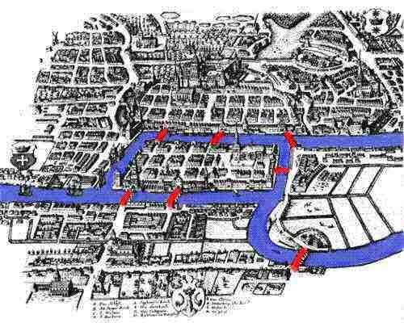

Trong cuộc sống, chúng ta rất hay gặp những bài toán liên quan đến các đối tượng và việc biểu thị quan hệ giữa những đối tượng đó với nhau. Vì vậy, các nhà toán học đã đưa ra một mô hình toán học chung để giải quyết những bài toán như vậy, đó chính là đồ thị. Lý thuyết đồ thị dùng để nghiên cứu những tính chất trong các quan hệ giữa các đối tượng rời rạc với nhau. Đồ thị thường được biểu diễn bởi tập các đỉnh (đại diện cho đối tượng) và các cạnh (thể hiện mối quan hệ giữa các đối tượng).

Trước hết, ta xem xét một bài toán nổi tiếng sau, bài toán 7 cây cầu ở Königsberg.

Bài toán 7 cây cầu là một bài toán bắt nguồn từ thành phố Königsberg (thuộc Phổ, nay là Kaliningrad thuộc Nga), thành phố này bao gồm 2 hòn đảo và đất liền, được nối với nhau bằng 7 cây cầu (xem hình dưới). Bài toán đặt ra là có tồn tại hay không một cách di chuyển đi qua tất cả các cây cầu sao cho mỗi cây cầu chỉ đi qua đúng một lần.

Vào năm 1736, Leonhard Euler đã chứng minh bài toán này không có lời giải bằng cách phát biểu lại bài toán dưới dạng lý thuyết đồ thị. Ông có nhận xét, ta chỉ quan tâm tới các vùng đất (đối tượng) và việc có thể di chuyển qua nhau giữa các vùng đất (quan hệ giữa các đối tượng), những chi tiết khác như: diện tích vùng đất, đảo hay đất liền… là không quan trọng.

Do đó, ông loại bỏ tất cả các chi tiết thừa ra, chỉ giữ lại vùng đất và các cây cầu nối giữa các vùng đất đó.

Sau đó, ông thay mỗi vùng đất thành một điểm (gọi là đỉnh), thay mỗi cây cầu thành một đoạn nối 2 điểm (gọi là cạnh).

Cấu trúc thu được bằng cách trên còn gọi là một đồ thị. Tới đây, bài toán tìm đường đi thoả mãn việc đi qua hết tất cả các cây cầu tương đương với việc tìm một đường đi (hoặc chu trình) trong đồ thị trên, đi qua tất cả các cạnh một và chỉ một lần. Euler đã chứng minh điều kiện cần để tồn tại chu trình thoả điều kiện trên là: bậc (số lượng cạnh nối với đỉnh) của mọi đỉnh phải là số chẵn, điều kiện cần để tồn tại đường đi là: có đúng 2 đỉnh có bậc là số lẻ. Trong đồ thị trên, bậc của 4 đỉnh là (5, 3, 3, 3), do đó không tồn tại chu trình cũng như đường đi thoả điều kiện trên. Sau này chu trình/đường đi đi qua tất cả các cạnh của đồ thị đúng một lần còn được gọi là chu trình/đường đi Euler.

Bằng cách này, ông đã chứng minh được bài toán 7 cây cầu là không có lời giải (hay không tồn tại một đường đi nào thoả mãn được việc đi qua tất cả các cây cầu một và duy nhất một lần).

Định lý về việc tồn tại lời giải cho bài toán của Euler được xem như là định lý đầu tiên của lý thuyết đồ thị, nên Euler cũng được xem là cha đẻ của lý thuyết đồ thị.

Rất nhiều cấu trúc, bài toán thực tế có thể được biểu diễn dưới dạng đồ thị: liên kết giữa các trang web, sơ đồ mạng giao thông, cấu trúc mạng máy tính, cấu trúc phân tử, bài toán xếp lịch giảng dạy, … Do đó, lý thuyết đồ thị xuất hiện ở rất nhiều các lĩnh vực nghiên cứu khoa học và chiếm phần rất quan trọng trong khoa học máy tính.
