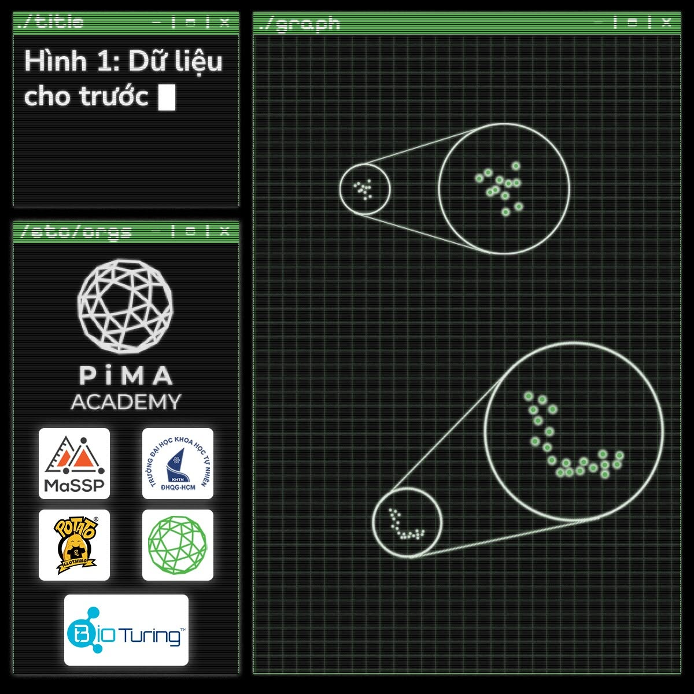
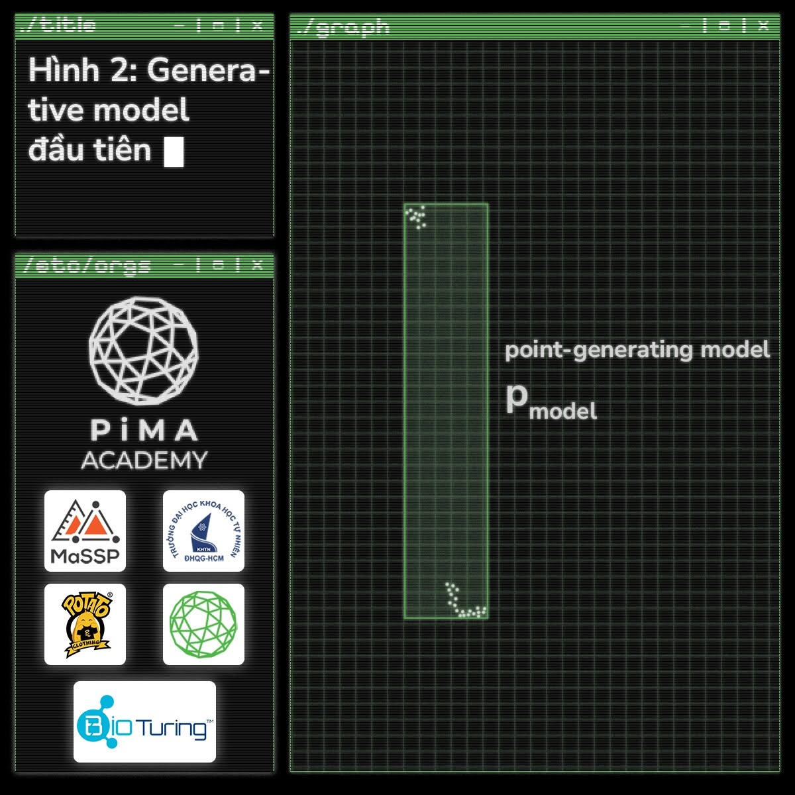
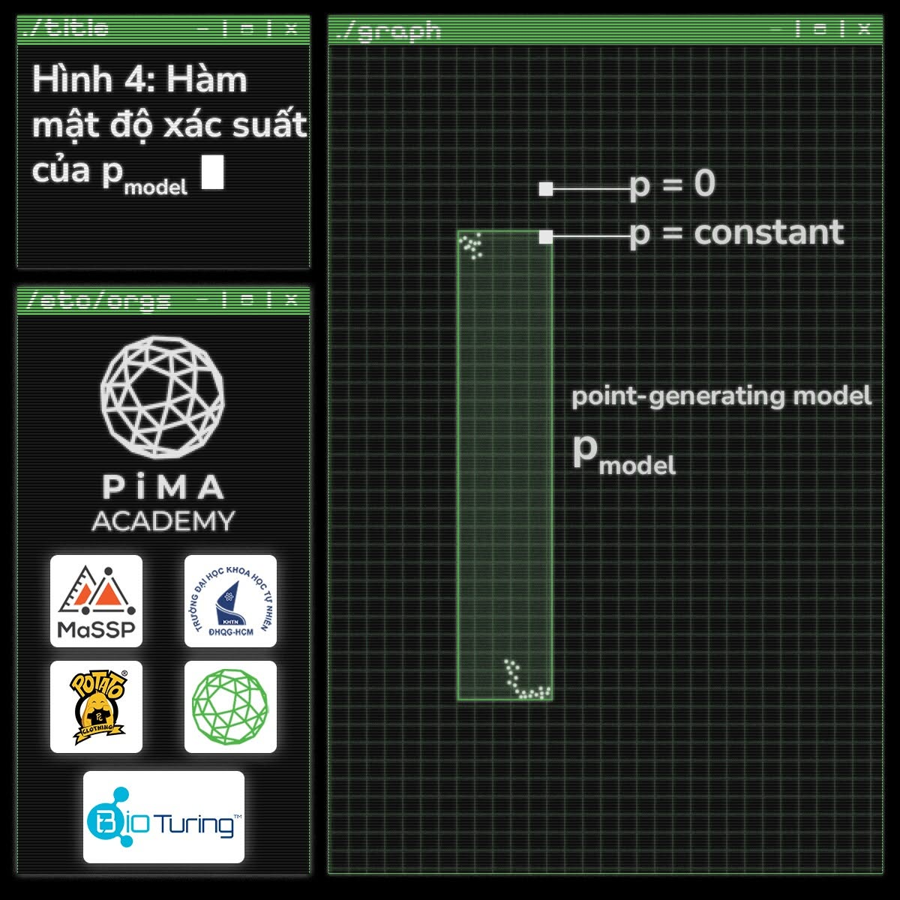
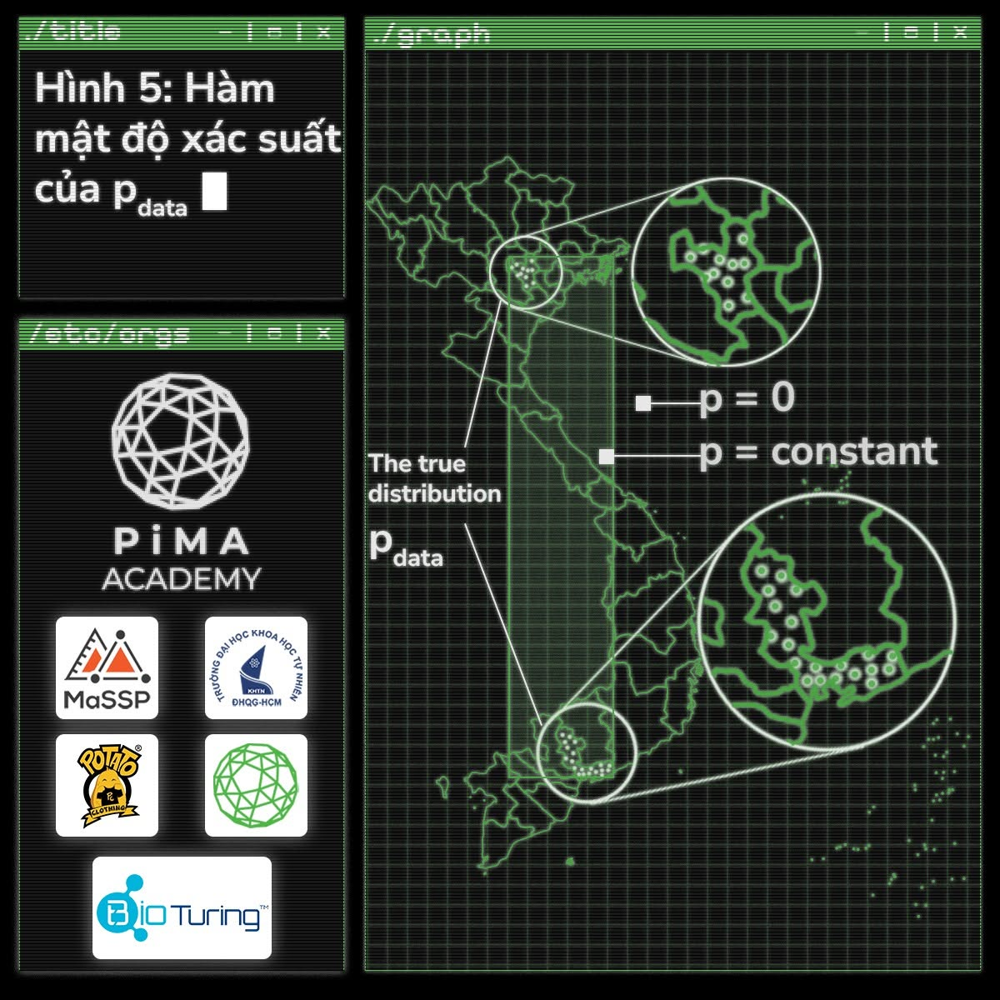
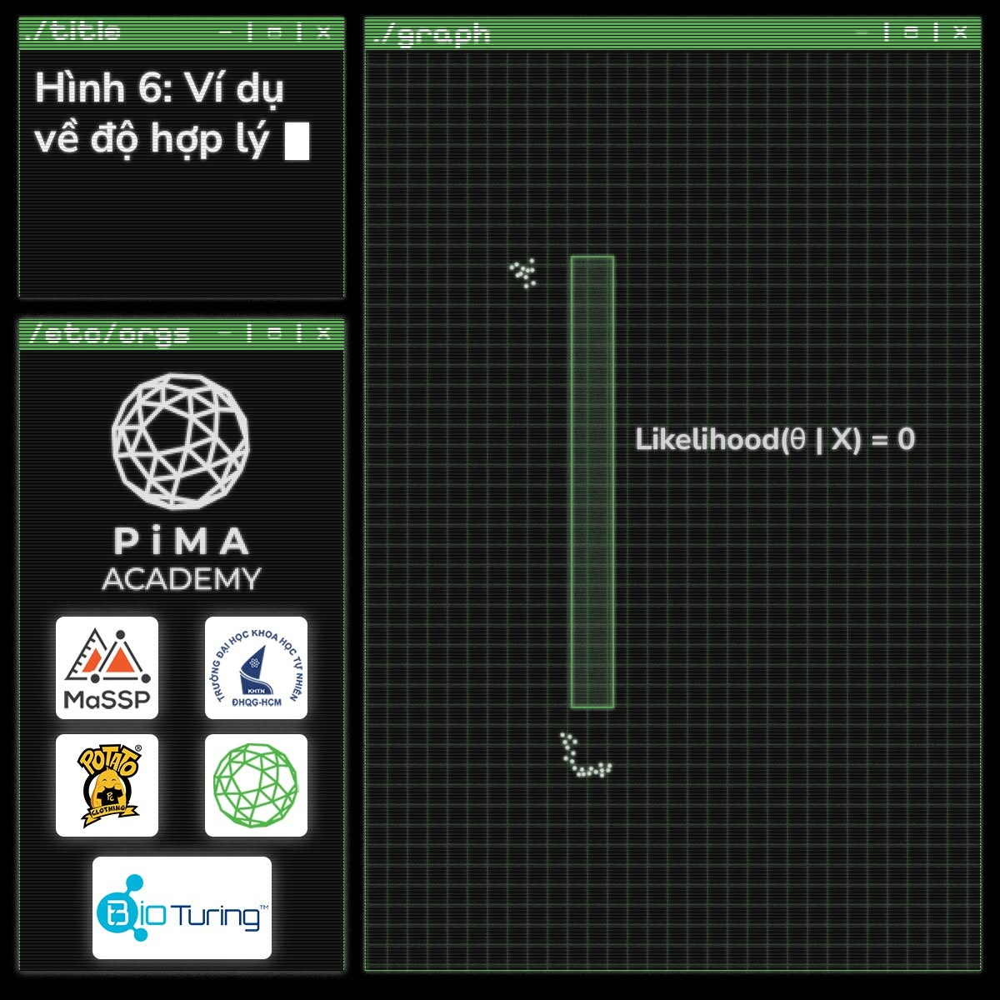

Hiểu về mô hình tạo sinh qua xác suất và… một hình chữ nhật?

Trong bài viết này, PiMA sẽ dẫn bạn đi từ một ví dụ khá trực quan: vẽ hình chữ nhật bao quanh dữ liệu, để từ đó giải thích những khái niệm cốt lõi trong lý thuyết xác suất cho mô hình tạo sinh, bao gồm:

- Hàm mật độ xác suất
- Mô hình tham số
- Độ hợp lý (Likelihood)
- Ước lượng hợp lý cực đại (Maximum Likelihood Estimation - MLE)

## 1. Giới thiệu

Làm thế nào để một mô hình không chỉ nhận biết thế giới, mà còn "tưởng tượng" ra một thế giới mới từ những gì nó đã học?

Trong nhiều năm, các mô hình học máy đã giải quyết các bài toán thực tế như phân loại ảnh, chẩn đoán bệnh, hay dự đoán xu hướng. Tuy nhiên nếu ta yêu cầu nó tạo ra một bản nhạc, một bức ảnh hay là một đoạn văn thì mọi thứ trở nên rắc rối hơn nhiều. Đây chính là thách thức mà các mô hình tạo sinh sẽ phải đối mặt và giải quyết.

Trong bài viết ngày hôm nay, các bạn hãy cùng PiMA đi khám phá vai trò của lý thuyết xác suất trong generative modeling dựa trên một ví dụ đơn giản nhé. Và dựa vào đó, ta hy vọng có thể phần nào giải thích các mô hình tạo sinh lớn hơn.

## 2. “Hello World” cho mô hình tạo sinh

Chắc hẳn nhiều người đều biết rằng khi học một ngôn ngữ lập trình mới, Hello World sẽ là thứ mà họ viết đầu tiên. Tương tự với mô hình tạo sinh, hôm nay PiMA cũng muốn giới thiệu cho bạn về một mô hình đầu tiên.

Trước hết, ta có những điểm dữ liệu $(x_1, x_2)$ được biểu diễn như trên hình.

Ta có thể thắc mắc: Làm sao dựa trên những dữ liệu có sẵn này và sinh ra những điểm dữ liệu mới mà vẫn tuân thủ theo phân phối xác suất của những dữ liệu đã có? Trong hình có lẽ là mô hình trực quan và dễ dàng mà ta có thể nghĩ ra: vẽ một hình chữ nhật sao cho các điểm dữ liệu đều nằm thuộc bên trong hình chữ nhật đó. Để sinh ra một dữ liệu mới, chỉ cần chọn 1 điểm ngẫu nhiên miễn sao nó thuộc hình chữ nhật này.

Thế câu trả lời cho câu hỏi ban đầu của chúng ta là gì? Thực ra, hàm mật độ xác suất của các điểm dữ liệu này là phân phối đều trên Thành phố Hồ Chí Minh và Thủ đô Hà Nội, và bằng 0 trên các vị trí khác tại Việt Nam.

Sau đây, chúng ta hãy cùng nhau đi qua 4 khái niệm lý thuyết xác suất cơ bản trong mô hình tạo sinh nhé.

## 3. Hàm mật độ xác suất

Hàm mật độ xác suất $p(x)$ ánh xạ dữ liệu $x$ thành mật độ xác suất tại điểm đó. Tích phân hàm mật độ xác suất trên mọi dữ liệu sẽ là 1.

Ta định nghĩa $p_{\text{model}}(x)$ là phân phối xác suất mà mô hình học được, $p_{\text{data}}(x)$ là phân phối xác suất thật sự của tập dữ liệu. Trong mô hình tạo sinh, chúng ta muốn $p_{\text{model}}(x)$ sẽ giống $p_{\text{data}}(x)$ nhất có thể.

Trong ví dụ đơn giản của chúng ta, $p_{\text{model}}(x) = 0$ với $x$ nằm ngoài hình chữ nhật màu xanh lá. Đối với các điểm bên trong, $p_{\text{model}}(x)$ là hằng số sao cho tích phân của $p_{\text{model}}(x)$ bằng 1.

Trong khi đó, thực ra $p_{\text{data}}(x)$ là hằng số nếu $x$ nằm ở Thành phố Hồ Chí Minh và Hà Nội, $p_{\text{data}}(x) = 0$ nếu $x$ ở những vị trí còn lại.

## 4. Mô hình tham số

Mô hình tham số là một phương pháp mô hình hóa hàm mật độ xác suất $p_{\text{model}}(x)$ bằng một họ hàm toán học có dạng xác định, chỉ phụ thuộc vào một số hữu hạn các tham số $\theta$. Quay lại với ví dụ trên, nếu chúng ta giả định rằng dữ liệu của ta tuân theo phân phối đều thì:

$$
p_\theta(x) =
\begin{cases}
0 & \text{với các điểm nằm bên ngoài hình chữ nhật,} \\
\dfrac{1}{\text{diện tích hình chữ nhật}} & \text{với các điểm nằm trong hình chữ nhật được xác định bởi } \theta.
\end{cases}
$$

Vậy một tập các hình chữ nhật mà ta có thể vẽ là một ví dụ của mô hình tham số. Một hình chữ nhật bất kì lại có thể được xác định bởi tọa độ góc trên trái và tọa độ góc dưới phải. Vì vậy chỉ cần có 4 tham số thì ta có thể xác định được tất cả các hàm mật độ xác suất $p_\theta(x)$:

$$
\theta = (x_1, x_2, y_1, y_2)
$$

Trong đó:

- $(x_1, y_1)$: tọa độ góc trên trái
- $(x_2, y_2)$: tọa độ góc dưới phải

Với mỗi một bộ số $(x_1, x_2, y_1, y_2)$ khác nhau, ta sẽ có 1 hình chữ nhật khác nhau hay đồng nghĩa với việc có một $p_\theta(x)$ khác nhau.

Như vậy, có thể tưởng tượng mô hình tham số như là một cái khuôn độc lập với việc khớp dữ liệu, và ta có thể thay đổi cái khuôn theo mong muốn của mình bằng cách thay đổi các tham số bên trong.

Vậy ta muốn một mô hình tham số như thế nào? Mục tiêu của ta là tìm được bộ tham số $\theta$ sao cho $p_\theta(x)$ khớp với $p_{\text{data}}(x)$ nhất có thể. Và đến đây, ta giới thiệu về khái niệm độ hợp lý.

## 5. Độ hợp lý (Likelihood)

Câu hỏi đặt ra: Nếu dùng mô hình với bộ tham số $\theta$ này, khả năng quan sát được toàn bộ dữ liệu là bao nhiêu?

Hay dễ hiểu hơn: Nếu chọn hình chữ nhật này là mô hình, thì khả năng tất cả các điểm $x$ nằm trong nó là bao nhiêu?

Với một điểm dữ liệu $x = (x, y)$, ta có công thức tính độ hợp lý như sau:

$$
\text{Likelihood}(\theta \mid x) = p_\theta(x)
$$

Vậy với nhiều điểm dữ liệu $x$ (ký hiệu là tập hợp $X$) mà mỗi điểm dữ liệu độc lập với nhau thì công thức tổng quát là:

$$
\text{Likelihood}(\theta \mid X) = \prod_{x \in X} p_\theta(x)
$$

Như trong ví dụ trên, nếu chỉ giữ lại nhóm dữ liệu phía dưới phải và hình chữ nhật chỉ còn là một nửa hình chữ nhật bên trái tức $\theta = (x_{11}, 0, x_{21}, x_{22})$ thì $\text{Likelihood}(\theta \mid X) = 0$. Lúc này hình chữ nhật của ta không bao gồm bất kỳ điểm dữ liệu nào.

## 6. Ước lượng hợp lý cực đại (Maximum Likelihood Estimation - MLE)

Trong thực tế, việc tìm $\theta$ hợp lý là rất khó. Do đó, “ước lượng hợp lý cực đại” là một tiêu chí mà tại đó, ta tìm $\theta$ sao cho $\text{Likelihood}(\theta \mid X)$ lớn nhất có thể.

$$
\theta^* = \arg\max_\theta \text{Likelihood}(\theta \mid X)
$$

trong đó $\theta^*$ được gọi là ước lượng hợp lý cực đại.

Trong ví dụ trên, “ước lượng hợp lý cực đại” là một hình chữ nhật nhỏ nhất sao cho nó vẫn bao gồm được tất cả các dữ liệu.

## 7. Lời kết

Chúng ta có thể xem MLE là công cụ phía sau phần lớn các mô hình tạo sinh. Tuy nhiên, điểm khác biệt là bấy giờ $\theta$ sẽ không còn là tham số tọa độ các điểm dùng để xác định được một hình chữ nhật nữa, mà thay vào đó là các trọng số bên trong các mạng neuron nhân tạo.

Bên cạnh đó, có một điểm khác biệt hết sức quan trọng rằng: với những dữ liệu đa chiều, việc tính $p_\theta(x)$ sẽ không còn hiệu quả nữa. Và các mô hình tạo sinh khác nhau sẽ áp dụng những phương pháp khác nhau để giải quyết vấn đề này.

## Tài liệu tham khảo

- Foster, D. (2019). Generative deep learning: Teaching machines to paint, write, compose, and play. O'Reilly Media.
