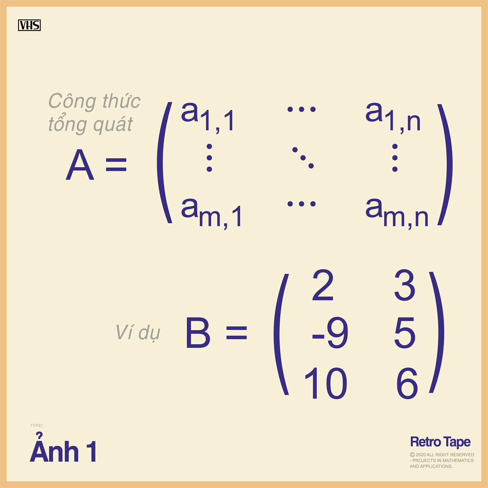
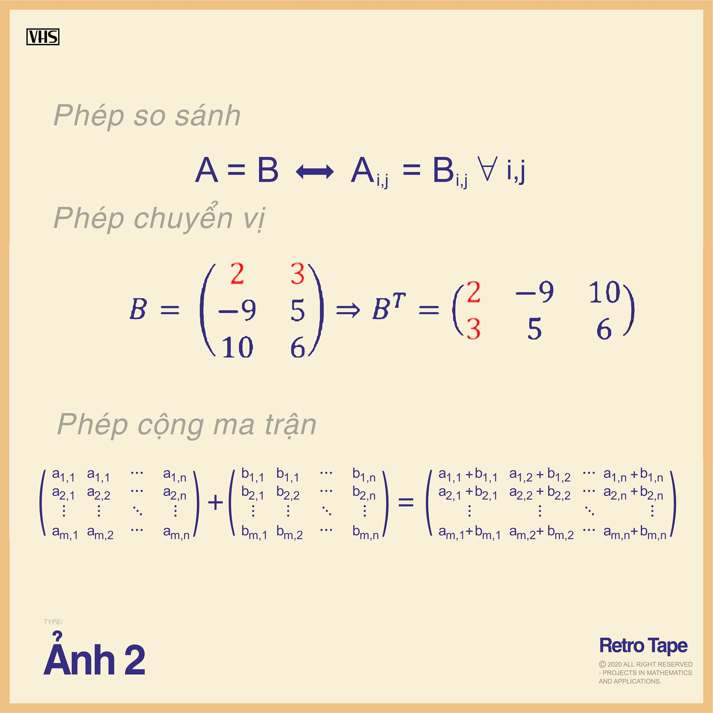
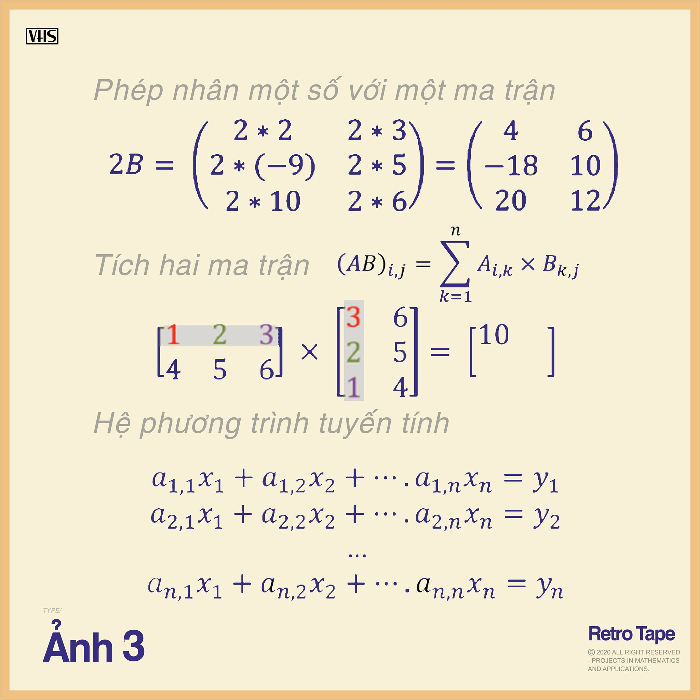

Hiện nay với sự bùng nổ của Trí tuệ Nhân tạo và Khoa học Dữ liệu, rất nhiều bài toán trong thực tế yêu cầu chúng ta phải làm việc với một tập dữ liệu vô cùng lớn. Ma trận và các phép toán với ma trận hỗ trợ chúng ta rất nhiều trong việc biểu diễn cũng như giải quyết các bài toán này. PiMA sẽ cùng các bạn tìm hiểu đôi nét về ma trận cùng một số phép toán trên ma trận nhé!

## Một số định nghĩa và ký hiệu

Ma trận: Một ma trận cấp $m \times n$ trên tập hợp các số thực hiểu nôm na là một bảng chữ nhật gồm $m \times n$ ô, chia thành có $m$ dòng và $n$ cột, trong đó mỗi ô chứa một số thực, gọi là các hệ số. Một ma trận tổng quát có dạng như hình bên.

Hệ số ở dòng $i$ và cột $j$ được kí hiệu là $A_{ij}$.

Ví dụ: Ma trận $B$ có kích thước $3 \times 2$ trên tập số thực $\mathbb{R}$ với $B_{2,2} = 5$, $B_{3,1} = 10$.

Một ma trận $A$ có kích thước $n \times n$, tức là số dòng và số cột đều bằng $n$, được gọi là ma trận vuông cấp $n$.

## Một số phép toán trên ma trận

**Phép so sánh:** Cho hai ma trận $A$ và $B$ cùng kích thước $m \times n$, $A$ và $B$ bằng nhau nếu mọi hệ số cùng vị trí tương ứng của chúng bằng nhau, tức là $A_{ij} = B_{ij}$ với mọi $i$ và $j$.

**Phép chuyển vị ma trận:** Cho ma trận $A$ có kích thước $m \times n$. Ma trận chuyển vị của $A$, kí hiệu $A^T$ là ma trận cấp $n \times m$ có được bằng cách “đổi các dòng thành cột và cột thành dòng”, ví dụ ở hình bên.

**Tổng hai ma trận:** Cho 2 ma trận $A$ và $B$ có cùng kích thước $m \times n$. Khi đó, ma trận tổng của $A$ và $B$, kí hiệu $A + B$, là ma trận có cùng kích thước $m \times n$ được xác định bằng việc cộng các hệ số tương ứng cùng vị trí lại với nhau (như hình).

(!) Chú ý: để cộng được hai ma trận thì chúng phải cùng kích thước.

## Phép nhân ma trận với số thực, nhân 2 ma trận

**Phép nhân một số với một ma trận:** Cho số thực $a$ và ma trận $A$ có kích thước $m \times n$. Ta định nghĩa $aA$ là ma trận có được bằng cách nhân tất cả các hệ số của $A$ với $a$.

**Tích hai ma trận:** Cho ma trận $A$ có kích thước $m \times n$ và $B$ có kích thước $n \times p$. Ta định nghĩa ma trận tích của $A$ và $B$, kí hiệu $AB$, là ma trận có kích thước $m \times p$ được xác định như sau: hệ số ở dòng $i$, cột $j$ của $AB$ sẽ là tích vô hướng của dòng $i$ trong $A$ và cột $j$ trong $B$, được xem như 2 vector $n$ chiều:

$$
(AB)_{i,j} = \sum_{k=1}^{n} A_{i,k} B_{k,j}
$$

Nói một cách nôm na là ta lấy dòng thứ $i$ của ma trận $A$ nhân từng lần lượt phần tử với cột thứ $j$ của ma trận $B$ rồi lấy tổng các tích điền vào ô $(i, j)$. Cần chú ý để hai ma trận có thể nhân được với nhau thì số cột của ma trận thứ nhất phải bằng với số dòng của ma trận thứ hai.

## Ứng dụng

Ma trận có thể dùng để biểu diễn nhiều bài toán khác nhau một cách tinh gọn và dễ xử lí. Đơn giản nhất, ta hãy xét bài toán giải hệ phương trình tuyến tính:

$$
\begin{aligned}
a_{1,1}x_1 + a_{1,2}x_2 + \dots + a_{1,n}x_n &= y_1 \\
a_{2,1}x_1 + a_{2,2}x_2 + \dots + a_{2,n}x_n &= y_2 \\
&\ \,\vdots \\
a_{n,1}x_1 + a_{n,2}x_2 + \dots + a_{n,n}x_n &= y_n
\end{aligned}
$$

Hệ phương trình trên có thể được biểu diễn dưới dạng ma trận: $A[x] = [y]$.

Bằng một số phép toán cơ bản trên ma trận hệ phương trình trên còn được giải một cách rất dễ dàng. Ma trận hay đại số tuyến tính nói chung còn là công cụ cho rất nhiều ứng dụng thú vị khác như giảm số chiều dữ liệu, lý thuyết đồ thị, [thuật toán Page-Rank](/blog/thuat-toan-pagerank-ki-1/).
