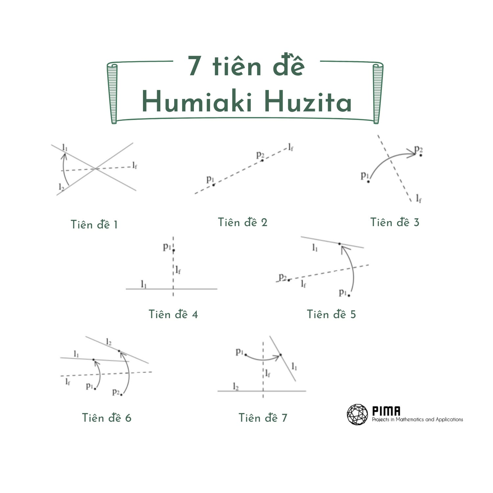
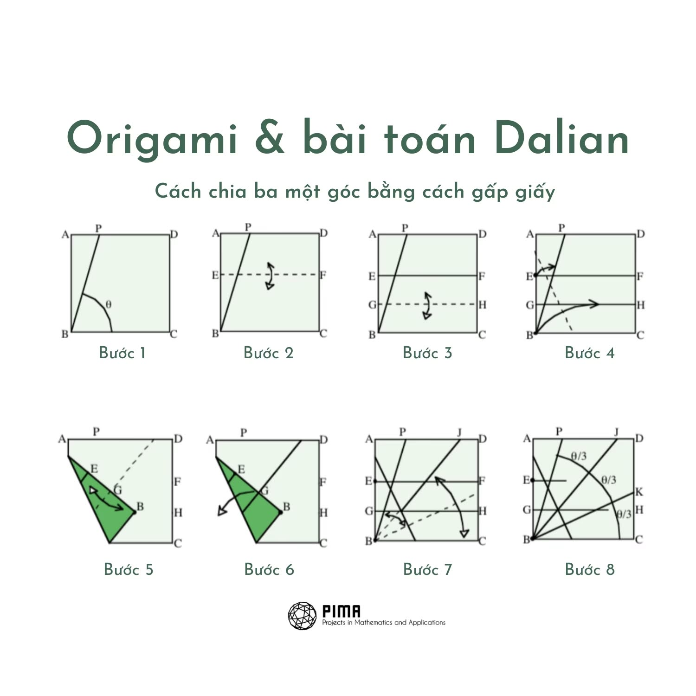
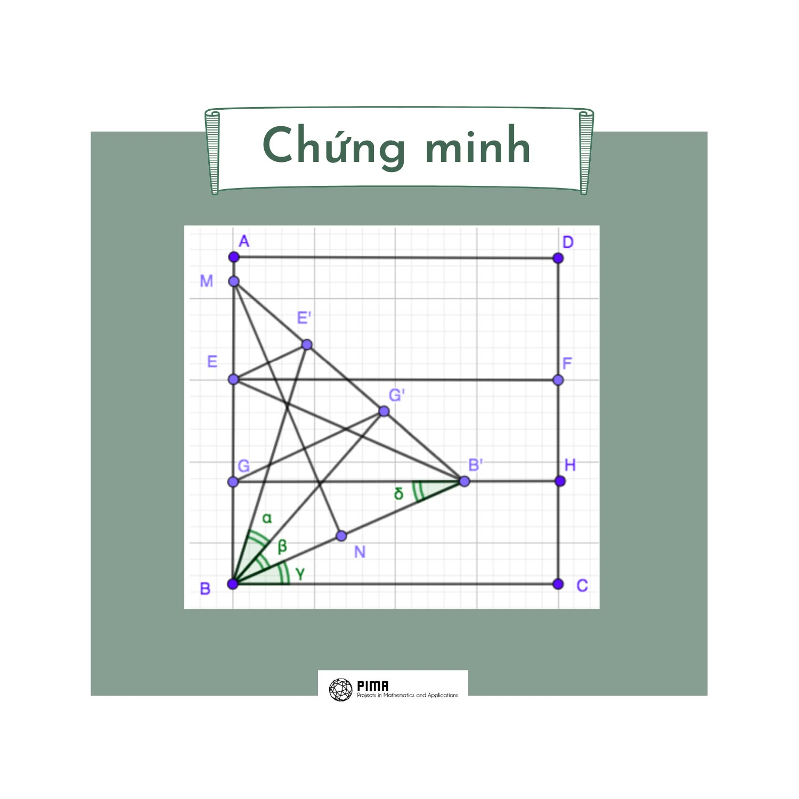

Giữa toán học và Origami có một mối quan hệ thú vị. Ngoài được biết đến như một nghệ thuật gấp giấy truyền thống của Nhật Bản, Origami được sử dụng như một công cụ dạy toán học ở nhiều nơi, nhất là ở bộ môn hình học. Các khái niệm cơ bản của hình học như điểm, cạnh, đường song song, đối xứng có thể được giải thích một cách trực quan và hiểu bằng Origami (\[1\]). Hơn thế nữa, Origami, với những tính chất đặc trưng của mình, có thể giải quyết một số bài toán mà hình học Euclid không thể làm được. Trong bài viết dưới đây, chúng ta sẽ đi tìm hiểu phương pháp giải bài toán góc chia ba bằng Origami.

## 1. 5 tiên đề Euclid

Hình học Euclid được xây dựng dựa trên năm tiên đề sau, các tiên đề này được minh hoạ trong hình đầu bài:

- Tiên đề 1: Qua hai điểm $p_1$, $p_2$ bất kì, luôn luôn vẽ được một đường thẳng.
- Tiên đề 2: Đường thẳng có thể kéo dài vô tận.
- Tiên đề 3: Với tâm bất kì và bán kính bất kì, ta luôn luôn vẽ được một đường tròn.
- Tiên đề 4: Mọi góc vuông đều bằng nhau.
- Tiên đề 5: Nếu như hai đường thẳng tạo thành với một đường thẳng thứ ba hai góc trong cùng phía với tổng nhỏ hơn 180 độ thì chúng sẽ cắt nhau về phía đó.

Chúng được dùng trong phép dựng hình Euclid - phép dựng các độ dài, góc, và các hình hình học khác bằng thước kẻ và compa. Thước kẻ giúp dựng một đường thẳng trên giấy, nối hai điểm bất kì. Thước kẻ được giả định là không có vạch chia, tức là không thể dùng để đo khoảng cách. Com-pa giúp chúng ta vẽ một đường tròn với tâm và bán kính bất kỳ. Phép dựng hình dùng ba tiên đề đầu tiên trong hình học Euclid.

Một vài phép dựng hình khả thi trong hình học Euclid là

- Dựng trung điểm của một đoạn thẳng.
- Dựng một hình vuông có diện tích gấp đôi một hình vuông cho trước.
- Chia đôi một góc bất kì.

Một vài phép dựng hình được chứng minh là bất khả trong hình học Euclid là

- Dựng một hình lập phương có thể tích gấp hai lần thể tích của một hình lập phương cho trước.
- Chia ba một góc bất kì.

Các phép dựng hình bất khả thi nêu trên, trở nên khả thi nếu chúng ta dùng hình học phi Euclid. Trong bài viết này, chúng ta tìm hiểu hình học Origami, cũng là một trường hợp của hình học phi Euclid. Chúng ta sẽ dùng hình học Origami để chia ba một góc bất kì.

## 2. 7 tiên đề Humiaki Huzita

Hình học Origami có những khác biệt cơ bản với hình học Euclid. Trong khi hình học Euclid được biểu diễn trên một không gian hai chiều (trên giấy) thì hình học Origami được biểu diễn trên một không gian ba chiều. Sau đây là bảy tiên đề cho hình học Origami, được phát biểu bởi Humiaki Huzita (\[3\]). Các tiên đề này được phát biểu và minh hoạ trên hình trên.

- Tiên đề 1: Cho hai đường $l_1$ và $l_2$, ta có thể gấp đường $l_1$ vào $l_2$. Đường $l_1$ là ảnh đối xứng của $l_2$ qua đường $l_f$.
- Tiên đề 2: Cho hai điểm $p_1$ và $p_2$, ta có thể gấp một đường $l_f$ đi qua $p_1$ và $p_2$.
- Tiên đề 3: Cho hai điểm $p_1$ và $p_2$, ta có thể gấp một đường $l_f$ sao cho $p_1$ gặp $p_2$. Điểm $p_1$ là ảnh của điểm $p_2$ qua trục đối xứng $l_f$.
- Tiên đề 4: Cho một điểm $p_1$ và một đường $l_1$, ta có thể gấp một đường $l_f$ đi qua $p_1$ và vuông góc với $l_1$.
- Tiên đề 5: Cho hai điểm $p_1$, $p_2$ và một đường $l_1$, ta có thể gấp một đường $l_f$ đi qua điểm $p_2$ sao cho điểm $p_1$ nằm trên đường $l_1$.
- Tiên đề 6: Cho hai điểm $p_1$, $p_2$ và hai đường $l_1$, $l_2$, ta có thể gấp một đường $l_f$ sao cho điểm $p_1$ nằm trên đường $l_1$ và điểm $p_2$ nằm trên đường $l_2$.
- Tiên đề 7: Cho một điểm $p_1$ và hai đường $l_1$, $l_2$, ta có thể gấp một đường $l_f$ sao cho điểm $p_1$ nằm trên đường $l_1$ và đường gấp $l_f$ vuông góc với đường $l_2$.

## 3. Bài toán Dalian

Sử dụng các tiên đề trên, chúng ta có thể giải bài toán được cho là bất khả thi trên hình học Euclid - Bài toán Dalian.

Bài toán Dalian là bài toán chia góc. Cho một góc bất kì, ta cần chia nó thành ba góc bằng nhau. Bài toán được minh hoạ bằng ảnh bên. Trên đó, góc $\theta$ được chia thành ba góc bằng nhau $\alpha = \beta = \gamma$.

- Bước 1: Bắt đầu bằng một góc bất kì (góc $PBC$ như trong hình vẽ, giới hạn bởi hình vuông $ABCD$).
- Bước 2: Gấp một đường ngang bất kì, gọi là $EF$.
- Bước 3: Gấp đường $BC$ vào đường $EF$ rồi mở giấy ra, tạo thành nếp, gọi là đường $GH$.
- Bước 4: Gập từ góc trái phía dưới lên trên sao cho điểm $E$ nằm trên đường $BP$ và điểm $B$ nằm trên đường $GH$.
- Bước 5: Giữ nguyên phần vừa gấp, gấp cạnh đi qua điểm $B$ lên cạnh đi qua điểm $E$.
- Bước 6: Nếp mới vừa tạo thành cắt cạnh $AD$. Mở giấy lại hình vuông ban đầu.
- Bước 7: Gấp cạnh $BC$ vào cạnh $BJ$ rồi mở giấy ra. Đường mới gấp giao với cạnh $DC$ tại điểm $K$.
- Bước 8: Đường $BJ$ và $BK$ chia góc $PBC$ thành ba phần bằng nhau.

## 4. Chứng minh

Chúng ta sẽ chứng minh ba góc trong ta tìm được là ba góc bằng nhau. Hình trên biểu diễn lại các đường ta vừa gấp. Xét tam giác $EBB'$, chúng ta có đoạn $EG$ bằng với đoạn $GB$, và đoạn $GB'$ vuông góc với đoạn $EB$. Nên tam giác $EBB'$ cân tại $B'$.

Mặt khác, đường $MN$ là trục đối xứng của tam giác $MBB'$. Theo cách dựng hình, $E'$ và $G'$, $B'$ lần lượt là ảnh của $E$ và $G$, $B$ qua trục đối xứng $MN$.

Tam giác $EBB'$ cân với $B'G$ là đường phân giác. Theo phép đối xứng, tam giác $E'BB'$ cân với $BG'$ là đường phân giác. Ta có góc $\alpha$ bằng góc $\beta$ và góc $\beta$ bằng góc $\delta$. (1)

Đường $GH$ song song với đường $BC$, ta có hai góc so le trong bằng nhau. Góc $\gamma$ bằng góc $\delta$. (2)

Từ (1) và (2), ta có ba góc bằng nhau: $\alpha = \beta = \gamma$.

## Tài liệu tham khảo

- \[1\] [Math in Origami](https://www.education.txstate.edu/ci/faculty/dickinson/PBI/PBISpring05/Origami/content/grant.htm)
- \[2\] [Maths in a minute: Euclid’s axioms](https://plus.maths.org/content/maths-minute-euclids-axioms)
- \[3\] [The Mathematics of Origami](https://sites.math.washington.edu/~morrow/336_09/papers/Sheri.pdf)
- \[4\] R. C. Alperin and R. J. Lang. One-, two-, and multi-fold origami axioms. In Proceedings of 4th International Conference on Origami, Science, Mathematics and Education. 4OSME, 2006. Caltech, Pasadena CA.
- \[5\] [Angle Quintisection](https://langorigami.com/wp-content/uploads/2015/09/quintisection.pdf), R. J. Lang
