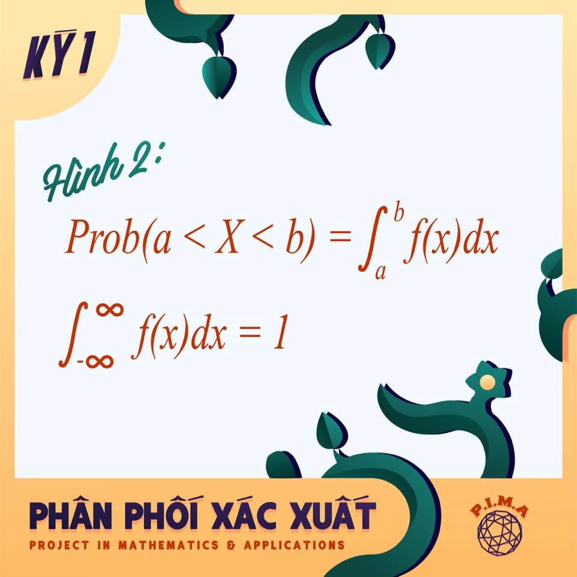

Trong bài viết kỳ này, chúng ta sẽ tìm hiểu về phân phối xác suất đối với hai loại biến cố gồm biến ngẫu nhiên rời rạc và biến ngẫu nhiên liên tục nhé.

Trong cuộc sống hằng ngày, chúng ta nhận thấy một vài hiện tượng xảy ra “ngẫu nhiên”. Ví dụ như khi tung đồng xu, chúng ta khó có thể dự đoán đúng mặt nào sẽ hiện lên trên dù biết rằng xác suất nhận được mặt sấp là 0.5 và xác suất nhận được mặt ngửa cũng là 0.5 (đối với đồng xu bình thường).

Do đó, trong toán học, chúng ta thường dùng hàm phân phối xác suất để miêu tả quy luật cho xác suất của các biến cố ngẫu nhiên nhằm phục vụ cho những tiên đoán trong kinh tế, y học, v.v. Một phân phối xác suất được dùng để tổng quát các xác suất của những biến cố ngẫu nhiên xảy ra trong không gian mẫu.

Nếu một biến ngẫu nhiên $X$ có tập giá trị đếm được như 2 mặt của đồng xu ($\{\text{sấp}, \text{ngửa}\}$), hay mặt chấm của viên xúc xắc ($\{1, 2, 3, 4, 5, 6\}$), ta gọi đây là biến ngẫu nhiên rời rạc. Với một giá trị $X$ bất kỳ, chúng ta có xác suất mà $X$ xuất hiện là $p(X)$ với $0 \le p(X) \le 1$. Từ đó, chúng ta có thể định nghĩa hàm khối xác suất (probability mass function) của biến ngẫu nhiên rời rạc $X$ như hình 1. Ngoài ra, tổng xác suất của các biến ngẫu nhiên trong tập giá trị của $X$ luôn bằng 1.

Giả sử xác suất hiện mặt ngửa khi tung một đồng xu là $p$ thì xác suất hiện mặt sấp là $1 - p$. Bạn A tung đồng xu liên tục và chỉ dừng lại khi mặt ngửa của đồng xu hiện lên trên. Vậy xác suất bạn A nhận được mặt ngửa của đồng xu sau $n$ lần tung là $(1 - p)^{n-1} p$.

Bài toán trên là một ví dụ của phân phối hình học (Geometric Distribution) của biến ngẫu nhiên rời rạc. Phân phối hình học miêu tả xác suất cho số lần thử nghiệm cần thiết để đạt được thành công đầu tiên với hàm khối xác suất $f(x) = p(1 - p)^{x-1}$ với các tiên đề:

- Chỉ có hai giá trị cho các lần thử (thành công hoặc thất bại).
- Các lần thử cho kết quả độc lập (không liên quan đến kết quả của các lần thử trước đó).
- Xác suất thành công của mỗi lần thử là như nhau.

Đối với các biến ngẫu nhiên $X$ có giá trị trong một khoảng trên trục số thực, ta gọi $X$ là biến ngẫu nhiên liên tục. Một ví dụ của biến ngẫu nhiên liên tục có thể kể đến thời gian xuất hiện ca nhiễm COVID-19 đầu tiên ở khu vực A. Do số lượng các xác suất tại một điểm trong khoảng giá trị của $X$ là vô hạn, chúng ta chỉ có thể xác định xác suất mà $X$ thuộc một khoảng $[a, b]$ trong tập giá trị của $X$ theo phương pháp lấy tích phân (diện tích giữa đồ thị và trục $x$) của hàm mật độ xác suất $f(x)$ (probability density function) của $X$ như trong hình 2. Tương tự như biến ngẫu nhiên rời rạc, tổng xác suất trong tập giá trị của $X$ cũng là 1.

Một ví dụ của phân phối xác suất của biến ngẫu nhiên liên tục là phân phối mũ (exponential distribution). Cho thời gian chờ trung bình để xuất hiện tình huống A là $t$, ta có hàm mật độ xác suất của phân phối mũ để thời gian chờ $x > 0$ là $f(x) = \frac{1}{t} e^{-x/t}$.

Ngoài việc tìm xác suất tại một điểm hay một khoảng bất kỳ trên tập giá trị của biến cố xác suất, nhiều bài toán trên thực tế yêu cầu chúng ta biểu diễn các phân phối xác suất một cách chi tiết và đầy đủ hơn. Trong kỳ sau, chúng ta sẽ cùng tìm hiểu kỹ hơn về những phương pháp.

## Tài liệu tham khảo

- <https://dominhhai.github.io/vi/2017/10/prob-rand-var/#4-1-k%E1%BB%B3-v%E1%BB%8Dng>
- Hogg, Tanis, and Zimmerman. Probability and Statistical Inference (9th edition)
