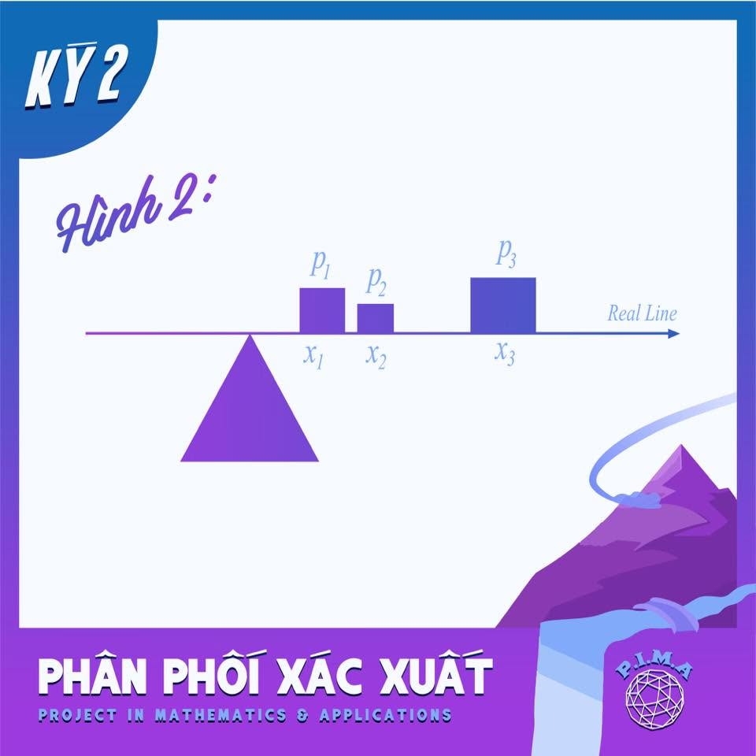
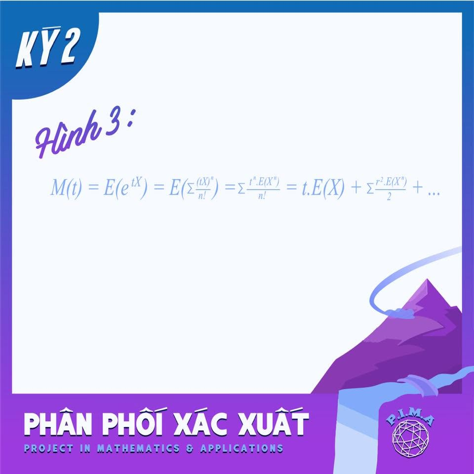
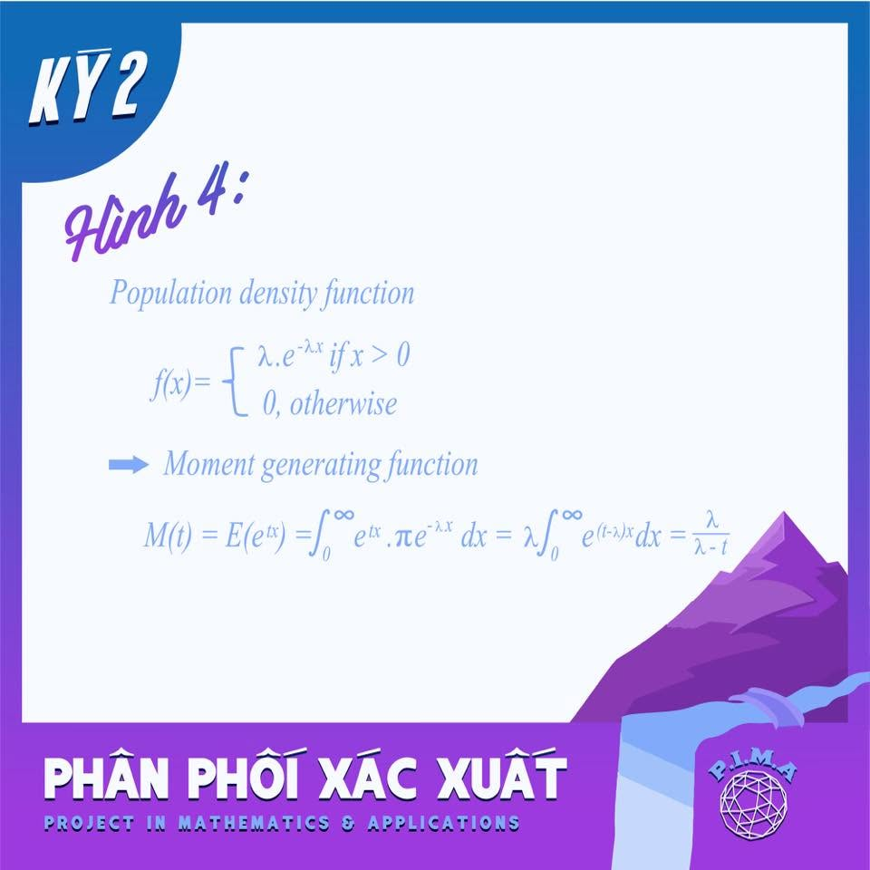

A là quản lý của một nhà hàng. Vào một ngày đẹp trời, ông chủ yêu cầu A báo cáo ngắn gọn thời gian từ lúc mở cửa đến lúc có thực khách đầu tiên bước vào. Dựa vào các số liệu lưu trữ, A nhanh chóng tính được giá trị trung bình (expectation) và phương sai (variance) của khoảng thời gian để có thực khách đầu tiên mỗi ngày. Tuy vậy, A nhận thấy giá trị trung bình và phương sai không hoàn toàn thể hiện đầy đủ được phân phối của dữ liệu. Để biểu diễn và xác định những giá trị đặc trưng của phân phối xác suất thời gian chờ thực khách đầu tiên, A đã dùng hàm sinh moment (moment generating function) của phân phối để báo cáo cho ông chủ.

Trong bài viết này, chúng ta sẽ tìm hiểu xem hàm sinh moment của một phân phối xác suất đóng vai trò như thế nào đối với giá trị kỳ vọng và phương sai và A đã làm cách gì để hoàn thành yêu cầu của ông chủ nhé!

![Hình 1: E(x) = Σ xᵢ·P(x = xᵢ) và Var(x) = E[(x − E(x))²] = E(x²) − (E(x))²](./hinh-1.jpg)

Ở bài viết kỳ trước, chúng ta đã tìm hiểu sơ lược về các phân phối xác suất đối với biến cố ngẫu nhiên. Ngoài hàm khối phân phối xác suất hoặc hàm mật độ xác suất thì giá trị kỳ vọng (expectation) và phương sai (variance) của một biến ngẫu nhiên là những thông tin quan trọng để miêu tả một phân phối xác suất. Giá trị kỳ vọng của một biến ngẫu nhiên $X$ (thường được ký hiệu $E(X)$) là giá trị trung bình với trọng lượng của $X$. Bên cạnh đó, phương sai của $X$ (ký hiệu là $\operatorname{Var}(X)$) là giá trị trung bình của bình phương khoảng cách từ $X$ đến giá trị kỳ vọng $E(X)$. Chúng ta có thể hiểu phương sai của $X$ được dùng để biểu diễn mức độ phân tán xác suất của $X$.

Xét một hàm khối xác suất (probability mass function) $p(x)$ với tập các biến ngẫu nhiên rời rạc $\{x_1, x_2, \ldots, x_k\}$. Trải đều trọng lượng của các biến ngẫu nhiên này lên đòn cân với trục quay ở 0. Khoảng cách từ trục đến một khối lượng thứ $i$ là $x_i$ và trọng lượng tương ứng của khối lượng này là $p(x_i)$.

Trong cơ học, tích của khoảng cách đến trục và trọng lượng của một vật thể còn được gọi là moment, đại lượng ước tính quán tính quay của vật. Tổng moment của phân phối của các biến ngẫu nhiên trên sẽ là: $\sum x_i \, p(x_i)$ hay còn được gọi là giá trị kỳ vọng $E(X)$. Do đó, giá trị kỳ vọng còn được gọi là moment quy tâm gốc bậc 1. Nếu chuyển trục đến vị trí của $E(X)$ trên đòn cân, lúc này, moment quy tâm tác động lên khối lượng $x_1, x_2, \ldots$ sẽ bằng 0.

Tương tự, chúng ta có thể tính được phương sai (moment quy tâm bậc 2):

$$
\operatorname{Var}(X) = E\big((X - E(X))^2\big) = \sum (x_i - E(X))^2 \, p(x_i).
$$

Do tính $E(X)$ và $E(X^2)$ sẽ dễ dàng hơn $E\big((X - E(X))^2\big)$, chúng ta có thể biến đổi cách tính phương sai như sau:

$$
\begin{aligned}
\operatorname{Var}(X) &= E\big((X - E(X))^2\big) = E\big(X^2 - 2X E(X) + (E(X))^2\big) = E(X^2) - 2E(X)E(X) + (E(X))^2 \\
&= E(X^2) - (E(X))^2
\end{aligned}
$$

Và tìm $E(X^2)$ theo công thức $\sum x_i^2 \, p(x_i)$.

Nhờ các moment quy tâm bậc $n$ của $X$, chúng ta có thể tìm các đặc trưng của phân phối xác suất của $X$ như phương sai hoặc độ lệch (skewness). Ta có dạng tổng quát của công thức tính moment quy tâm bậc $n$ như sau:

$$
E\big((X - E(X))^n\big) = \sum (x_i - E(X))^n \, p(x_i).
$$

Đối với nhiều dạng phân phối xác suất, dạng tổng quát tính moment bậc $n$ sẽ khá phức tạp và tốn thời gian. Do đó, nhờ vào phương pháp khai triển Taylor cho hàm mũ $e^x$, chúng ta có thể dùng hàm sinh moment $M(t)$ để tìm moment quy tâm bậc $n$.

Moment bậc $n$ của $X$ thực tế là đạo hàm bậc $n$ của hàm tạo moment của $X$ với $t = 0$:

$$
E(X) = M'(0), \quad E(X^2) = M''(0), \quad \ldots, \quad E(X^n) = M^{(n)}(0)
$$

Quay lại với bài toán mà ông chủ đưa ra cho quản lý A. Xét thấy xác suất để có vị khách đầu tiên trong khoảng thời gian $t$ là $X$, A biết biến ngẫu nhiên $X$ có thể được tổng quát bởi phân phối mũ với tham số $\lambda$ và có hàm mật độ xác suất $f(x)$ (xem hình 4). Nhờ vậy, A đã tìm được hàm sinh moment $M(t)$ và đưa hàm $M(t)$ cho ông chủ.

Thông qua hàm $M(t)$, ông chủ của A có thể dễ dàng tìm ra giá trị kỳ vọng $E(X)$ và phương sai $\operatorname{Var}(X)$ bằng cách tính đạo hàm bậc 1 và bậc 2 của $M(t)$. Không chỉ thế, ông chủ của A còn biết được phân phối xác suất để có vị khách đầu tiên mỗi ngày trong khoảng thời gian $t$ mà không cần phải xem toàn bộ dữ liệu lưu trữ. Vậy là A đã hoàn thành xuất sắc yêu cầu của ông chủ nhờ báo cáo ngắn gọn nhưng cũng rất đầy đủ!

## Tài liệu tham khảo

- Kỳ 1: [Phân phối xác suất (kì 1)](/blog/phan-phoi-xac-suat-ki-1/)
- Hogg, Tanis, and Zimmerman. Probability and Statistical Inference (9th edition)
- <https://towardsdatascience.com/moment-generating-function-explained-27821a739035>
- <https://dominhhai.github.io/vi/2017/10/prob-rand-var/>
