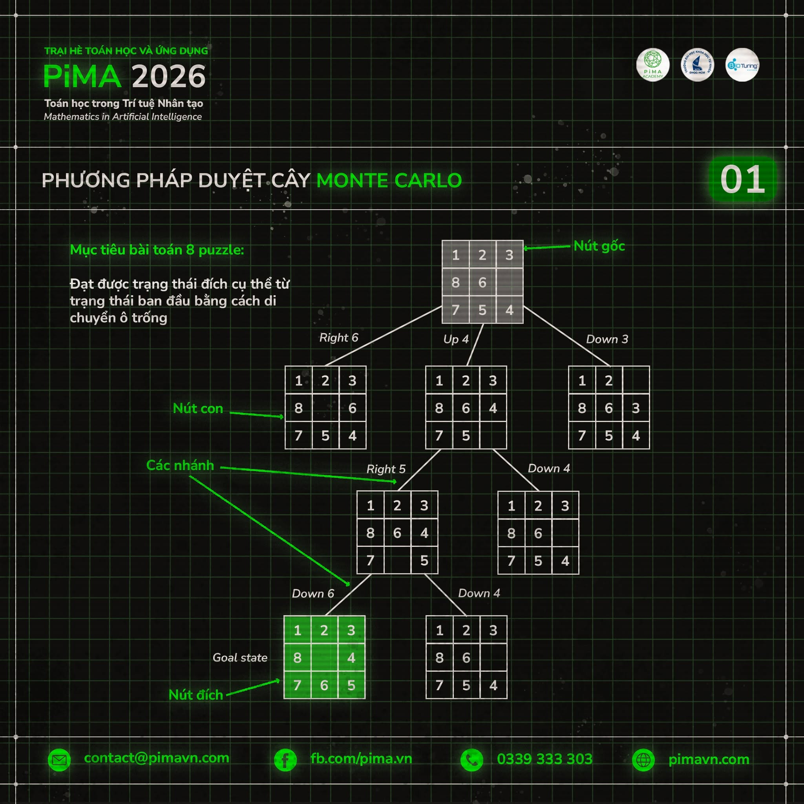
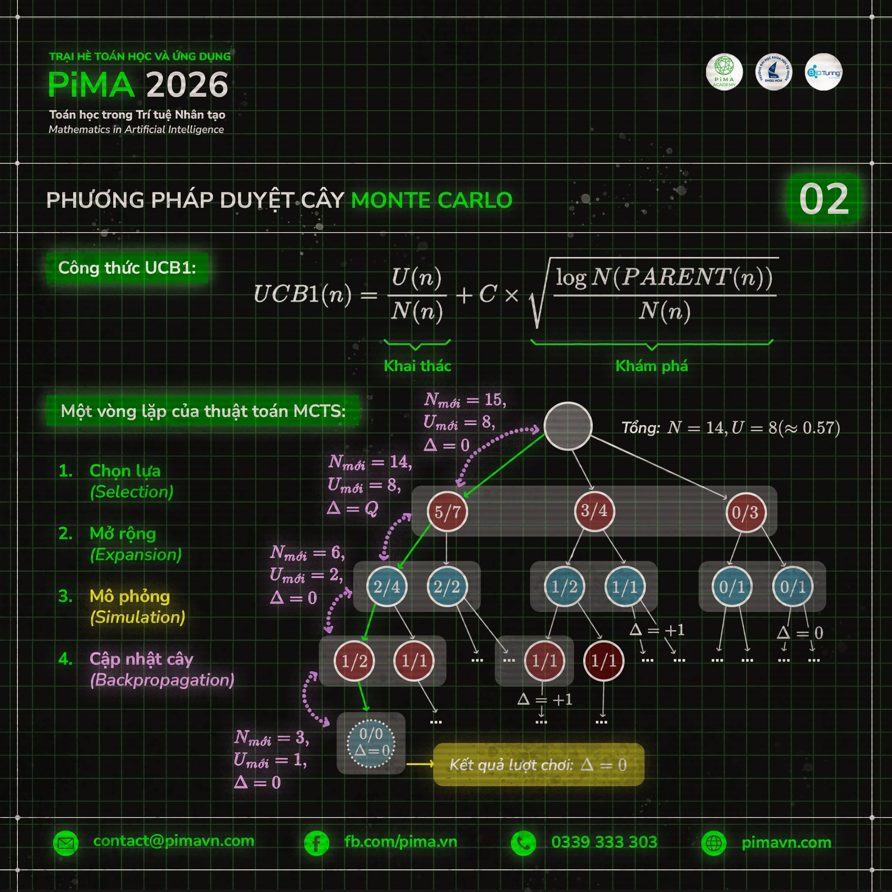

Chắc hẳn nhiều người trong chúng ta đã từng nghe đến trận đấu cờ vây huyền thoại giữa Lee Sedol - người từng 18 lần vô địch thế giới - và AlphaGo, một phần mềm cờ vây máy tính được phát triển bởi Google DeepMind.

Nhưng bạn có bao giờ tự hỏi, điều gì thực sự đứng phía sau khả năng “suy nghĩ” của AlphaGo?

Một trong những mảnh ghép quan trọng nhất đứng sau AlphaGo chính là phương pháp duyệt cây Monte Carlo (Monte Carlo Tree Search, hay MCTS), thuật toán giúp AI khám phá, đánh giá và lựa chọn những hướng đi tiềm năng nhất.

Sau gần một thập kỷ, MCTS vẫn chưa hề lỗi thời mà vẫn tiếp tục xuất hiện trong các nghiên cứu về mô hình ngôn ngữ lớn (Large Language Models, hay LLM) hiện đại.

Trong bài viết hôm nay, chúng ta sẽ cùng tìm hiểu chi tiết hơn về phương pháp duyệt cây Monte Carlo và cách thuật toán này vẫn tiếp tục chứng minh hiệu quả của mình, từ thời kỳ AlphaGo cho đến kỷ nguyên LLM hiện nay.

Nhiều bài toán giải đố (như chơi cờ vây, Rubik, trò chơi trượt ô 8-puzzle, hay giải mã mê cung) trong khoa học máy tính có thể được mô hình hóa một cách trực quan thông qua cấu trúc cây tìm kiếm (search tree).

- **Nút gốc:** Đại diện cho trạng thái khởi đầu của bài toán.
- **Các nhánh:** Mỗi nhánh xuất phát từ một nút đại diện cho một thao tác hoặc nước đi hợp lệ mà người chơi có thể thực hiện.
- **Nút con:** Khi thực hiện một nước đi từ trạng thái hiện tại, bài toán chuyển sang một trạng thái mới, được biểu diễn bằng một nút con.
- **Nút đích:** Trạng thái kết thúc của bài toán.

Với mỗi trạng thái trò chơi (nút) $n$, thuật toán lưu trữ hai thông số chính là $N(n)$ là tổng số lượng trò chơi đã được mô phỏng đi qua nút $n$ và $U(n)$ là tổng số ván thắng trong các mô phỏng đi qua nút $n$.

Các bước của thuật toán MCTS:

1. **Chọn lựa:** Bắt đầu từ nút gốc, thuật toán chọn nút con có giá trị UCB (Upper Confidence Bound) cao nhất để đi xuống qua các tầng của cây cho đến khi gặp một nút lá chưa được mở rộng. Tiêu chí UCB đảm bảo thuật toán cân bằng giữa việc khai thác (exploitation) những nước đi cho kết quả tốt và khám phá (exploration) những nước đi khác.
2. **Mở rộng:** Khi đến một nút lá, thuật toán tạo ra một nút con $n'$ mới tại đó ($N(n') = 0$ và $U(n') = 0$).
3. **Mô phỏng:** Từ nút mới vừa được tạo, thuật toán tiếp tục chơi hoàn toàn ngẫu nhiên cho đến khi trò chơi kết thúc. Kết quả của lượt chơi này sẽ được quy ra điểm delta ($\Delta$): nếu thắng thì $\Delta = +1$, nếu thua hoặc hòa thì $\Delta = 0$.
4. **Cập nhật cây:** Truyền ngược đệ quy lên tất cả các nút cha trên cây cho đến tận nút gốc: $N(n)_{\text{new}} = N(n)_{\text{old}} + 1$ và $U(n)_{\text{new}} = U(n)_{\text{old}} + \Delta$.

Khi thuật toán kết thúc, trả về nút con "tốt nhất" tính từ nút gốc ban đầu. Nút "tốt nhất" thường được chọn là nút có tỷ lệ thắng cao nhất hoặc có tỷ lệ thắng cao nhất kèm theo số lần ghé thăm nhiều nhất.

Hầu hết các LLM hiện nay như ChatGPT chủ yếu suy luận theo hướng tuyến tính. Tuy hiệu quả trong nhiều tác vụ, cách tiếp cận này vẫn tồn tại hạn chế: mô hình khó nhìn trước hậu quả dài hạn, thiếu khả năng mô phỏng môi trường, và gần như không thể quay lui khi suy luận sai hướng.

Trong ngữ cảnh LLM, bài toán là suy luận logic với mỗi nút đại diện cho sự thật hoặc một mệnh đề mà AI đang xem xét để tiếp tục suy diễn. Tương tự như cách AlphaGo tính toán nước đi, LLM ứng dụng MCTS để triển khai các nhánh suy luận. Điểm cải tiến nằm ở bước Mô phỏng: Thay vì chơi ngẫu nhiên, AI tận dụng khả năng Tự đánh giá (Self-evaluation) để chấm điểm phần thưởng cho từng nhánh suy luận. Nhờ đó, hệ thống có thể ưu tiên khám phá những hướng suy luận triển vọng hơn, giảm các lỗi lập luận và nâng cao chất lượng câu trả lời được tạo ra cho prompt của người dùng.

Và đó chính là MCTS - một ý tưởng tưởng chừng đơn giản nhưng đã và đang xuất hiện trong nhiều cột mốc quan trọng của trí tuệ nhân tạo!

## Tài liệu tham khảo

- Massachusetts Institute of Technology. (2016). Monte Carlo Tree Search. MIT OpenCourseWare. [https://ocw.mit.edu/courses/16-412j-cognitive-robotics-spring-2016/resources/mit16_412js16_l17/](https://ocw.mit.edu/courses/16-412j-cognitive-robotics-spring-2016/resources/mit16_412js16_l17/)

## Người thực hiện

**Người biên soạn**

- Đặng Trọng Bảo Thi: Mentor Ban Học thuật, Trại hè Toán học và Ứng dụng PiMA 2026

**Minh họa & Thiết kế**

- Hà Phương Uyên: Lead Media, Trại hè Toán học và Ứng dụng PiMA 2026

**Reviewers**

- Trần Phan Anh Danh: Co-head Ban Học thuật, Trại hè Toán học và Ứng dụng PiMA 2026
- Vòng Vĩnh Toàn: Co-head Ban Học thuật, Trại hè Toán học và Ứng dụng PiMA 2026
