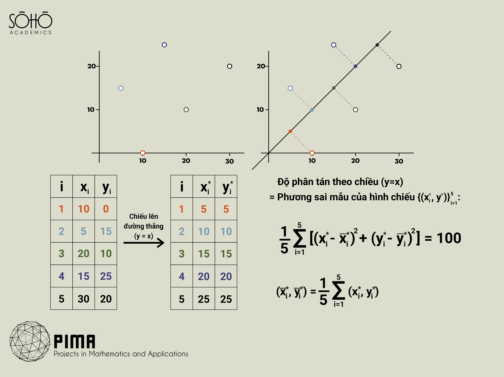
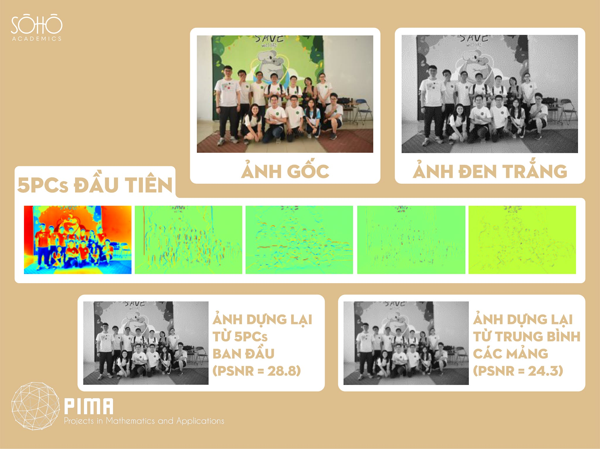

Bài toán giảm chiều dữ liệu là một vấn đề trọng yếu của data science. Trong bài viết này, chúng ta sẽ cùng tìm hiểu ý tưởng chính của phương pháp Principal Component Analysis (PCA) thông qua một ứng dụng cụ thể trong thị giác máy tính.

Trước khi các mạng neuron nhân tạo (artificial neural network) trở nên mạnh mẽ và được sử dụng phổ biến để nhận diện ảnh, các thuật toán giảm chiều dữ liệu được xem như những công cụ đắc lực nhất cho bài toán này. Hiện nay các thuật toán này vẫn thường được sử dụng trong việc tiền xử lý (preprocessing) ảnh input trước khi đưa vào các mạng neuron, không chỉ vì chúng giảm chiều input giúp tăng tốc độ tính toán của mạng neuron lên nhiều lần, mà còn nhờ vào khả năng phát hiện và biểu diễn các thuộc tính (feature) của ảnh một cách trực quan, dễ mô tả bằng lời. PCA còn đặc biệt hữu dụng hơn nhờ khả năng “bonus” giúp tái tạo lại gần đúng dữ liệu input từ dữ liệu output.

Thuật toán Principal Component Analysis có thể được dịch nôm na là “Phân tích thành phần chính” hay “Phân tích chiều chính”, tức là phân tách các chiều không gian chứa đựng nhiều thông tin nhất của dữ liệu input. Các chiều không gian này tạo thành một hệ trục tọa độ cho không gian output, mà khi phóng chiếu các điểm dữ liệu input lên hệ trục này theo phép chiếu vuông góc thông thường, ta thu được dữ liệu output.

Một hệ các “chiều chính” (principal component) tốt cần thỏa mãn hai tiêu chí:

1. Các chiều trong hệ vuông góc với nhau (orthogonality).
2. Mức độ phân tán (variation) của dữ liệu input là nhiều nhất có thể khi xem xét hình chiếu lên các chiều trong hệ (sao cho vẫn thỏa mãn tiêu chí 1).

Để đạt được cả hai tiêu chí, một ý tưởng sơ khai cho thuật toán PCA bao gồm các bước:

1. Tìm chiều không gian có mức độ phân tán lớn nhất của dữ liệu input (tiêu chí 2). Hiểu nôm na, nếu các điểm dữ liệu input là các đám mây nhỏ và chiều không gian là một con đường, ta cần xây con đường sao cho khi đi trên đường, các bóng đổ xuống của những đám mây được phân tán ra hết mức có thể. Những “cái bóng” này chính là Principal Component (PC) đầu tiên.

2+. Ở các bước sau, ta lần lượt tìm các “con đường” vuông góc với các con đường đã tìm được với độ phân tán của những chiếc bóng lớn nhất có thể để tìm các PC tiếp theo.

Ví dụ 1: Trong ví dụ đơn giản trong hình, ta thử tìm Principal Component đầu tiên cho các điểm dữ liệu trong không gian 2 chiều. Giả sử phương trình của đường thẳng chứa PC đầu tiên có dạng: $ax + by = c$, với giả thiết chuẩn hóa: $a^2 + b^2 = 1$. Khi đó mỗi điểm dữ liệu $(x_i, y_i)$ sẽ “đổ bóng” xuống đường thẳng này tại tọa độ

$$
(x_i^*, y_i^*) := \big(x_i - a(ax_i + by_i - c),\ y_i - b(ax_i + by_i - c)\big).
$$

“Độ phân tán” $D(a, b, c)$ của các chiếc bóng được tính bằng phương sai mẫu của các hình chiếu $(x_i^*, y_i^*)$ theo công thức như hình. Bây giờ ta chỉ việc tìm $a, b, c$ để $D(a, b, c)$ đạt giá trị lớn nhất, thì tập hợp các “bóng”/hình chiếu $(x_i^*, y_i^*)$ chính là PC đầu tiên và đường thẳng $ax + by = c$ chính là “con đường” chứa PC này.

Trong tập dữ liệu input gồm 5 điểm trên hình, có thể tính được “con đường” này là đường thẳng $x = y$ và PC đầu tiên là hình chiếu của các điểm input lên đường thẳng này, có tọa độ như hình.

Ví dụ 2: Phát hiện các đường nét trong ảnh bằng PCA.

Để thể hiện sức mạnh của PCA trong việc nhận diện ảnh, hãy thử quy trình sau trên một bức ảnh đen trắng bất kỳ:

1. Lấy ra các mảng $10 \times 10$ (pixel) của ảnh, với khoảng cách trượt là 5 pixels cho mỗi mảng mới. Số mảng có được xấp xỉ bé hơn 25 lần so với số pixels của ảnh gốc, mỗi mảng có thể được xem như một điểm dữ liệu 100 chiều.
2. Thực hiện PCA để tìm ra 5 Principal Components đầu tiên của các mảng trên. Sau đó sắp xếp lại từng thành phần của mỗi PC theo vị trí tương ứng của mảng mà nó đại diện, ta được một bức ảnh có kích thước bé hơn 25 lần so với ảnh gốc, thể hiện một “loại đường nét” (feature) của ảnh gốc.

Bức ảnh mẫu trên hình có kích thước $1125 \times 1685$, khi trích xuất ra các mảng $10 \times 10$ với khoảng cách trượt 5 sẽ tạo được $224 \times 336 = 75264$ mảng. Quan sát 5 PCs đầu tiên từ các mảng (khi sắp xếp lại đúng vị trí), ta thấy PC đầu tiên thể hiện các vùng màu sắc trên ảnh, PC thứ hai thể hiện các cạnh đứng, PC thứ ba các cạnh ngang, v.v.

Hơn nữa, có thể tái tạo xấp xỉ lại ảnh ban đầu từ 5 PCs này (phương pháp tái tạo chúng mình xin không bàn sâu). Bức ảnh tái tạo bằng 5 PCs trông sắc nét và sát với ảnh gốc hơn, với Peak Signal-to-noise Ratio \[1\] (PSNR) là 28.8. Trong khi đó, bức ảnh tạo từ việc lấy trung bình từng mảng trông khá mờ với PSNR chỉ 24.3.

## Tài liệu tham khảo

- \[1\] <https://www.mathworks.com/help/vision/ref/psnr.html>
