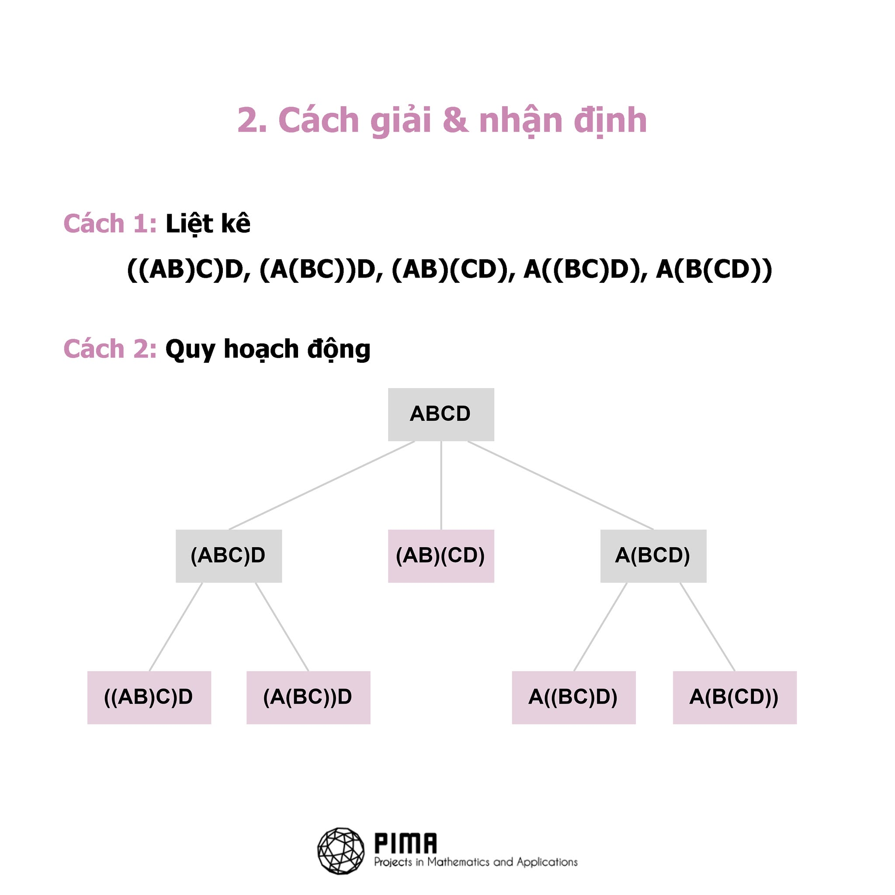
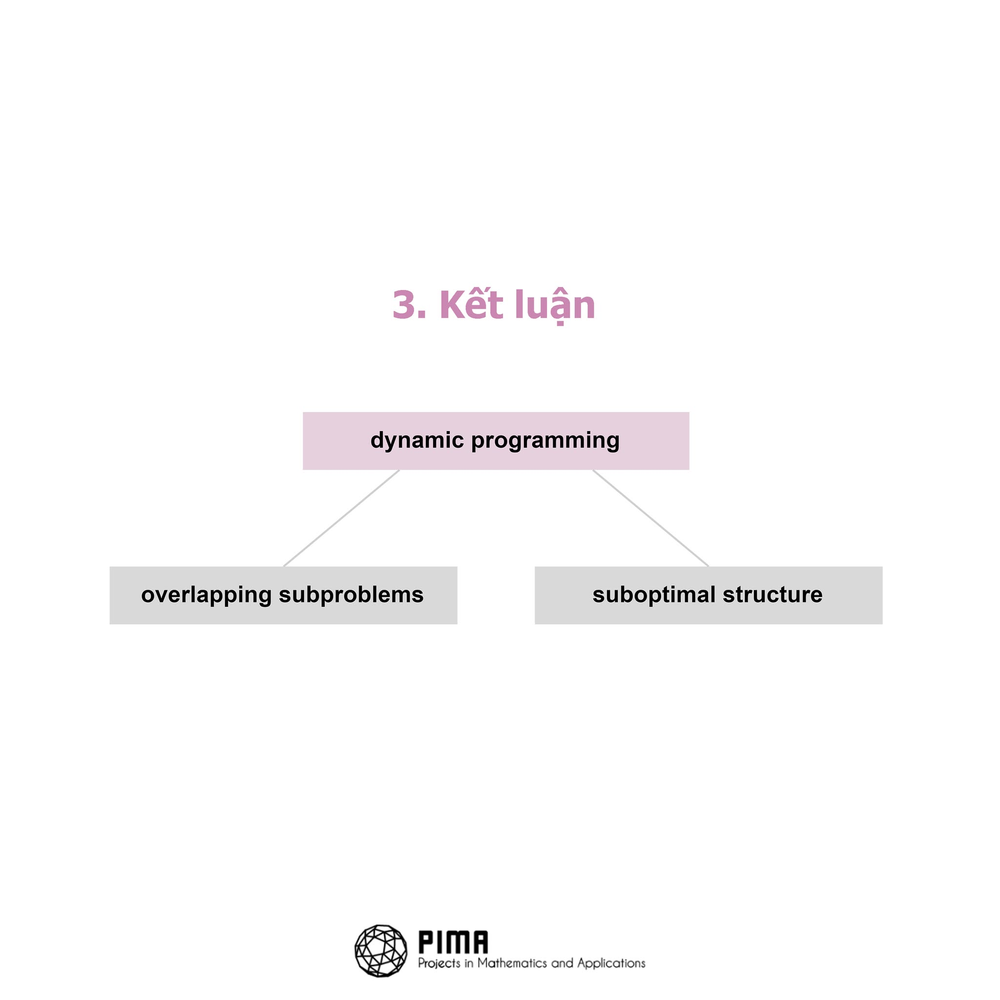

Trong sự phát triển bùng nổ của khoa học dữ liệu và trí tuệ nhân tạo, chúng ta đã và đang phải tiếp xúc, thao tác với những lượng dữ liệu vô cùng lớn và phức tạp. Những dữ liệu ấy thường được tổ chức, lưu trữ và biểu diễn trên nhiều mô hình, cấu trúc khác nhau.

Trong đó, ma trận được sử dụng khá phổ biến. Khi làm việc trên ma trận, một phép tính rất thường dùng đó là phép nhân ma trận. Tuy nhiên, phép này có số phép tính lớn (để nhân 2 ma trận $(n, m)$ và $(m, p)$ thì tốn $n \cdot m \cdot p$ phép nhân!).

Liên quan tới phép nhân ma trận chính là bài toán nhân một chuỗi các ma trận. Hôm nay, PiMA sẽ cùng các bạn phân tích xem phương pháp quy hoạch động có thể tối ưu độ phức tạp của bài toán này không nhé!

Trước đây, PiMA đã chia sẻ về Dynamic programming - Quy hoạch động. Đây là một phương pháp tối ưu nhiều vấn đề trong tin học và toán học. Các bạn có thể tìm hiểu qua [bài viết sau](https://www.facebook.com/pima.vn/posts/1041897819308583). Đồng thời, để dễ dàng tiếp cận bài toán của kỳ này, các bạn có thể xem qua [bài viết về ma trận của PiMA](https://www.facebook.com/pima.vn/posts/1506729086158785).

## 1. Bài toán

Quay lại với bài toán, tưởng tượng bạn có 3 ma trận $A$ ($6 \times 5$), $B$ ($5 \times 2$), $C$ ($2 \times 1$) và bạn cần tìm kết quả $ABC$. Nếu bạn thực hiện phép nhân một cách bình thường từ trái sang phải, thì số lượng phép nhân bạn cần thực hiện là: $6 \cdot 5 \cdot 2 + 6 \cdot 2 \cdot 1 = 72$ (chi phí tính $AB$ là $6 \cdot 5 \cdot 2$, sau đó chi phí tính $(AB)C$ là $6 \cdot 2 \cdot 1$).

Nhưng nếu bạn thực hiện phép nhân theo thứ tự khác: $A(BC)$ thì số lượng phép nhân bạn cần thực hiện sẽ là: $5 \cdot 2 \cdot 1 + 6 \cdot 5 \cdot 1 = 40$ (chi phí tính $BC$ là $5 \cdot 2 \cdot 1$, sau đó, chi phí tính $A(BC)$ là $6 \cdot 5 \cdot 1$).

Chỉ bằng việc thực hiện phép tính kết hợp, ta đã giảm được rất nhiều phép tính nhân trong phép nhân chuỗi ma trận, do đó bài toán được đặt ra khi ta có một chuỗi $n$ ma trận $A_1, A_2, \ldots, A_n$, có cách nào để tìm được chi phí tối thiểu (số phép nhân ít nhất) khi nhân $n$ ma trận này hay không? PiMA sẽ đề cập tới các bạn 2 cách xử lý trong ảnh tiếp theo.

## 2. Cách giải & nhận định

### Cách 1

Thông thường, để tìm được trình tự thực hiện các phép toán cho chi phí thấp nhất, có thể liệt kê ra hết tất cả các trình tự có thể và chọn trình tự có chi phí nhỏ nhất, ví dụ với 4 ma trận $A, B, C, D$ thì được 5 trình tự nhân: $((AB)C)D$, $(A(BC))D$, $(AB)(CD)$, $A((BC)D)$, $A(B(CD))$. Cách làm này tuy đơn giản nhưng mất rất nhiều thời gian để liệt kê được mọi trình tự (với chuỗi 10 ma trận thì có tới tận 4862 trình tự khác nhau), do đó cách làm này chỉ phù hợp với số lượng ma trận rất nhỏ.

### Cách 2

Để ý trong cách làm thứ nhất, khi ta liệt kê hết mọi trình tự thì ta thấy có rất nhiều bài toán con được lặp lại, ví dụ phép tính $AB$ được lặp lại 2 lần, $BC$, $CD$ cũng đều được lặp lại 2 lần. Ta cũng thấy bài toán $ABC$ cũng được lặp lại 2 lần (ở dưới 2 dạng khác nhau là $(AB)C$ và $A(BC)$), tương tự với $BCD$ cũng được lặp lại 2 lần. Do đó, ta nói bài toán này có tính chất bài toán con gối nhau (overlapping subproblems)(\*).

Khi số lượng ma trận lớn hơn, ngày càng nhiều các bài toán con bị lặp lại, rõ ràng việc tính toán lại các bài toán con này là vô nghĩa, do đó ta chỉ cần tính một lần và lưu lại kết quả để áp dụng cho những lần lặp lại bài toán con.

Ta cũng thấy bài toán này khi muốn tính được $ABCD$ thì ta phải tính được các bài toán nhỏ hơn, sau đó lại dùng kết quả của bài toán nhỏ hơn để tính ngược lại bài toán lớn. Ta nói bài toán này có tính chất cấu trúc con tối ưu (optimal substructure)(\*\*).

Do bài toán có đầy đủ tính chất bài toán con gối nhau, và cấu trúc con tối ưu nên ta có thể sử dụng phương pháp quy hoạch động để tối ưu chi phí xử lý ví dụ bài toán nhân chuỗi 4 ma trận $ABCD$ như sau:

1. Tách chuỗi $ABCD$ thành $A(BCD)$, $(AB)(CD)$ hoặc $(ABC)D$.
2. Tính chi phí tối ưu cho các bài toán con trên. Với mỗi bài toán con, thực hiện tách thành các bài toán nhỏ hơn, và áp dụng cách làm tương tự để giải các bài toán nhỏ đó.
3. Từ các chuỗi ma trận con, tìm chi phí tối ưu cho bài toán ban đầu.

## 3. Kết luận

Trên đây chính là quá trình phân tích để áp dụng phương pháp quy hoạch động (Dynamic Programming) vào bài toán nhân một chuỗi các ma trận. Chung quy lại, để giải bài toán bằng phương pháp quy hoạch động như trên, ta cần xác định các yếu tố của bài toán. Trong đó có 2 yếu tố chính:

- Bài toán có bài toán con gối nhau (overlapping subproblems)(\*)
- Bài toán có cấu trúc con tối ưu (optimal substructure)(\*\*)

Thông qua bài viết này, PiMA đã cùng với các bạn tìm hiểu được một phần nào đó về việc áp dụng phương pháp quy hoạch động trong các bài toán nhân chuỗi ma trận. Mặc dù phương pháp quy hoạch động là một phương pháp tối ưu hiệu quả, tuy nhiên không phải bài toán nào cũng có thể áp dụng quy hoạch động (điều kiện cần là bài toán cần có 2 tính chất đã nêu). Đối với nhiều bài toán, tuy có thể áp dụng được phương pháp quy hoạch động, nhưng đây chưa phải phương pháp tối ưu, chẳng hạn bài toán chuỗi ma trận có một thuật toán tốt hơn với độ phức tạp $O(n \log n)$ thay vì $O(n^3)$ như nhân ma trận. Do đó, ta cần phải xem xét các hướng giải để chọn ra phương án tối ưu phù hợp cho từng bài toán.

## Tài liệu tham khảo

- <https://topdev.vn/blog/thuat-toan-quy-hoach-dong/#vi-du-1-bai-toan-kinh-dien-voi-dong-xu>
- <https://www.giaithuatlaptrinh.com/?p=66>
- <https://en.wikipedia.org/wiki/Matrix_chain_multiplication>
