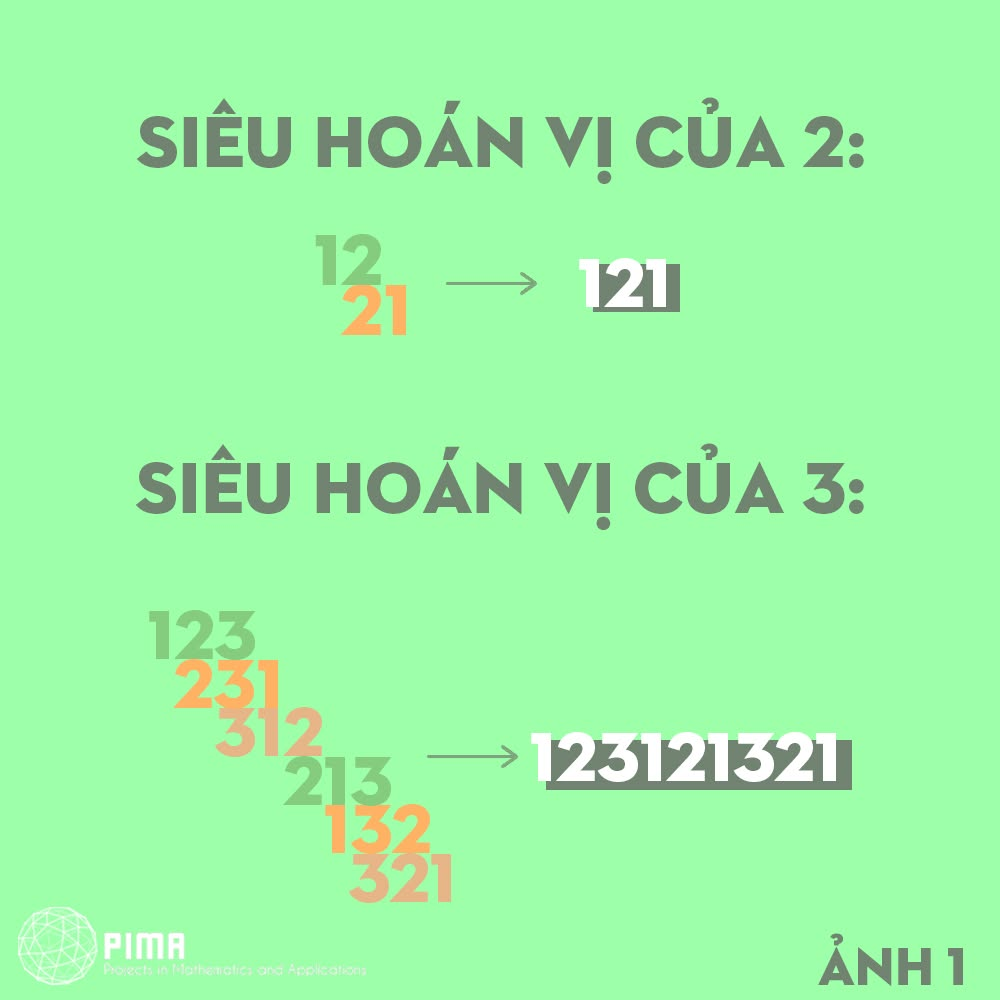
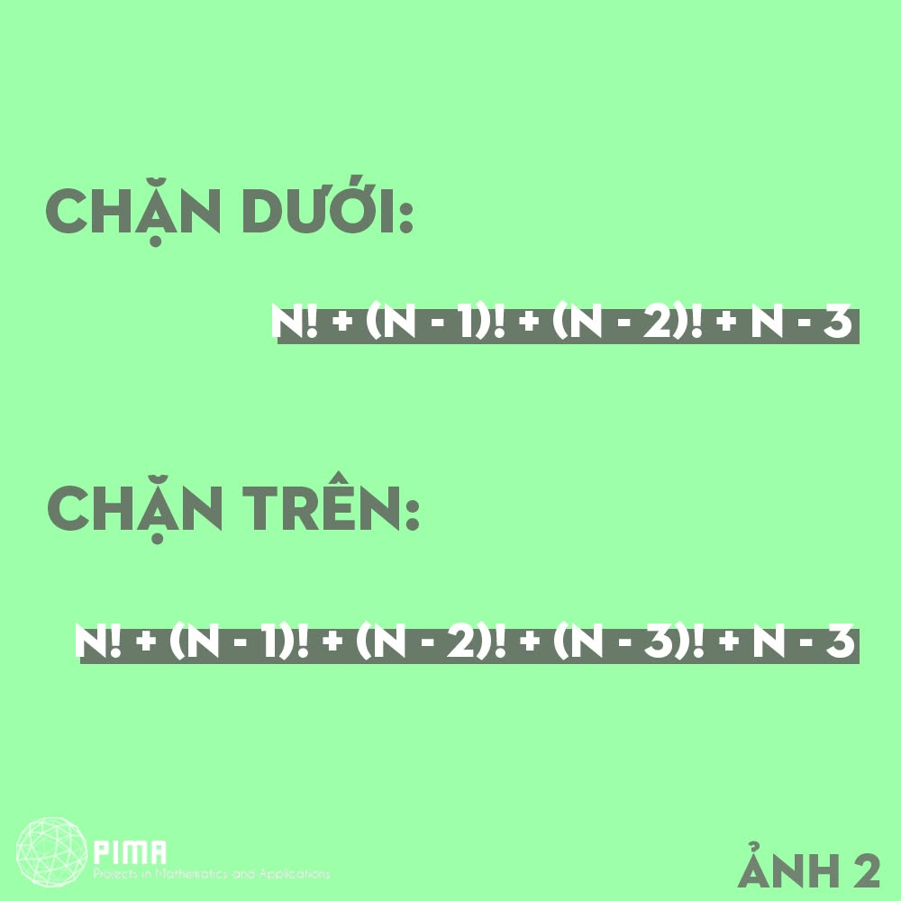

Kỳ này, PiMA xin giới thiệu với bạn đọc một bài toán rất thú vị về superpermutation - siêu hoán vị.

Một ngày nọ, Thế Anh quyết định xem một bộ phim hoạt hình Nhật Bản có tên là The Melancholy of Haruhi Suzumiya (tạm dịch: Nỗi Buồn của Haruhi Suzumiya). Phần một của bộ phim này có 14 tập. Bộ phim này có một điểm đặc biệt đó là thứ tự xem các tập phim là không quan trọng, ta có thể xem theo bất kì hoán vị nào của 14 tập phim, mỗi hoán vị sẽ cho ta một cốt truyện khác nhau. Do muốn tìm hiểu sâu hơn về bộ phim, Thế Anh đã tìm cách xem hết toàn bộ tất cả các hoán vị có thể của 14 tập phim đó. Ban đầu, bạn ấy xem từng hoán vị một theo thứ tự, hiển nhiên số tập phim phải xem là $14! \cdot 14$. Thấy Thế Anh dùng quá nhiều thời gian để xem anime, Trung đã cố gắng tìm ra một thứ tự xem ít tập phim hơn cho Thế Anh. Trung nhận ra 2 hoán vị không nhất thiết phải nằm tách hẳn khỏi nhau, để tối ưu, có thể cho 2 hoán vị nằm gối lên nhau.

Ví dụ: Nếu chỉ có 2 tập phim, ta có 2 hoán vị là (1, 2) và (2, 1); Thế Anh có thể dùng thứ tự [1, 2, 1] để xem hết cả 2 hoán vị.

Tới đây Trung nhận thấy bài toán cần giải quyết là: Tìm ra một thứ tự xem phim ngắn nhất có thể nhưng vẫn chứa đủ hết tất cả các hoán vị của 14 tập phim (các hoán vị có thể nằm gối lên nhau, nhưng mỗi hoán vị phải nằm liên tiếp trong dãy thứ tự).

Do kết quả có thể rất lớn nên Trung đã thử giải bài toán trên với ít tập phim hơn, nếu chỉ có 2 tập phim thì dãy số ngắn nhất thỏa mãn đó là dãy [1,2,1] (chứa cả hoán vị (1,2) và (2,1) như các dãy con liên tiếp), nếu có 3 tập thì có dãy [1,2,3,1,2,1,3,2,1], 4 tập thì sẽ là [1,2,3,4,1,2,3,1,4,2,3,1,2,4,3,1,2,1,3,4,2,1,3,2,4,1,3,2,1,4,3,2,1].

Dãy số thỏa mãn điều kiện trên còn được gọi là dãy siêu hoán vị (superpermutation), và bài toán tìm ra độ dài của dãy số siêu hoán vị ngắn nhất là một bài toán được nghiên cứu từ năm 1993. Tính tới thời điểm hiện tại, độ dài của dãy siêu hoán vị ngắn nhất với $n = 6$ (và lớn hơn) vẫn chưa được tìm ra, chỉ có các kết quả về chặn trên và chặn dưới của nó.

Vào năm 2011, nhiều người cũng có cùng câu hỏi với Trung khi xem bộ anime trên, họ đã lập một bài đăng về việc tìm kiếm độ dài của dãy số này, sau này còn được gọi là The Haruhi Problem. Một người dùng ẩn danh đã đưa ra chặn dưới sau đây: nếu có $n$ tập phim ($n \ge 2$), thì số tập phim phải xem ít nhất phải lớn hơn hoặc bằng

$$
n! + (n - 1)! + (n - 2)! + n - 3.
$$

Kết quả trên tốt hơn tất cả kết quả của các nhà toán học trước đó. Tới nay, danh tính của người dùng ấy vẫn là một bí ẩn.

Vào ngày 20/10/2018, một chặn trên đã được nhà khoa học Greg Egan người Úc đưa ra, ông chứng minh rằng độ dài của dãy siêu hoán vị ngắn nhất với $n$ tập phim ($n \ge 7$), số tập phim nhiều nhất phải xem là

$$
n! + (n - 1)! + (n - 2)! + (n - 3)! + n - 3.
$$

Vậy, Thế Anh cần xem khoảng 93.884.313.611 tới 93.924.230.411 tập phim để có thể xem được hết toàn bộ các hoán vị 14 tập của anime Haruhi. Nếu xem độ dài của một tập anime là 20 phút thì Thế Anh chỉ cần bỏ ra gần 3,6 triệu năm để xem hết số lượng tập phim trên.

## Tài liệu tham khảo

- <https://mathsci.fandom.com/wiki/The_Haruhi_Problem>
- <https://en.wikipedia.org/wiki/Superpermutation>
- <https://www.youtube.com/watch?v=OZzIvl1tbPo>
