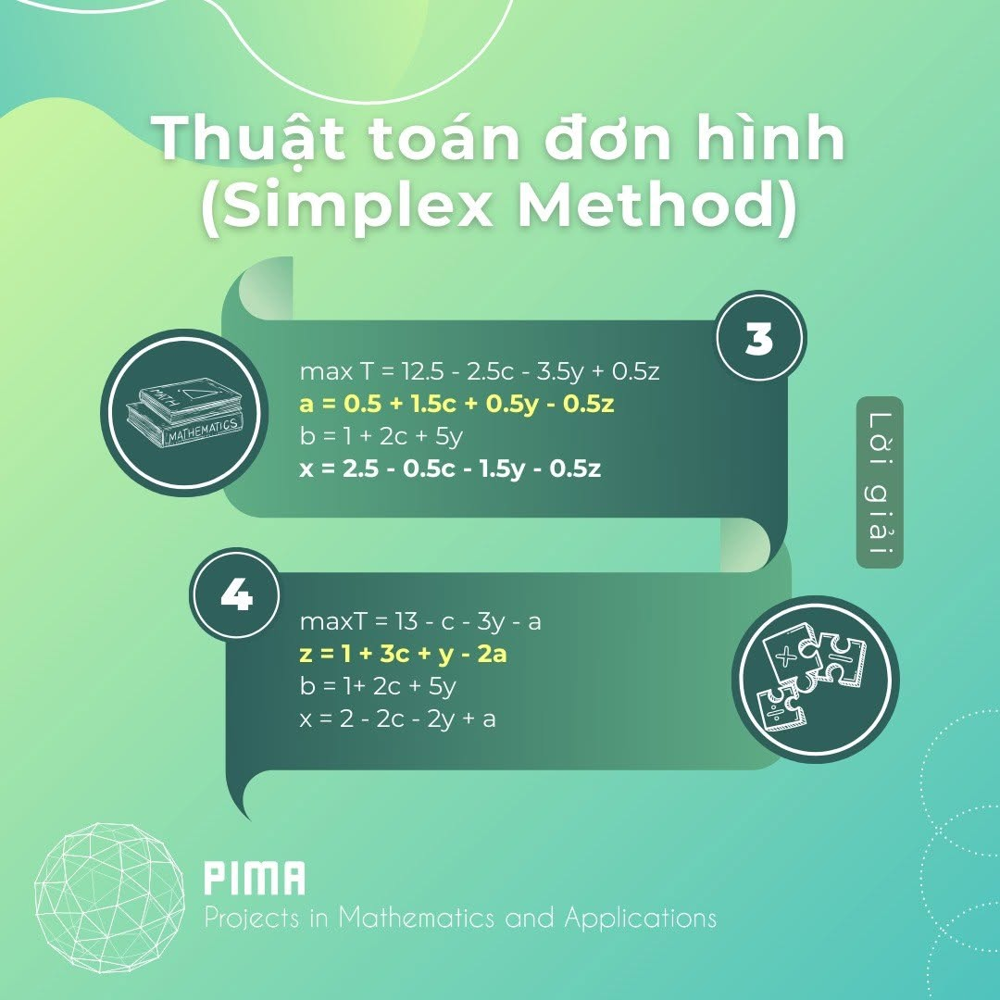

Trong bài viết kỳ này, chúng ta sẽ giới thiệu Thuật toán Đơn hình (Simplex Method) qua một ví dụ tính toán cụ thể. Thuật toán này do Dantzig tìm ra vào năm 1947, được các giáo sư uy tín bầu chọn là 1 trong 10 thuật toán quan trọng nhất Thế kỷ 20, và có ý nghĩa lớn trong việc Kantorovich giành giải Nobel Kinh tế vào năm 1975.

Ở miền đồng bằng sông Chín Rồng xa xôi, anh Việt có một thửa ruộng rộng 8 ha để trồng lúa, ngô và đậu phộng (lạc). Theo kinh nghiệm của tổ tiên, để trồng được một tấn lúa thì phải có một diện tích đất là 3 ha, một tấn ngô sẽ chiếm 4 ha và một tấn đậu phộng đòi hỏi phải có 2 ha. Về nhu cầu phân bón cho cây, theo tính toán của anh, một tấn lúa, ngô và đậu phộng sẽ lần lượt cần một lượng phân bón là 400, 100 và 200 kg. Mặt khác lượng nước cần dùng để sản xuất cùng một khối lượng sản phẩm như trên (1 tấn) của lúa, ngô và đậu phộng lần lượt là 200, 300, 100 tấn nước. Do hạn chế của kỹ thuật và nguồn vốn gia đình, anh Việt chỉ có thể đầu tư 1.1 tấn phân bón và kênh đào của anh chỉ có thể vận chuyển tối đa 500 tấn nước vào ruộng.

Anh Việt cần lập kế hoạch trồng bao nhiêu tấn lúa, ngô và đậu phộng sao cho tổng số tiền bán nông sản là cao nhất, biết rằng một tấn lúa, ngô và đậu phộng có giá bán lần lượt là 5, 4, 3 triệu đồng?

Sau đây là một giải pháp đơn giản của anh Việt, chỉ gồm các bước thế rất “nghệ thuật”. Các bạn có thể tự tay thế lại các bước này để thấy sự “ảo diệu” cùng sự “ngây thơ trong sáng”.

Bước 1: Anh Việt đặt khối lượng lúa mà anh định trồng là $x$ (tấn), tương tự khối lượng ngô và đậu phộng lần lượt là $y, z$ (tấn). Khi đó $x, y, z \ge 0$. Dựa vào các điều kiện của đề bài, ta thu được bài toán tối ưu hóa như mục 1 hình bên.

Bước 2: Anh Việt thêm các biến phụ $a, b, c \ge 0$ như biểu diễn ở mục 2 hình bên. Thao tác này giúp biến đổi các bất phương trình thành phương trình để dễ dàng “thế” mà không làm thay đổi giá trị lớn nhất của $T$.

Bước 3: Trong phương trình thứ ba, giữ $x$ bên trái, đẩy $y, z, c$ qua vế phải. Thế $x$ ở các phương trình còn lại theo phương trình này để có biểu diễn của $T, x, a, b$ theo $c, y, z$ (mục 3 hình bên).

Bước 4: Trong phương trình đầu, rút $z$ qua trái, đẩy $a$ qua phải, thay $z$ trong các phương trình còn lại theo phương trình này để biểu diễn $T, b, x, z$ theo $a, c, y$ (mục 4 hình bên).

Đến đây, do $a, y, c \ge 0$ nên $T \le 13$. Để đạt được lợi nhuận này thì $a = y = c = 0$, thế vào giải hệ phương trình, anh Việt thu được $x = 2$, $b = 1$, $z = 1$.

Tức là anh ấy nên trồng 2 tấn lúa, 1 tấn đậu phộng và không trồng ngô thì sẽ được doanh thu lớn nhất là 13 triệu. Thậm chí anh Việt chỉ cần đầu tư đúng 1 tấn phân bón chứ không cần mua thừa thêm 100 kg phân bón nữa. Không những lợi nhuận cao nhất mà còn tiết kiệm được thêm phân bón!

Sau khi xem xong giải pháp của anh Việt, chúng ta có thể thấy đây là cách giải “có lý” nhưng sẽ có hàng loạt nghi vấn sau đây về cách thế rất “ngây thơ” này.

1. Tại sao ta lại nghĩ đến cách thêm ẩn phụ $a, b, c$ vào bài toán?
2. Tại sao trong bước thứ ba ta lại chọn phương trình thứ ba để đổi vị trí của $x$ không phải là hai phương trình còn lại?
3. Thêm vào đó, tại sao trong phương trình này ta lại đổi vai trò của $x$ mà không phải là $c$ hay $y$ hay $z$?
4. Tại sao sau bước thứ ba ta không dừng lại mà lại phải tiến hành bước “thế” thứ tư?
5. Tại sao bước thứ tư ta lại chọn phương trình đầu để đổi vai trò của $a$ và $z$ mà không phải là $a$ và các biến $c$ hay $y$?
6. Tại sao sau bước thứ tư thì ta dừng và có thể khẳng định bài toán đã được giải quyết?

Và hàng loạt câu hỏi khác, liệu cách làm của anh Việt có thật sự “ngây thơ trong sáng” không? Phương pháp thế này rất đơn giản nhưng liệu có dễ nghĩ ra và thực hiện không?
