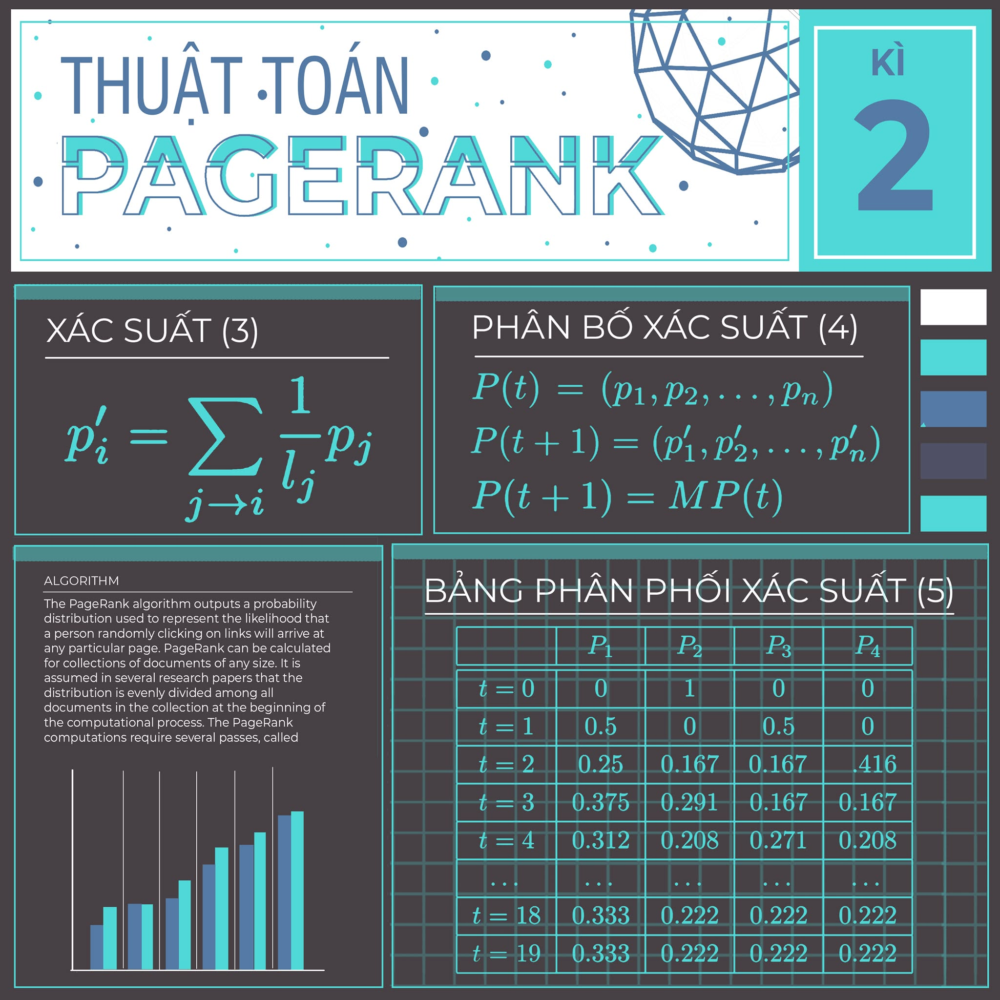

Ở kì trước, ta đã minh họa cách xác định trọng lượng của một trang web qua một ví dụ đơn giản với mô hình gồm 4 trang. Tuy nhiên, khi số trang rất lớn thì việc giải hệ phương trình tuyến tính là vô cùng khó khăn. Ở kì này, chúng ta cùng xây dựng mô hình tổng quát để xác định trọng lượng của $n$ trang bất kì.

Nhắc lại công thức hồi quy (1). Ta viết công thức trên dưới dạng ma trận:

$$
\mu_i = \sum_{j \to i} \frac{\mu_j}{l_j} \quad \Longleftrightarrow \quad \mu = M\mu.
$$

Trong đó, $\mu = (\mu_1, \mu_2, \ldots, \mu_n)^T$ là vector trọng lượng và $M = (m_{ij})$ là ma trận với $m_{ij} = 1/l_j$ nếu trang $P_j$ trỏ liên kết đến trang $P_i$ và $m_{ij} = 0$ nếu trang $P_j$ không trỏ liên kết đến trang $P_i$.

Với ví dụ mô hình 4 trang web ở kì trước (xem mô hình (2) ở hình đầu bài),

$$
M = \begin{pmatrix} 0 & \frac{1}{2} & \frac{1}{2} & \frac{1}{2} \\ \frac{1}{3} & 0 & 0 & \frac{1}{2} \\ \frac{1}{3} & \frac{1}{2} & 0 & 0 \\ \frac{1}{3} & 0 & \frac{1}{2} & 0 \end{pmatrix},
$$

dễ thấy $M$ là một ma trận ngẫu nhiên - tổng các hệ số trên mỗi cột đều bằng 1.

Chú ý rằng các hệ số $1/l_j$ trong ma trận $M$ cũng chính là xác suất để một người lướt web đi ngẫu nhiên từ trang $P_j$ đến trang $P_i$ (xác suất bằng 0 nếu không có đường dẫn nào từ $P_j$ đến $P_i$). Giả sử ở thời điểm $t$, người lướt web đang ở trang $P_j$ với xác suất $p_j$ thì xác suất để người đó đi từ trang $P_j$ theo đường dẫn $j \to i$ được xác định bởi $\frac{1}{l_j} p_j$. Vậy, ở thời điểm $t + 1$, xác suất để người đó đi đến trang $P_i$ là

$$
p'_i = \sum_{j \to i} \frac{1}{l_j} p_j. \tag{3}
$$

Kí hiệu phân bố xác suất ở thời điểm $t$ bởi $P(t) = (p_1, p_2, \ldots, p_n)$ và phân bố xác suất ở thời điểm $t + 1$ bởi $P(t+1) = (p'_1, p'_2, \ldots, p'_n)$. Công thức trên trở thành

$$
P(t + 1) = MP(t). \tag{4}
$$

Một câu hỏi đặt ra là nếu một người lướt web chọn ngẫu nhiên một đường dẫn bất kì thì vị trí của người đó sẽ tiến triển thế nào?

Hệ mà chúng ta đang xét là một xích Markov hữu hạn đồng nhất thời gian (time-homogeneous Markov chains), do đó sẽ tồn tại một phân bố đặc biệt mà ở đó nếu như hệ chạm đến thì sẽ không thoát được phân bố này. Người ta gọi đây là trạng thái cân bằng (equilibrium) và phân bố lúc này là phân bố dừng (stationary distribution) của xích Markov hữu hạn đồng nhất thời gian.

Cho trước phân bố ban đầu $P(0)$, nếu kể từ một thời điểm nào đó, dãy phân bố xác suất $P(t)$ hội tụ, thì giới hạn $\mu$ của dãy đó sẽ thỏa mãn $\mu = M\mu$.

Quay lại ví dụ trên, giả sử người lướt web xuất phát từ trang $P_2$, tức trạng thái đầu là $(0, 1, 0, 0)$ thì sau 18 bước sẽ đạt trạng thái dừng $(0.333, 0.222, 0.222, 0.222)$. Các bước thể hiện trong bảng phân phối xác suất (xem hình (5)).

Ý tưởng ban đầu tưởng chừng hoàn hảo nhưng gặp phải một vấn đề: Nếu có một “hố đen” (trang không trỏ liên kết đến trang nào khác) thì phân bố dừng là $(\ldots, 1, \ldots)$ - một vị trí bằng 1, tất cả các vị trí còn lại bằng 0. Khi đó, mô hình đã định nghĩa ở trên không còn thỏa mãn.

Để giải quyết vấn đề này, người ta đã thêm một tham số vào công thức hồi quy ban đầu, gọi là damping factor. Ở kì sau, chúng ta sẽ cùng nhau cải tiến thuật toán PageRank với tham số này.
