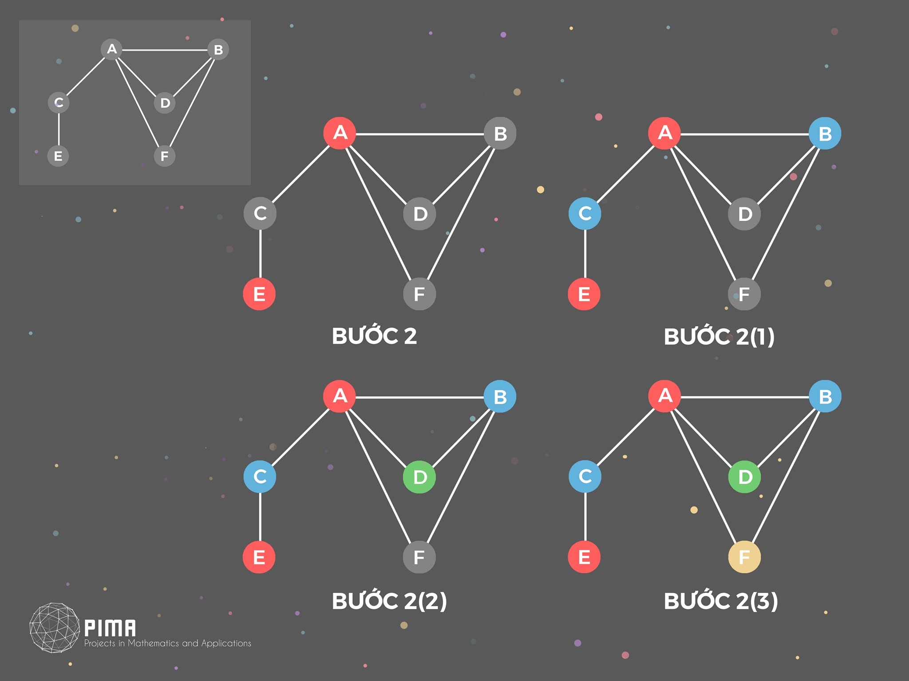

Ở bài viết hôm nay, chúng ta lại cùng khám phá thêm một bài toán điển hình khác trong Lý thuyết đồ thị - bài toán tô màu.

Tô màu đồ thị là một trong những bài toán cơ bản của lý thuyết đồ thị trong đó người ta gán màu cho các yếu tố (đỉnh, cạnh, miền) của đồ thị với một số ràng buộc nhất định, tô màu đỉnh là bài toán phổ biến nhất. Bài toán tô màu đỉnh là việc gán màu cho mỗi đỉnh của đồ thị sao cho hai đỉnh kề nhau không cùng màu. Số màu ít nhất có thể sử dụng để tô màu đồ thị được gọi là sắc số của đồ thị đó.

Bài toán tô màu đồ thị bắt nguồn từ những vấn đề trong cuộc sống như sắp xếp lịch thi/thời khóa biểu, phân bố tần số vô tuyến di động (Mobile Radio Frequency Assignment), tô màu các nước trên bản đồ, hay thậm chí là trò Sudoku nổi tiếng.

Sudoku là một biến thể của bài toán tô màu đồ thị trong đó mỗi ô đại diện cho một đỉnh của đồ thị. Những cặp đỉnh nào có ràng buộc sẽ có cạnh giữa chúng, cụ thể là giữa hai đỉnh sẽ có một cạnh nếu chúng ở cùng một hàng hoặc cùng một cột hoặc cùng một khối. Bài toán được giải quyết khi các ô tương ứng với các đỉnh cùng màu thì được điền cùng một số. Ví dụ trong hình đầu bài là một ô sudoku kích thước $4 \times 4$.

Tô màu các nước trên bản đồ cũng là một bài toán tô màu đồ thị: có thể dùng ít nhất bao nhiêu màu để tô màu một bản đồ sao cho các miền kề nhau không cùng một màu? Bài toán này dẫn đến định lí Five Coloring: cần không quá 5 màu để tô, và định lí Four Coloring: cần không quá 4 màu để tô. Một điều rất thú vị là trong khi định lí đầu có thể được chứng minh rất đơn giản bằng kiến thức toán sơ cấp, định lí sau phức tạp hơn rất nhiều và cần đến sự trợ giúp của máy tính trong chứng minh!

Sau đây là một trong những thuật giải đơn giản nhất cho bài toán trên - tô màu theo bậc.

Xét đồ thị $G = (V, E)$ với $V$ là tập các đỉnh, $E$ là tập các cạnh. Thuật toán tô màu các đỉnh của $G$ được trình bày như sau:

- Input: Đồ thị $G = (V, E)$.
- Output: Đồ thị $G = (V, E)$ với các đỉnh đã được gán màu.

Bước 1: Tính bậc của các đỉnh trong $V$. Lập danh sách $V' := [v_1, v_2, \ldots, v_n]$ các đỉnh của đồ thị được sắp xếp theo thứ tự bậc giảm/không tăng dần. Gọi $i$ là số màu cần sử dụng. Gán $i := 1$.

Bước 2: Tô màu $i$ cho đỉnh đầu tiên trong danh sách $V'$ và lần lượt các đỉnh khác (nếu có) không kề với đỉnh đã có màu $i$.

Bước 3: Nếu tất cả các đỉnh trong $V$ đã được tô màu thì thuật toán kết thúc, đồ thị đã sử dụng $i$ màu để tô. Ngược lại, nếu vẫn còn đỉnh chưa được tô thì chuyển sang bước 4.

Bước 4: Loại khỏi $V'$ các đỉnh đã được tô màu. Sắp xếp lại các đỉnh trong $V'$. Gán $i := i + 1$ và quay lại bước 2.

Ta minh họa thuật toán trên bởi đồ thị ở hình trên:

- Bước 1: Đồ thị có 6 đỉnh được kí hiệu A, B, C, D, E, F với bậc tương ứng là 4, 3, 2, 3, 1, 3. Nên $V' = [A, B, D, F, C, E]$. Gán $i := 1$.
- Bước 2: Tô màu 1 (đỏ) cho đỉnh A. Ta thấy đỉnh E không kề với đỉnh A, do đó thực hiện tô màu 1 (đỏ) cho đỉnh E.
- Bước 3: Vẫn còn các đỉnh trong $V'$ chưa được tô màu nên chuyển sang bước 4.
- Bước 4: Loại các đỉnh A, E đã được tô màu ra khỏi $V'$, khi đó $V' = [B, D, F, C]$. Ta có $i = 2$. Quay lại bước 2.
- Bước 2 (1): Tô màu 2 (xanh dương) cho đỉnh B. Ta thấy đỉnh C không kề đỉnh B do đó tô màu 2 (xanh dương) cho đỉnh C.
- Bước 3 (1): Vẫn còn đỉnh chưa được tô màu nên chuyển sang bước 4.
- Bước 4 (1): Loại các đỉnh B, C đã được tô màu ra khỏi $V'$, khi đó $V' = [D, F]$. Ta có $i = 3$. Quay lại bước 2.
- Bước 2 (2): Tô màu 3 (xanh lá) cho đỉnh D. Chỉ còn đỉnh F kề với D nên F chưa được tô màu.
- Bước 3 (2): Vẫn còn đỉnh chưa được tô màu nên chuyển sang bước 4.
- Bước 4 (2): Loại đỉnh D ra khỏi $V'$, khi đó $V' = [F]$. Ta có $i = 4$. Quay lại bước 2.
- Bước 2 (3): Tô màu 4 (vàng) cho đỉnh F.
- Bước 3 (3): Tất cả các đỉnh đã được tô màu, thuật toán kết thúc.

Trong trường hợp này số màu cần sử dụng là 4.
