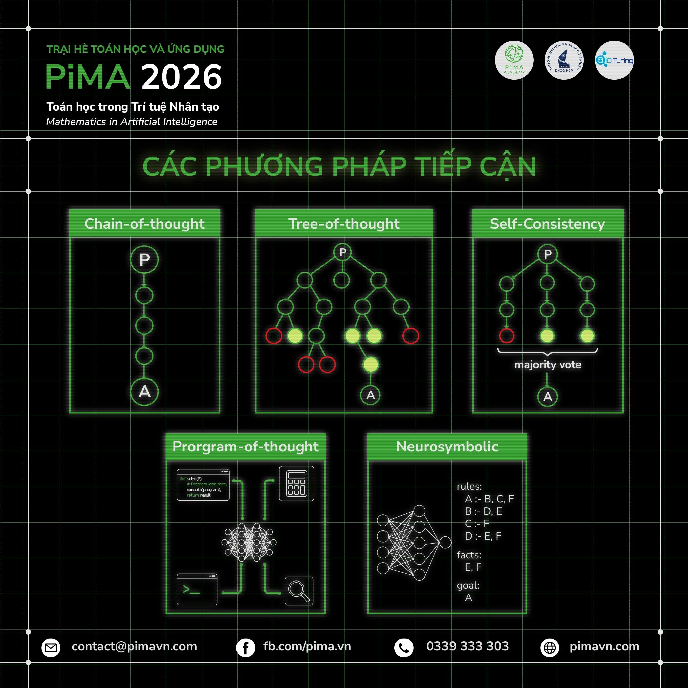
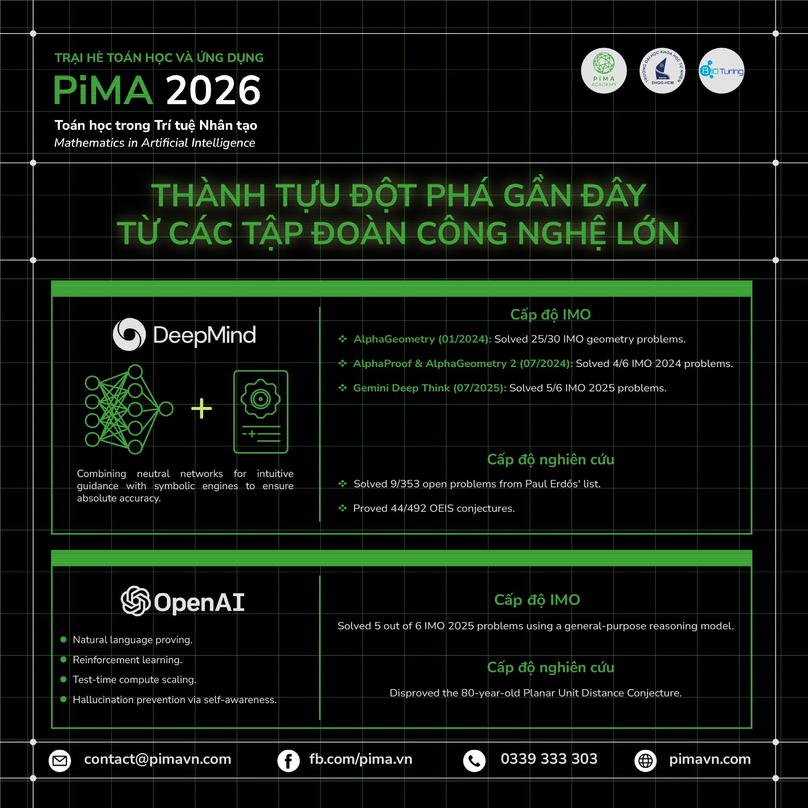

Chúng ta đều biết, đằng sau bất kỳ mô hình Trí tuệ nhân tạo (AI) nào đều là những lý thuyết toán học vô cùng vững chắc. Nhiều phân ngành của Toán học - tiêu biểu là đại số tuyến tính, giải tích, xác suất thống kê - chính là ngôn ngữ đã định hình nên “bộ não” của các mô hình mà chúng ta gọi là “trí tuệ” nhân tạo. Cho đến ngày nay, hiệu quả của việc ứng dụng các mô hình này đã được chứng minh trong nhiều lĩnh vực và tác vụ khác nhau: từ chơi cờ vây, đề xuất sản phẩm, cho đến hiểu và trình bày nội dung bằng ngôn ngữ tự nhiên (như các mô hình ngôn ngữ lớn đã và đang làm).

Từ đây chúng ta có thể nghĩ đến một câu hỏi, rằng liệu quan hệ giữa Toán học và Trí tuệ nhân tạo có phải là quan hệ một chiều? Nói cách khác, khi năng lực của Trí tuệ nhân tạo ngày càng được mở rộng nhờ sự thúc đẩy của nền tảng toán học phía sau, liệu nó có thể quay lại để tái định hình và thúc đẩy sự phát triển của chính Toán học hay không? Nếu câu trả lời là có, sự thúc đẩy lẫn nhau đó chắc hẳn sẽ đẩy nhanh đáng kể tốc độ phát triển của cả hai ngành này, cũng như tất cả các ngành phụ thuộc vào chúng. Vì lý do đó, từ rất sớm, vấn đề này đã thu hút được sự quan tâm của nhiều nhà toán học và nhà khoa học, đặc biệt là các nhà khoa học máy tính.

Trong bài viết hôm nay, chúng ta sẽ cùng tìm hiểu sơ lược về những nỗ lực và thành tựu trong việc ứng dụng Trí tuệ nhân tạo vào nghiên cứu và khám phá Toán học, từ đó có được cái nhìn tổng quan về lĩnh vực đầy tiềm năng này.

## 1. Các phương pháp tiếp cận

Những nỗ lực ứng dụng AI vào nghiên cứu Toán học cho đến hiện nay tập trung vào việc yêu cầu LLM viết ra lời giải cho các bài toán - các phương pháp như CoT, Self-Consistency, ToT, PoT - hoặc đề xuất các ý tưởng/hướng giải cho một công cụ chứng minh hình thức - phương pháp Neurosymbolic. Sau đây chúng ta sẽ tìm hiểu tổng quan về các phương pháp này cũng như ưu điểm và nhược điểm của chúng.

### 1.1. Phương pháp Chuỗi suy luận (Chain-of-Thought - CoT)

Phương pháp Chuỗi suy luận yêu cầu mô hình tạo ra các bước suy luận trung gian trước khi đưa ra câu trả lời cuối cùng, mô phỏng quá trình tư duy từng bước của con người [1]. Khi các mô hình suy luận chuyên sâu như OpenAI o1 và DeepSeek R1 xuất hiện, khái niệm Long CoT (Chuỗi suy luận dài) hình thành, cho phép mô hình mở rộng tính toán ngay tại thời điểm suy luận để khám phá sâu, kiểm tra giả thuyết, tự sửa sai và quay lui tự động. Trong Toán học, tính tuần tự của CoT giúp phân rã bài toán phức tạp thành chuỗi các lập luận nhỏ hơn, cải thiện độ chính xác ở các bài suy luận đa bước và tăng tính minh bạch; Long CoT, nhờ khả năng quay lui và thử nhiều hướng, lại càng phù hợp với những bài toán khó đòi hỏi chứng minh sâu, tạo bước nhảy vọt đưa AI tới cấp độ Olympic.

### 1.2. Phương pháp Tự nhất quán (Self-Consistency)

Phương pháp Tự nhất quán hoạt động dựa trên ý tưởng rằng khi mô hình trả lời nhiều lần, nếu các đáp án nó đưa ra là đúng thì các kết quả đó phải giống nhau (hội tụ về một đáp án), trong khi nếu nó đưa ra đáp án sai thì có thể có nhiều đáp án sai khác nhau (không hội tụ). Do đó việc một đáp án xuất hiện nhiều lần sẽ làm tăng khả năng nó là đáp án đúng [2]. Phương pháp này mở rộng CoT bằng cách sinh nhiều luồng suy luận độc lập song song cho cùng một bài toán, thường mỗi luồng là một CoT ngắn. Hệ thống sau đó sẽ thực hiện bỏ phiếu theo đa số trên các kết quả đầu ra cuối cùng của mỗi luồng để chọn ra đáp án xuất hiện nhiều nhất. Cơ chế này khắc phục tính ngẫu nhiên của việc sinh luồng suy luận và lọc bỏ các nhánh chứa lỗi tính toán cục bộ, nhờ đó nâng cao độ ổn định và độ chính xác trên các bài toán phổ thông. Hạn chế là chi phí tính toán tăng tuyến tính theo số luồng lấy mẫu, và phương pháp sẽ không cải thiện được chất lượng nếu tất cả các luồng đều mắc cùng một sai lầm hệ thống.

### 1.3. Phương pháp Cây suy luận (Tree-of-Thought - ToT)

Đây là phiên bản khái quát hóa của CoT, mô hình hóa việc giải quyết vấn đề như một cuộc tìm kiếm trên không gian lập luận. Nếu phương pháp Tự nhất quán chỉ phân nhánh ở cấp toàn bộ luồng rồi đánh giá ở cuối, thì ToT phân nhánh và đánh giá ngay tại mỗi bước, cho phép tỉa nhánh và quay lui có chủ đích thay vì dựa vào sức mạnh thống kê đơn thuần. ToT chia quá trình suy luận thành các "ý nghĩ" (thoughts) - mỗi đơn vị là một bước tiến tới lời giải. Tại mỗi nút trên cây, mô hình sinh ra nhiều nhánh ý nghĩ, dùng một bộ đánh giá tự động chấm điểm triển vọng của từng nhánh ("chắc chắn", "có thể", "bất khả thi"), rồi áp dụng thuật toán tìm kiếm như BFS hoặc DFS để ra quyết định toàn cục [3].

### 1.4. Phương pháp Lập trình suy luận (Program-of-Thought - PoT)

Phương pháp này tách biệt quá trình suy luận ra khỏi quá trình tính toán số học. Thay vì yêu cầu LLM tự tính toán kết quả (bằng suy luận từ ngữ), PoT hướng dẫn mô hình tạo ra các đoạn mã lập trình (thường là Python) chứa các bước giải thuật, sau đó giao cho một trình thông dịch bên ngoài thực thi để trả về kết quả tính toán chính xác. Phương pháp này được chứng minh là giúp mô hình nhất quán hơn về mặt hành vi đối với các bài toán có cùng cấu trúc logic, tăng tỉ lệ thành công so với CoT trên các tập đánh giá khi giá trị trong bài toán bị thay đổi. Tuy nhiên, PoT cũng có một nhược điểm nghiêm trọng là nó có thể khiến mô hình củng cố các lỗi sai. Thay vì sửa lỗi, mô hình lại hội tụ về các hành vi sai lệch một cách ổn định, tức là chúng học cách “thất bại một cách nhất quán”. Ngoài ra, PoT cũng được chứng minh là chỉ mang lại sự trôi chảy về quy trình lập trình chứ không phải hiểu biết sâu sắc về toán học [4].

### 1.5. Phương pháp Thần kinh-ký hiệu (Neurosymbolic)

Các hệ thống Neurosymbolic kết hợp thế mạnh của hai trường phái là Học sâu (Deep Learning) và Trí tuệ nhân tạo ký hiệu truyền thống (Symbolic AI - GOFAI). Hai thành phần này lần lượt đóng vai trò như “hệ thống 1” phản xạ nhanh, trực giác và “hệ thống 2” suy luận chậm, logic, chặt chẽ để phối hợp hoạt động giống như cách mà con người tư duy - theo mô tả của D. Kahneman [5]. Trong các hệ thống chứng minh toán học, thành phần mạng thần kinh (Neural Network) đóng vai trò đề xuất các ý tưởng, các phép xây dựng cấu trúc phụ hoặc các bước chứng minh tiềm năng, trong khi công cụ ký hiệu (Symbolic Engine; như bộ giải SMT, trợ lý chứng minh Lean hoặc các hệ thống suy diễn tự động) thực hiện việc kiểm tra, xác thực tính đúng đắn của từng suy luận. Một thành công tiêu biểu cho phương pháp này là hệ thống giải toán hình học tự động AlphaGeometry [6]. Ưu điểm lớn nhất của một hệ thống như vậy là nó giúp đảm bảo tính chính xác logic tuyệt đối nhờ cơ chế xác minh cơ học, loại bỏ hoàn toàn các lỗi ảo giác (hallucination) và tiết kiệm dữ liệu huấn luyện thực tế nhờ tích hợp trực tiếp được các tri thức dưới dạng luật logic. Đi cùng với những ưu điểm đó, phương pháp này cũng đòi hỏi chúng ta phải thiết kế những hệ thống với độ phức tạp rất cao. Ngoài ra, dữ liệu đầu vào cũng không thể viết tự do (free-form text) mà cần phải có cấu trúc rõ ràng (formal form).

## 2. Thành tựu đột phá gần đây từ các tập đoàn công nghệ lớn

Với nhiều phương pháp hiện đại, các mô hình tiên phong (Frontier Models) đã đạt được nhiều kết quả ấn tượng, không chỉ trên các bài toán cấp độ Olympic mà còn cả những bài toán mà con người chưa có lời giải. Dưới đây chúng ta sẽ điểm qua một số thành tựu đáng chú ý gần đây từ các tập đoàn công nghệ lớn.

### 2.1. Google DeepMind

Google DeepMind liên tục dẫn đầu hướng đi kết hợp giữa mạng thần kinh (Neural Network) để định hướng trực giác và các công cụ ký hiệu (Symbolic Engine) để đảm bảo tính chính xác tuyệt đối.

Ở cấp độ Olympic, vào tháng 01/2024, AlphaGeometry - kết hợp một mô hình ngôn ngữ chuyên gợi ý các cấu trúc phụ với một công cụ suy diễn tự động - được công bố với thành tích giải được 25/30 bài toán Hình học trong các kỳ thi Olympic Toán Quốc tế (IMO), gần bằng với mức trung bình 25.9 của các thí sinh đạt Huy chương Vàng [6]. Đến tháng 07/2024, AlphaProof - được huấn luyện trên ngôn ngữ hình thức Lean thông qua thuật toán học tăng cường kiểu AlphaZero - cùng với AlphaGeometry 2 đã giải được 4/6 bài toán tại IMO 2024 (bao gồm bài toán khó nhất trong kỳ thi), đạt mức điểm tương đương Huy chương Bạc [7]. Mùa hè năm 2025, một phiên bản nâng cao của Gemini Deep Think chính thức đạt đến trình độ Huy chương Vàng IMO với 5/6 bài giải thành công. Ở phiên bản này, lời giải được trình bày ngay trong ngôn ngữ tự nhiên [8].

Ở cấp độ nghiên cứu, sử dụng khung làm việc AlphaProof Nexus, AI của DeepMind đã giải quyết hoàn toàn tự động 9 trong số 353 bài toán mở trong danh sách của Paul Erdős. Ngoài ra, hệ thống của họ cũng chứng minh được 44/492 giả thuyết OEIS [9]. Nhờ được viết trong ngôn ngữ hình thức Lean, những chứng minh được tạo ra đều có thể kiểm chứng tự động, chính xác và đáng tin cậy.

### 2.2. OpenAI

Ở kỳ thi IMO 2025, cùng với DeepMind, OpenAI cũng công bố một kết quả ấn tượng khi mô hình của họ giải thành công 5/6 bài toán, đạt 35/42 điểm. Bài toán duy nhất mô hình thất bại là bài số 6 (bài khó nhất kỳ thi). Với quan điểm rằng ngôn ngữ hình thức như Lean có thể làm hẹp đi phạm vi suy luận của mô hình, OpenAI không dịch các bài toán sang ngôn ngữ hình thức mà để AI tự suy luận ngay trong ngôn ngữ tự nhiên kết hợp với mã LaTeX. Các giải pháp của họ đã giải quyết được nhiều vấn đề quan trọng. Với khả năng mở rộng quy mô tính toán tại thời điểm kiểm tra (Test-time compute scaling), mô hình có thể dành nhiều thời gian để suy luận sâu hơn trên các bài toán khó. Bên cạnh đó, họ cũng sử dụng hiệu quả phương pháp Học tăng cường (Reinforcement Learning) nhờ giải quyết được các vấn đề liên quan tới việc đánh giá lời giải - một việc không đơn giản khi lời giải được viết bằng ngôn ngữ tự nhiên. Ngoài ra, OpenAI cũng huấn luyện để mô hình của họ có thể nhận thức được giới hạn của chính nó và trả lời “no answer” ở những bài toán nó không giải được, thay vì cố gắng đưa ra một giải pháp nghe có vẻ hợp lý nhưng sai (hallucination) [10].

Ở góc độ nghiên cứu, vào tháng 05/2026, OpenAI đã tạo ra một cột mốc lớn và thu hút được sự quan tâm của rất nhiều nhà toán học khắp thế giới. Một mô hình suy luận tổng quát của họ đã được công bố là giải quyết thành công Giả thuyết khoảng cách đơn vị trên mặt phẳng (Planar Unit Distance Conjecture) của nhà toán học lỗi lạc Paul Erdős [11]. Đây là một bài toán mở đã tồn tại từ năm 1946. Công trình này có thể được coi là một thành tựu lớn kể cả khi nó được viết bởi một nhà toán học con người. Và nó cũng để lại một lời nhắc nhở rằng chúng ta cần có sự sẵn sàng để đón nhận những thay đổi có thể có về cách dạy và học toán trong tương lai.

## 3. Những giới hạn và thách thức chưa thể vượt qua

Có thể thấy, các mô hình AI hiện nay đã giải được nhiều bài toán khó và đạt được những cột mốc đáng ghi nhận, điều đó rất đáng để chúng ta để tâm. Tuy nhiên, cũng không nên vội bi quan rằng AI rồi sẽ thay thế con người ở cả công việc nghiên cứu toán. Bởi vì việc giải các bài toán thực chất chỉ là một phần rất nhỏ so với những gì mà một nhà toán học có thể làm.

Những đột phá trong nghiên cứu toán học không chỉ nằm ở việc tìm ra lời giải cho các bài toán, mà đôi khi nó nằm ở việc xây dựng nên những khái niệm mới. Tiêu biểu cho điều này là ví dụ về Évariste Galois. Trong khoảng những năm 1829-1832, Galois đã trình bày chứng minh của mình về việc phương trình đa thức bậc 5 (trở lên) tổng quát không thể giải được bằng căn thức. Đó là một chứng minh rất có giá trị vì nó đã dừng được những nỗ lực không cần thiết trong việc giải nghiệm phương trình bậc cao. Tuy nhiên những gì Galois để lại không chỉ có thế. Trong công trình của mình, ông đã tạo ra lý thuyết về số ảo Galois (Galois imaginaries), từ đó đặt nền móng cho khái niệm Trường hữu hạn (Finite Fields). Ông cũng tạo ra Lý thuyết Galois (Galois Theory) và đặt những viên gạch đầu tiên cho Lý thuyết nhóm (Group Theory) [12] - những lý thuyết về sau có rất nhiều ý nghĩa đối với Vật lý học, Mật mã học, và cả Hình học.

Cũng không thể phủ nhận tầm quan trọng của việc giải quyết được các bài toán khó, nhưng đôi khi việc đặt ra một bài toán hay cũng tạo ra nhiều giá trị không kém. Một minh chứng cho điều này chính là Định lý cuối cùng của Fermat (Fermat's Last Theorem - FLT), khẳng định rằng phương trình $x^n + y^n = z^n$ không có nghiệm nguyên dương nếu $n$ là số nguyên lớn hơn 2. Phát biểu của bài toán rất đơn giản, và bản thân nó có vẻ chỉ là một câu đố thử thách tư duy thuần túy. Tuy nhiên, hành trình tìm kiếm lời giải kéo dài hơn 350 năm dành cho FLT đã tạo ra một lực đẩy to lớn trong lịch sử toán học thế giới. Những nỗ lực đó đã khai phá và hoàn thiện nhiều nhánh toán học mới như Lý thuyết số đại số (Algebraic Number Theory) và lý thuyết về Đường cong elliptic (Elliptic Curves). Điều đó cho chúng ta thấy, một câu hỏi hay trong toán học không chỉ là cái đích để đến mà nó còn mở ra rất nhiều con đường mới đáng để đi.

Khả năng xây dựng những khái niệm mới, hay khả năng đặt đúng câu hỏi, cũng như nhiều khả năng khác trong nghiên cứu toán học không chỉ đòi hỏi tư duy logic mà còn cần trực giác và hiểu biết về xã hội - những yếu tố rất “người” - và đó là những khoảng trống lớn mà AI ngày nay vẫn chưa thể lấp đầy. Những khoảng trống đó vừa là vấn đề mở cho sự phát triển trong tương lai của Trí tuệ nhân tạo, cũng vừa là nơi để những “nhà toán học con người” tiếp tục khẳng định được vai trò khó thay thế của mình trên bản đồ nghiên cứu Toán học.

## 4. Tổng kết

Đi cùng với sự phát triển của Trí tuệ nhân tạo, việc học tập, nghiên cứu Toán học và Khoa học của chúng ta chắc hẳn sẽ phải có nhiều thay đổi. Chẳng hạn như khi máy tính có thể tính toán các bài toán đại số hay tích phân chỉ trong vài giây, việc dành ra nhiều giờ đồng hồ để học thuộc lòng các công thức và mẹo biến đổi (như cách mà rất nhiều người vẫn đang làm) sẽ không còn mang lại lợi thế cạnh tranh. Thay vào đó, kỹ năng đặt câu hỏi, trao đổi ý tưởng, mô hình hóa vấn đề thực tế, … sẽ là những kỹ năng giúp chúng ta khẳng định được sự khác biệt giữa bản thân với những mô hình AI chạy trên máy tính.

Tuy nhiên, chúng ta cũng không nên lạm dụng AI trong quá nhiều tình huống, chẳng hạn nhờ AI làm những việc như giải bài tập về nhà. Bởi vì điều đó sẽ dẫn đến sự lười biếng nhận thức và làm mất đi khả năng tư duy độc lập. Thay vào đó, có thể coi AI như một cộng sự cấp thấp, hỗ trợ thực hiện những công việc tính toán lặp đi lặp lại mà sẽ gây tốn thời gian và có thể dẫn tới sai sót nếu thực hiện thủ công. Nhờ đó, ta có thể tập trung vào các ý tưởng và có nhiều thời gian để suy nghĩ về những vấn đề phức tạp hơn.

P/s: Có lẽ các bạn đều đã từng nghe một câu nói đùa quen thuộc, rằng tại sao Toán học không tự giải quyết vấn đề của mình mà cứ bắt chúng ta phải giải quyết. Qua bài viết này, có thể thấy rằng câu hỏi đó không còn chỉ là một chuyện đùa. Người ta đã thực sự nghiên cứu một cách nghiêm túc để khiến Toán học - giúp cho Trí tuệ nhân tạo - giải quyết các vấn đề của chính Toán học. Có lẽ đã sắp đến lúc Toán học phải tự mình “trưởng thành” rồi.

## Tài liệu tham khảo

- \[1\] J. Wei và cộng sự, "Chain-of-Thought Prompting Elicits Reasoning in Large Language Models", Hội nghị NeurIPS, 2022.
- \[2\] X. Wang và cộng sự, "Self-Consistency Improves Chain of Thought Reasoning in Language Models", Hội nghị ICLR, 2023.
- \[3\] S. Yao và cộng sự, "Tree of Thoughts: Deliberate Problem Solving with Large Language Models", Hội nghị NeurIPS, 2023.
- \[4\] M. Zhou và cộng sự, "Program-of-Thought Reveals LLM Abstraction Ceilings", Findings of EACL, 2026.
- \[5\] D. Kahneman, “Thinking, Fast and Slow”, Farrar, Straus and Giroux, 2011.
- \[6\] T. H. Trinh và cộng sự, "Solving olympiad geometry without human demonstrations", Tạp chí Nature, 2024.
- \[7\] T. Hubert và cộng sự, “Olympiad-level formal mathematical reasoning with reinforcement learning”, Tạp chí Nature, 2025.
- \[8\] T. Luong, V. Mirrokni, "Gemini Deep Think: Redefining the Future of Scientific Research", Google DeepMind Blog, 2026.
- \[9\] G. Tsoukalas và cộng sự, "Advancing Mathematics Research with AI-Driven Formal Proof Search", arXiv preprint arXiv:2605.22763, 2026.
- \[10\] A. Wei, S. Hsu, N. Brown, "OpenAI’s IMO Team on Why Models Are Finally Solving Elite-Level Math", Training Data Podcast (Sequoia Capital), 2025.
- \[11\] OpenAI, "Model disproves discrete geometry conjecture", OpenAI Blog, 2026.
- \[12\] P. M. Neumann, “The mathematical writings of Évariste Galois”, European Mathematical Society, 2011.

## Người thực hiện

**Người biên soạn**

- Nguyễn Ngọc Cảnh: Mentor Ban Học thuật, Trại hè Toán học và Ứng dụng PiMA 2026
- Đặng Trọng Bảo Thi: Mentor Ban Học thuật, Trại hè Toán học và Ứng dụng PiMA 2026

**Minh họa & Thiết kế**

- Lê Hoàng Khánh Vy: Graphic Designer, Trại hè Toán học và Ứng dụng PiMA 2026

**Reviewers**

- Trần Phan Anh Danh: Co-head Ban Học thuật, Trại hè Toán học và Ứng dụng PiMA 2026
- Vòng Vĩnh Toàn: Co-head Ban Học thuật, Trại hè Toán học và Ứng dụng PiMA 2026
