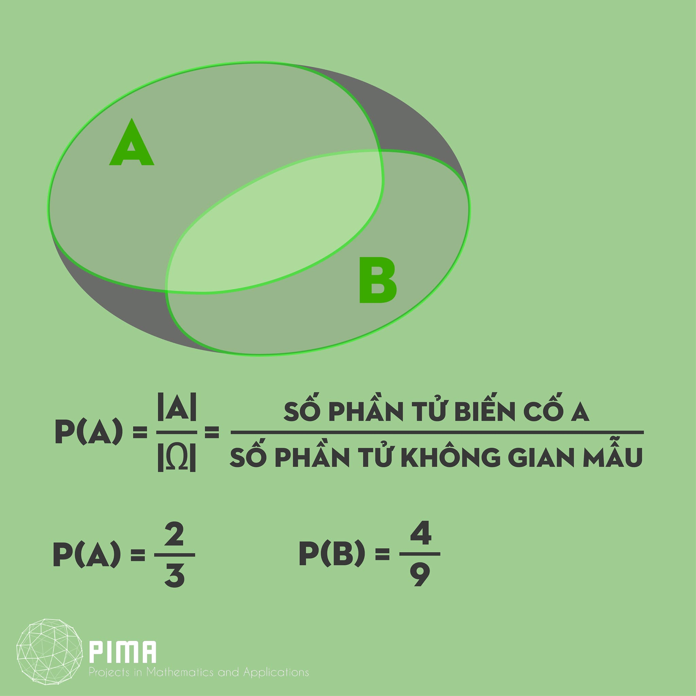
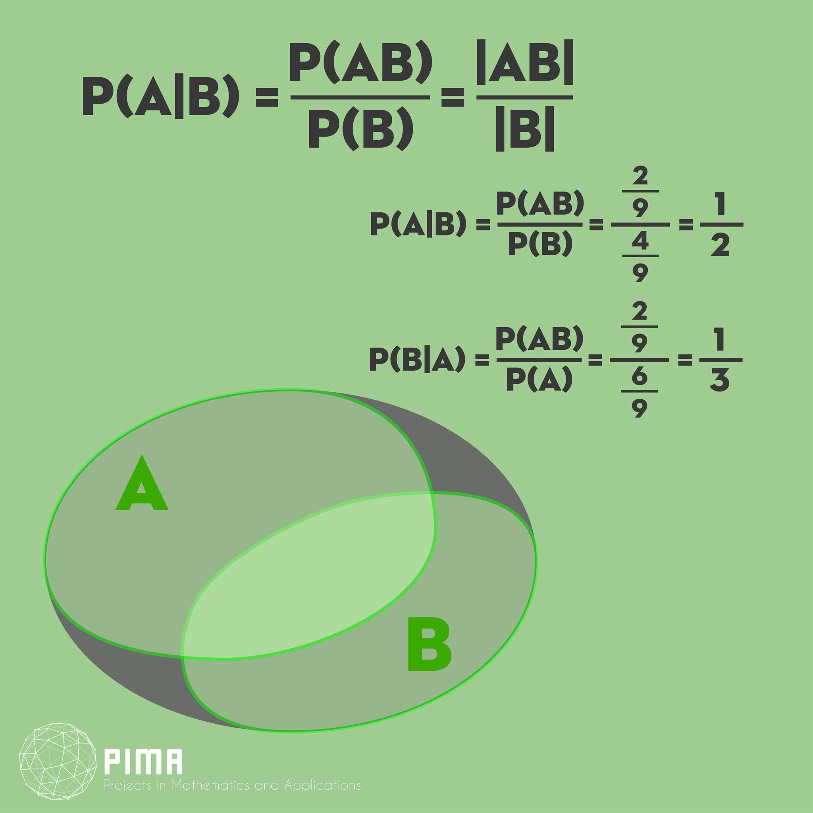
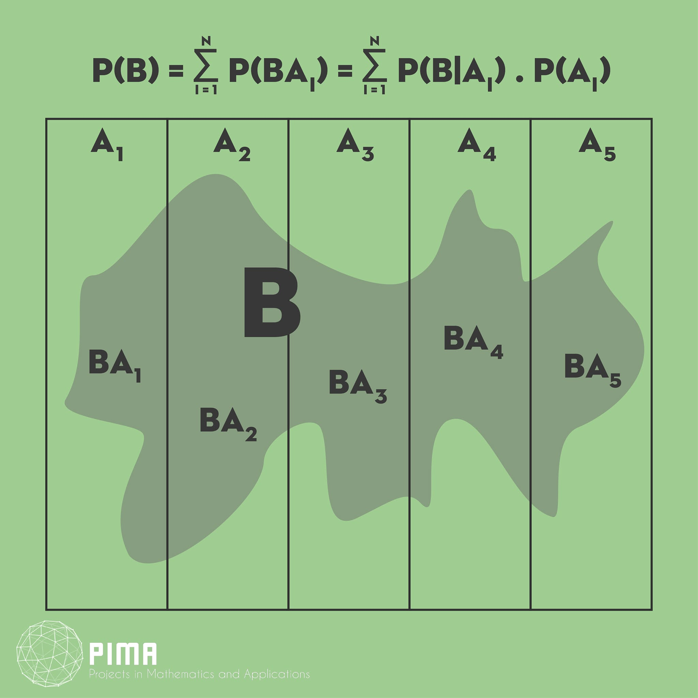
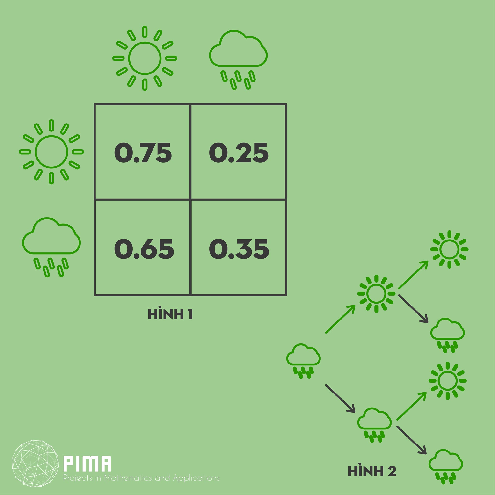

Xác suất hẳn không còn là một khái niệm xa lạ đối với tất cả mọi người, được sử dụng rộng rãi trong cả nghiên cứu lẫn ứng dụng trên nhiều lĩnh vực khác nhau của đời sống.

Sau đây, các bạn hãy cùng PiMA tìm hiểu thêm một số kiến thức khái quát về xác suất nhé!

## Xác suất cổ điển

Xác suất luôn xuất hiện hằng ngày trong tất cả các lĩnh vực đời sống. Trong sinh học, chúng ta muốn biết xác suất tạo ra các kiểu gen. Trong kinh tế, xác suất được dùng để định hướng kinh doanh, định giá sản phẩm,… Trong tin học, xác suất là nền tảng cho các thuật toán ngẫu nhiên, Machine Learning,…

### a) Không gian mẫu, biến cố và kết quả của phép thử

Trước hết chúng ta hãy cùng ôn lại một số định nghĩa, kí hiệu cơ bản trong xác suất.

- Phép thử ngẫu nhiên: Hiểu nôm na là một việc làm, thử nghiệm được thực hiện mà ta không biết trước kết quả của nó.

- Không gian mẫu: Tập hợp tất cả kết quả có thể xảy ra khi thực hiện phép thử. Kí hiệu: $\Omega$.
  Ví dụ: Trên bàn có 9 chiếc bánh. Bạn Phúc nhắm mắt lấy đại một chiếc bánh nào đó để ăn. Việc lấy một chiếc bánh một cách ngẫu nhiên như trên có thể được gọi là một phép thử ngẫu nhiên. Phép thử lấy bánh ngẫu nhiên này có 9 khả năng xảy ra. Do đó không gian mẫu của chúng ta sẽ có 9 phần tử, mỗi phần tử là một chiếc bánh.

- Kết quả của phép thử: Một kết quả có thể xảy ra của phép thử, có thể hiểu là một phần tử của tập không gian mẫu $\Omega$.

- Biến cố: là tập con của tập $\Omega$. Một biến cố $A$ gọi là “xảy ra” nếu như kết quả thật sự của phép thử thuộc tập $A$.
  Ví dụ: hai biến cố $A$ và $B$ đều là tập con của $\Omega$. Giả sử trong phép thử, Phúc lấy được chiếc bánh màu xanh dương ở hàng thứ ba. Do chiếc bánh này thuộc tập $A$, ta nói biến cố $A$ xảy ra.

- Biến cố tổng của $A$ và $B$: phần hợp của tập $A$ và tập $B$. Kí hiệu: $A + B$.
- Biến cố tích của $A$ và $B$: phần giao của tập $A$ và tập $B$. Kí hiệu: $AB$.
  Ví dụ: xem hình đầu bài.

- Biến cố xung khắc: Hai biến cố $A$ và $B$ gọi là xung khắc nếu như $AB = \varnothing$.
- Biến cố bù: Biến cố bù của biến cố $A$ là biến cố $B$, sao cho $AB = \varnothing$ và $A + B = \Omega$. Biến cố bù của một biến cố $A$ được kí hiệu là $\overline{A}$.
  Ví dụ: xem hình đầu bài.

- Hệ đầy đủ các biến cố: Các biến cố $A_1, A_2, \ldots, A_n$ được gọi là hệ đầy đủ các biến cố nếu chúng đôi một xung khắc và $A_1 + A_2 + \cdots + A_n = \Omega$.
  Ví dụ: xem hình ở mục d.

### b) Định nghĩa xác suất cổ điển

Xác suất của một biến cố $A$ là khả năng mà biến cố đó xảy ra, xác suất càng cao thì khả năng biến cố đó xảy ra càng lớn. Trong một phép thử có không gian mẫu hữu hạn, xác suất của một biến cố $A$ được tính như sau:

$$
P(A) = \frac{|A|}{|\Omega|} = \frac{\text{số phần tử biến cố } A}{\text{số phần tử không gian mẫu}}.
$$

### c) Xác suất có điều kiện

Nếu $A$ và $B$ là hai biến cố với $P(B) > 0$, khi đó xác suất của $A$ khi biết $B$ xảy ra $P(A|B)$ được tính như sau:

$$
P(A|B) = \frac{P(AB)}{P(B)} = \frac{|AB|}{|B|}.
$$

Hiểu một cách nôm na về xác suất có điều kiện như sau: Khi biết một biến cố $B$ nào đó chắc chắn xảy ra, không gian mẫu như được thu hẹp lại. Ở ví dụ trên, không gian mẫu thu hẹp chỉ còn lại 4 phần tử của $B$. Để $A$ xảy ra thì chỉ các phần tử của $A$ đó phải nằm trong $B$, hay là $AB$. Từ đó ta có cách tính xác suất có điều kiện như trên.

Từ công thức trên, suy ra được một số hệ quả sau:

Với $A$ và $B$ là hai biến cố có xác suất dương,

- $P(AB) = P(A|B)\,P(B) = P(B|A)\,P(A)$;
- Định lý Bayes: $P(B|A) = \dfrac{P(A|B)\,P(B)}{P(A)}$.

Với các biến cố $A_1, A_2, \ldots, A_n$ có xác suất dương,

$$
P(A_1 A_2 \ldots A_n) = P(A_1)\,P(A_2|A_1)\,P(A_3|A_1A_2) \ldots P(A_n|A_1 A_2 \ldots A_{n-1}).
$$

### d) Công thức xác suất đầy đủ

Cho $A_1, A_2, \ldots, A_n$ là một hệ đầy đủ các biến cố với $P(A_i) > 0$ với mọi $i$ và biến cố $B$. Công thức tính xác suất xảy ra biến cố $B$ được cho như sau:

$$
P(B) = \sum_{i=1}^{n} P(BA_i) = \sum_{i=1}^{n} P(B|A_i)\,P(A_i).
$$

Công thức này có thể được hiểu một cách hình tượng như sau: Ta chia biến cố $B$ thành $n$ biến cố nhỏ hơn là $BA_1, BA_2, \ldots, BA_n$. Do $A_1, A_2, \ldots, A_n$ là một hệ đầy đủ, nên hệ $BA_1, BA_2, \ldots, BA_n$ đôi một xung khắc (hai biến cố bất kì trong hệ này giao nhau bằng tập rỗng). Ta biết:

- Xác suất $B$ bằng tổng xác suất $BA_i$ với mọi $i$;
- $P(BA_i) = P(B|A_i)\,P(A_i)$.

Kết hợp hai điều trên, ta có xác suất biến cố $B$ xảy ra.

Công thức này giúp ta chia một biến cố thành các biến cố đơn giản để thuận tiện trong việc tính toán hơn.

## Ví dụ: bài toán dự báo thời tiết

Sau một vài ngày quan sát, trung tâm khí tượng một thành viên của Thức cho ra kết quả như Hình 1. Nếu hôm nay trời nắng thì với 75% hôm sau trời sẽ nắng, 25% trời sẽ mưa. Tương tự, xác suất thời tiết ngày hôm sau trong trường hợp hôm nay trời mưa được cho như trong bảng. Hôm nay trời mưa, Thức muốn biết hai ngày sau thời tiết sẽ như thế nào để xếp lịch đi picnic với bạn Uyên.

Gọi ngày hôm nay là ngày 1, ngày mai là ngày 2 và ngày mốt là ngày 3. Gọi $S_3$ là xác suất ngày 3 sẽ nắng; $S_2$ và $R_2$ lần lượt là xác suất ngày 2 sẽ nắng và mưa.

Dễ dàng ta thấy $S_3$ có thể được chia thành hai biến cố (xem Hình 2):

- Ngày 3 nắng và ngày 2 nắng ($S_2 S_3$).
- Ngày 3 nắng và ngày 2 mưa ($R_2 S_3$).

Ta tính được:

$$
\begin{aligned}
P(S_2 S_3) &= P(S_2) \cdot P(S_3 | S_2) = 0.65 \cdot 0.75 = 0.4875, \\
P(R_2 S_3) &= P(R_2) \cdot P(S_3 | R_2) = 0.35 \cdot 0.65 = 0.2275, \\
P(S_3) &= P(S_2 S_3) + P(R_2 S_3) = 0.715.
\end{aligned}
$$

Với xác suất trên Thức khá an tâm sẽ có một ngày nắng đẹp và sẽ mời Uyên đi một buổi picnic ngoài trời với mình.

Việc tính xác suất ngày thứ 3 mưa có thể được thực hiện theo cách tương tự hoặc bằng cách lấy phần bù. (Bạn đọc có thể tự thực hiện!)
